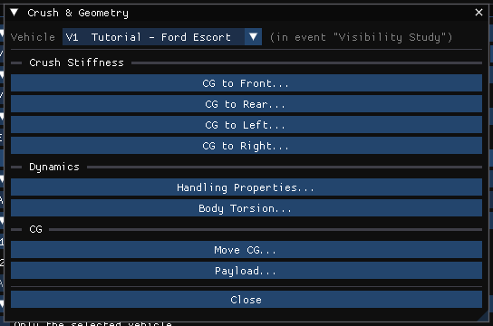
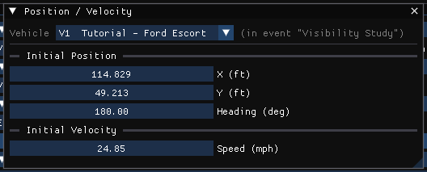
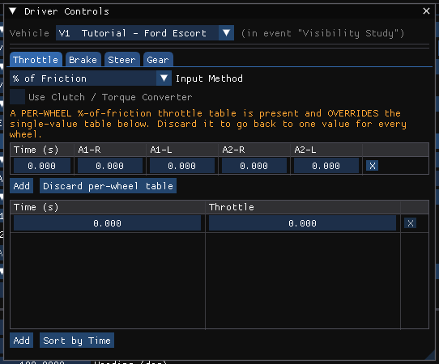
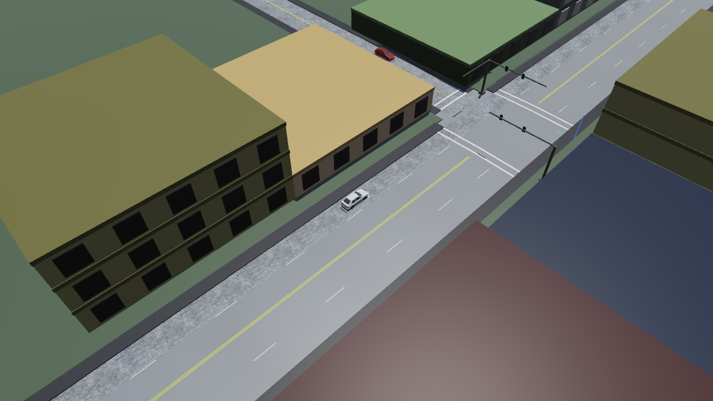
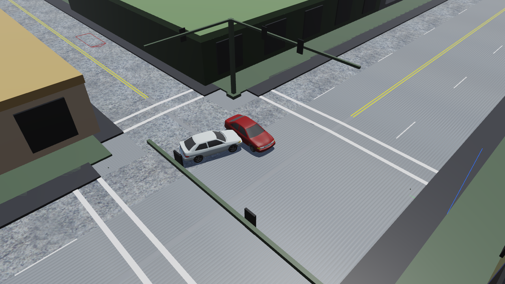
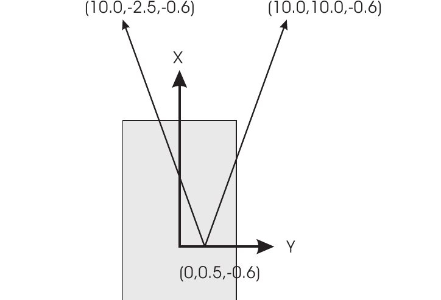
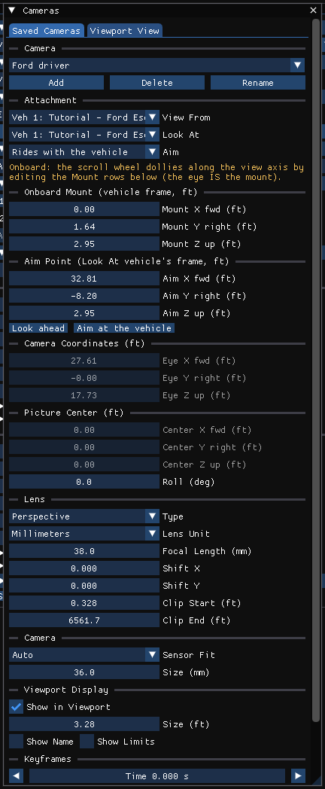
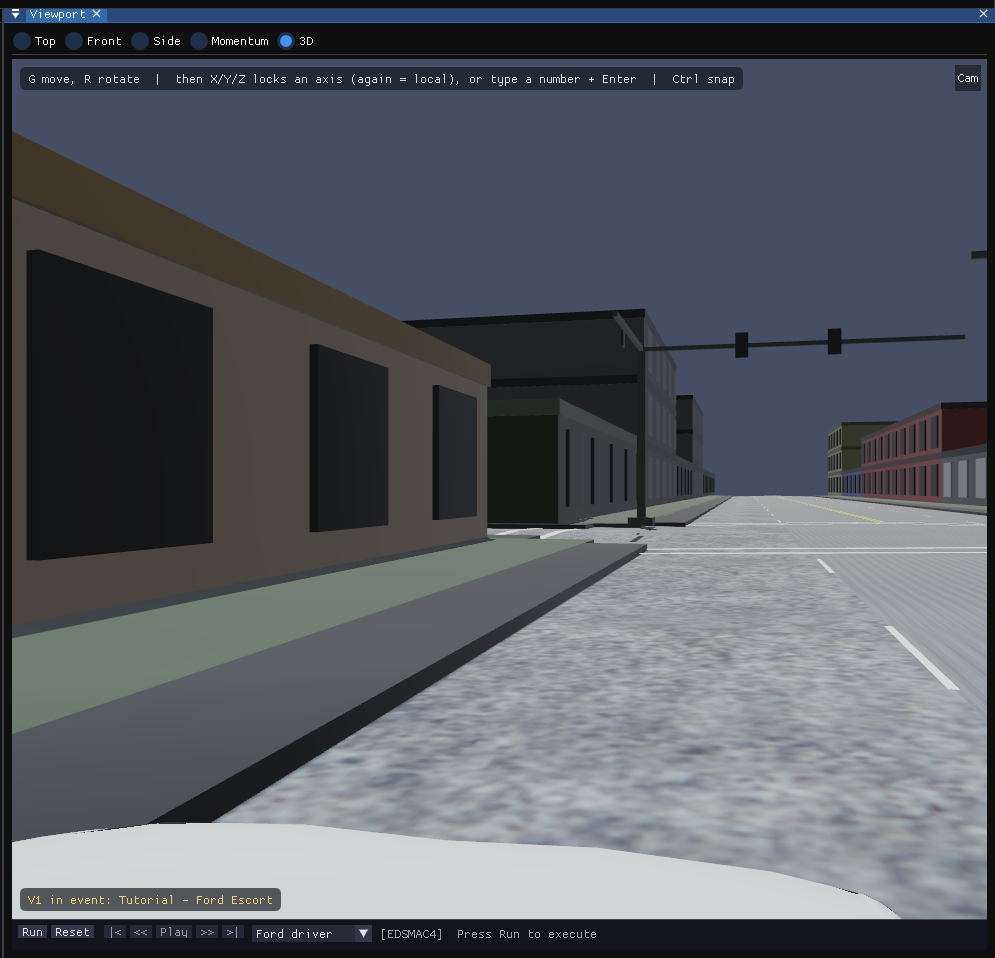

# Chapter 5 — EDSMAC4 Tutorial

## Description

This tutorial illustrates a very common use of EDSMAC4, that is, to perform a time-distance study to evaluate accident avoidability.

Executing this event in 3-D further illustrates the power of visualization: while the EDSMAC4 event tells us the time available to avoid a crash, the visualization actually *shows* us.

This tutorial is a continuation of the EDCRASH Tutorial, wherein the initial vehicle velocities were estimated. You may wish to review that tutorial before continuing.

Like all EDSMAC4 events, the procedure involves the following basic steps:

- Create the vehicle(s)
- Create the environment
- Execute the EDSMAC4 event
- Review the EDSMAC4 output reports

!!! note "HVE 2027"
    HVE builds this tutorial from scratch out of its `Tutorial.db` vehicle database and the `EdcrashEdsmacTutorial.h3d` site. HVE 2027 does not ship either file, but it opens the finished tutorial case that HVE's support files include, **`Edsmac4TutorialEDC.hve`**, with both vehicles, the site and the event already in it. This chapter therefore opens that case and walks through each step of the original tutorial *where its input lives in HVE 2027*, so that you check each value rather than type it. If you have HVE's `Tutorial.db`, you can build the case from scratch with the same steps instead: add each vehicle with **Add...** in the Vehicle editor, and enter each value where this chapter shows it.

    HVE 2027 reproduces HVE's own saved result for this event: at the end of the run both vehicles are within 0.01 m of the positions HVE saved, and their headings within 0.6°.

> **NOTE:** It is assumed that HVE 2027 is running and that you are familiar with its basic features: the editor tabs, the panels and the 3-D viewport. The purpose of this tutorial is to illustrate those features while setting up and executing an EDSMAC4 event.

## Getting Started

Before we start, let's set the display options so we're all starting on the same page.

1. Choose **Tools › Preferences...** and set **Units** to **Metric (m, km/h, kg, N)**.

    > **NOTE:** As we'll see when we look at the environment, our EDSMAC4 Tutorial takes place in Australia; thus, we use metric units. (The figures in this chapter were captured with US units; the values in the text are given in both.)

2. In the **View** menu, make sure **Key Results** is checked, and in **View › Scene Display** turn on **Skidmarks**.

3. In **View › Scene Display › Rendering**, choose **Phong**.

!!! note "HVE 2027"
    HVE 2027 has no AutoPosition switch for EDSMAC4: an EDSMAC4 vehicle always conforms to the surface beneath it. The remaining display options keep their defaults.

## Opening the Case

1. Choose **File › Open Case...** (Ctrl+O).
2. Browse to the `supportfiles\case` folder of your HVE installation and open **`Edsmac4TutorialEDC.hve`**.

The case opens with two vehicles, the *Blind Intersection* site, and one event, *Visibility Study*, using EDSMAC4. The window title shows the case file's name.

## Creating the Vehicles

The case contains the two vehicles of our study. The first vehicle is a white 1996 Ford Escort 2-Door Hatchback; the second is a dark red 1995 Nissan Sentra 4-Door Sedan. Let's look at them.

1. Choose the **Vehicle (F3)** editor tab. The Vehicles panel lists **Tutorial - Ford Escort** and **Tutorial - Nissan Sentra**.
2. Click **Tutorial - Ford Escort** in the list. Its data are shown in the panel below the list and the vehicle is displayed in the viewport.
3. In the **Information** section, note the vehicle's attributes:
    - Vehicle Type = Passenger Car
    - Make = Ford
    - Model = Escort
    - Year = 1991-1996
    - Body Style = 2-Door Hatchback
    - Driver Location = Right

    > **NOTE:** The Information section (and **Vehicle › Vehicle Information**) also lets you edit the Driver Location, Engine Location, Number of Axles and Drive Axle(s). For our tutorial, only the driver location differs from its default.

4. Click **Tutorial - Nissan Sentra** and note its attributes: Passenger Car, Nissan, Sentra, 1995-1999, 4-Door, Driver Location Right.

*Figure 5-1: The Vehicle Information window for the Ford Escort.*

> **NOTE:** To build the case from scratch, click **Add...** at the top of the Vehicles panel. The **Add Vehicle** dialog searches the vehicle databases in the folders listed under **Database folders**; add the folder holding HVE's `Tutorial.db`, choose the vehicle, and click **Add Vehicle**. Then set **Driver Location** to **Right**.

### Editing the Vehicles

In the original tutorial we edit the vehicles to change their color and weight, and change the stiffness of the Nissan Sentra using values derived from our initial reconstruction analysis. The case already holds the edited values; here is where each one lives.

Start with the color of the Ford Escort:

1. Select **Tutorial - Ford Escort** in the Vehicles panel.
2. In the **Information** section, the **Color** row holds the vehicle's color as red, green and blue values; click the color chip at the end of the row to open a color picker. The Escort is white (229, 240, 240).

    !!! note "HVE 2027"
        HVE 2027 has no separate Vehicle Color dialog; the color is the Color row of the Information section. The vehicle is drawn in this color in every editor.

Next, the Escort's weight:

1. In the **Vehicle Properties** section, click **Inertia / Mass...**. The **Inertia / Mass** window is displayed, with each quantity shown TOTAL and SPRUNG.
2. The total **Weight** is the measured value, 11037 N (2481.2 lbf), where the database value was 10283 N.

    > **NOTE:** The weight is entered as a force; the mass is calculated and displayed beside it. The value may show extra digits, because the weight is stored as mass and multiplied by the gravity constant for display.

    !!! note "HVE 2027"
        HVE 2027 has no *Auto Update Inertia When Weight Changes* checkbox. When you change a weight, check the **Yaw** row of **Rotational Inertia** in the same window and enter the yaw inertia you intend.

The Ford Escort is now ready for use in our tutorial. In the viewport, orbit, pan and zoom to look at the vehicle (the keys are listed along the top of the viewport).

Now the Nissan Sentra:

1. Select **Tutorial - Nissan Sentra**. Its color is a dark red (Color row).
2. In **Vehicle Properties › Inertia / Mass...**, the total **Weight** is the measured value, 11282 N (2536.3 lbf), where the database value was 10858 N.

Finally, the stiffness of the Nissan. From a previous reconstruction analysis, the A and B stiffnesses were re-calculated in order to balance the forces (the technique is described in references [20] and [21]). The stiffness of each side of a vehicle is edited from the Event editor:

1. Choose the **Event (F5)** editor tab.
2. Choose **Event › Crush Profile...**. The **Crush & Geometry** window is displayed. Choose **V2 Tutorial - Nissan Sentra** in its **Vehicle** list.
3. Click **CG to Right...**. The **CG to Right Stiffness** window is displayed for the Nissan's right side.
4. **A Stiffness** is the calculated value, 980 N/cm (shown as 98000 N/m in metric units, 559.6 lbf/in in US units), and **B Stiffness** is 200 N/cm² (2 000 000 N/m², 290.1 lbf/in²). The database values were 175.1 N/cm and 45.6 N/cm².

*Figure 5-4: The Crush & Geometry window, from which each side's A, B and Kv stiffness is edited. EDSMAC4 uses the A and B stiffness of the surface that is struck; earlier programs used a single value of Kv for the entire vehicle.*

Now we have both vehicles ready for our study.

## Saving the Case

HVE 2027 does not write `.hve` files, so save the case under a new name in HVE 2027's own format:

1. Choose **File › Save Case As...**.
2. Enter the file name `Edsmac4Tutorial` and save. The case is saved as an `.hvex` file (or use **File › Save Case As JSON...** for a `.json` file).

> **NOTE:** Saving the file occasionally is a highly recommended practice. Once the event has been run, saving also writes its results beside the case, so they are there when the case is next opened.

## Creating the Environment

The case brings its site, the *Blind Intersection*, with it. Let's look at the environment:

1. Choose the **Environment (F4)** editor tab. The Environment panel is displayed.
2. The **Terrain** section reports that the terrain is embedded in the imported case, and how many surfaces it has. To use a site of your own, you would click **Browse...** beside **Geometry File** and then **Import**.
3. In the **Location** section, enter the site and time of our study: **Name** `Blind Intersection`, **Date** `07/23/1997`, **Time** `1330`, **Latitude** `-35.5` and **Longitude** `151.1667` (35°30'S, 151°10'E, as the original tutorial gives them).
4. The angle from true north to the earth-fixed X axis, −10 degrees, and the UTC offset, +10 hours, are set in the world of the Shader Editor: choose **View › Shader Editor** and set **North** to `-10` and **UTC offset** to `+10`.

    > **NOTE:** The latitude, longitude, time zone, date, time and north angle are used to position the sun in the scene. This is, of course, important because the sun is the primary light source for the scene.

    !!! note "HVE 2027"
        The case as HVE saved it does not bring its location across to HVE 2027, which is why it is entered here. These values only light the scene; they do not change the EDSMAC4 results.

Use the viewport to look at the scene.

*Figure 5-5: The environment used for the EDSMAC4 tutorial, in the Environment (F4) editor.*

## Creating Events

As mentioned at the outset, this EDSMAC4 tutorial is an avoidability study in which visibility plays a key role. With this in mind, we will start simulating the event well before impact to illustrate the visibility between vehicles, as obstructed by the building on the southwest corner of the intersection.

The event already exists in the case. To see how it is set up:

1. Choose the **Event (F5)** editor tab. The **Event Information** panel is displayed.
2. **Active Event** shows *Visibility Study [EDSMAC4]*.
3. Under **Calculation Method**, **Method** is **EDSMAC4**.
4. Under **Vehicles in Event**, V1 is the Ford Escort and V2 the Nissan Sentra.

> **NOTE:** To create such an event yourself, click **+** beside **Active Event**, choose **EDSMAC4** in **Method**, click **Add Vehicle** twice and choose the two vehicles, and type `Visibility Study` in **Name**.

Now let's look at how the vehicles are placed in the environment and what the drivers do.

### The Ford Escort

1. Choose **Event › Position / Velocity...** (Ctrl+P). The **Position / Velocity** window is displayed; choose **V1 Tutorial - Ford Escort** in its **Vehicle** list.
2. The initial position is **X** = 35 m (114.8 ft), **Y** = 15 m (49.2 ft) and **Heading** = 180 degrees.
3. The initial velocity is **Speed** = 40 km/h (24.85 mph).

*Figure 5-6: The Position / Velocity window for the Ford Escort. The same values are in the Vehicle Initial Conditions section of Event Information.*

> **NOTE:** To place a vehicle with the mouse, click it in the viewport and press **G** to move it on the road surface or **R** to rotate it about its yaw axis; X, Y or Z then locks the motion to an axis, and you can also type a number and press Enter. It is often easier to type the coordinates into the Position / Velocity window or into Vehicle Initial Conditions.

Next, the driver controls:

1. Choose **Event › Driver Controls...** (Ctrl+D). The **Driver Controls** window is displayed; choose the Ford Escort in its vehicle list.
2. Click the **Steer** tab. The steering-wheel angle table (*Time (s) → Steering Angle*) holds the entries of Table 5-1.

**Table 5-1: Steer table entries for the Ford Escort**

| Time (sec) | Steer Angle at Steering Wheel (degrees) |
|---|---|
| 1.50 | 0.0 |
| 2.00 | 90.0 |

3. Click the **Brake** tab. **Input Method** is **% of Friction**, and the per-wheel table holds the entries of Table 5-2.

**Table 5-2: Brake table for Ford Escort — Friction (%/100)**

| Time (sec) | R/F | L/F | R/R | L/R |
|---|---|---|---|---|
| 2.25 | 0.00 | 0.00 | 0.00 | 0.00 |
| 2.35 | 1.00 | 1.00 | 1.00 | 1.00 |
| 2.70 | 1.00 | 1.00 | 1.00 | 1.00 |
| 2.80 | 1.00 | 1.00 | 0.01 | 0.01 |

*Figure 5-7: The Driver Controls window for the Ford Escort (Throttle tab shown). A per-wheel table's columns are named by axle and side: A1-R is HVE's R/F, A1-L is L/F, A2-R is R/R and A2-L is L/R.*

!!! note "HVE 2027"
    In HVE 2027 the per-wheel % of Friction table above came from the HVE case. A % of Friction table entered in HVE 2027 applies one value to all four wheels; a per-wheel table can be edited, but not started, in HVE 2027. HVE's default steer option, *At Steering Wheel*, is the Steer tab's table.

### The Nissan Sentra

1. In **Event › Position / Velocity**, choose **V2 Tutorial - Nissan Sentra**. The initial position is **X** = 3.5 m (11.5 ft), **Y** = 39 m (128.0 ft), **Heading** = −90 degrees, and the initial **Speed** is 35 km/h (21.75 mph).
2. The Nissan has no driver inputs, per se. However, after impact the vehicle coasts to rest, so its **Brake** tab in **Event › Driver Controls** holds the post-impact rolling resistances of Table 5-3 (% of Friction).

**Table 5-3: Post-impact rolling resistances for the Nissan Sentra — Friction (%/100)**

| Time (sec) | R/F | L/F | R/R | L/R |
|---|---|---|---|---|
| 2.70 | 0.00 | 0.00 | 0.00 | 0.00 |
| 2.80 | 0.20 | 0.20 | 0.01 | 0.01 |

### Simulation Controls

This event lasts more than 5 seconds, so the maximum simulation time is increased from 5 to 10 seconds. In HVE 2027:

1. Click the **Simulation** tab beside Event Information (or choose **View › Simulation**).
2. Under **Simulation Controls**, **Duration** is 10 s. The case also states **Trajectory Timestep** 0.02 s, **Collision Timestep** 0.001 s, **Separation Timestep** 0.01 s and **Output Timestep** 0.1 s.

### Setting the View and Running

Now we're ready to set the view for the event. Let's first view the sequence from a good overall vantage point:

- In the viewport, orbit and zoom until both vehicles and the intersection are in view, similar to Figure 5-8.

*Figure 5-8: Overall view of the scene after event set-up is complete. The Ford Escort (white) is in the foreground, the Nissan Sentra (red) beyond the intersection, hidden from the Ford's driver by the building on the corner.*

Next, the Key Results:

- If the **Key Results** panel is not displayed, choose **View › Key Results**. Dock it where it does not block the viewport.

Now, we're ready to execute the event:

- Press **Run** on the playback bar under the viewport.

Watch as the vehicles approach each other, collide, and roll to their rest positions.

> **NOTE:** You can change the view while the event is playing, or press **Pause**, set the view, and press **Play** to continue.

> **NOTE:** Remember to pay attention to the Key Results; in this case, you might be interested in the position and velocity of each vehicle at initial visibility.

The run status in the Simulation panel reads *EDSMAC4 complete*, with two engine messages (see [Messages](#messages) below). The vehicles collide at t = 2.65 s, the Ford at about 31 km/h and the Nissan at about 35 km/h; they separate at t = 2.72 s, and the Ford comes to rest at t = 3.42 s and the Nissan at t = 6.11 s, after mounting the curb.

*Figure 5-8a: The vehicles at separation, t = 2.72 s.*

Because the issue is avoidability, let's view the sequence from several locations, including from within the vehicles, to determine what the event was actually like for each driver. Press **|<** to return to the start.

### Setting the View

A very useful feature is the ability to simulate the driver's view by attaching the camera to the vehicle in the position of the driver's head and facing in the direction of the driver's sight. In HVE 2027 this is done with a camera in **Tools › Cameras...**.

Let's attach a camera to the Ford:

1. Choose **Tools › Cameras...**. The **Cameras** window is displayed.
2. On the **Saved Cameras** tab, click **Add** to add a camera, and **Rename** it `Ford driver`.
3. Under **Attachment**, choose the Ford Escort in **View From**.
4. Under **Onboard Mount**, enter **Mount X fwd** = 0.0 m, **Mount Y right** = 0.5 m and **Mount Z up** = 0.9 m.

    > **NOTE:** These coordinates are relative to the Ford Escort's CG, in the vehicle's own axes. They place the camera over the (right-hand) driver's seat, just above the roof. We place the camera outside the car because the windshield is tinted and difficult to see through.

    !!! note "HVE 2027"
        The Cameras window measures **Z up**, where HVE's camera coordinates use the vehicle's SAE axes with z down; x and y are the same. The original tutorial gives z = −0.6 m, i.e. **Mount Z up** = 0.6 m. For this car that is about 1.16 m above the ground (the CG is 0.56 m high and the car 1.41 m tall), which in HVE 2027 puts the eye inside the body shell and shows only the car's own body; 0.9 m clears the roof.

5. Choose the Ford Escort in **Look At** as well, leave **Aim** at **Rides with the vehicle** (the default for a new camera), and under **Aim Point** enter **Aim X fwd** = 10.0 m, **Aim Y right** = −2.5 m and **Aim Z up** = 0.9 m.

    > **NOTE:** These coordinates are also relative to the Ford Escort, and define a view angle looking forward and to the left, as shown in Figure 5-10 (whose z values are HVE's, positive down).

    
    *Figure 5-10: Relationship between the camera position and picture center coordinates, in the vehicle's SAE axes (z down).*

6. Click **Activate**. Only the active camera drives the viewport; the camera list on the playback bar switches between it and **Free view**.

*Figure 5-9: The Cameras window with the Ford driver camera of this tutorial, shown in US units (0.5 m = 1.64 ft, 0.9 m = 2.95 ft, 10 m = 32.81 ft, 2.5 m = 8.20 ft).*

The viewport now shows the scene as viewed from the Ford Escort. Now we're ready to see how the accident occurred from the Ford driver's perspective.

*Figure 5-11: The scene from the Ford driver's camera at the start of the event, t = 0. The Nissan is approaching on the cross street to the left, hidden by the building on the corner.*

- Press **Play** to view the accident sequence from the Ford driver's perspective.

Watch for the moment the Nissan becomes visible past the building — in the original tutorial, at about t = 1.2 seconds. Noting from the steer table that the Ford's driver began steering at t = 1.5 seconds and began braking at t = 2.25 seconds, we can draw some conclusions regarding the driver's perception/reaction time.

Allow the event to run to completion.

Next, we can repeat the above steps for the driver of the Nissan Sentra:

1. In the Cameras window, **Add** a second camera and name it `Nissan driver`.
2. Choose the Nissan Sentra in **View From** and in **Look At**.
3. The mount coordinates used for the Ford Escort are acceptable for the Nissan as well: **Mount X fwd** 0.0, **Mount Y right** 0.5, **Mount Z up** 0.9 m.
4. Enter the aim point **Aim X fwd** = 10.0 m, **Aim Y right** = 10.0 m, **Aim Z up** = 0.9 m.

    > **NOTE:** These coordinates are relative to the Nissan Sentra, and define a view angle looking forward and to the right.

5. Click **Activate**, press **|<**, and press **Play**.

Watch for the moment the Ford becomes visible — in the original tutorial, at about t = 1.3 seconds. Because there was no pre-impact skidding of the Nissan, we cannot draw any conclusions regarding the Nissan driver's perception/reaction time (other than there was a lack of driver response).

You may wish to view the sequence from other perspectives, or to choose one vehicle in **View From** and the other in **Look At**. Doing so allows the view to follow the other vehicle throughout the simulation. To return to the ordinary view, choose **Free view** in the camera list on the playback bar.

We have now completed the event.

## Viewing Results

Now that we have produced our EDSMAC4 simulation, let's take a detailed look at the results. In HVE 2027 the results of the solved event are in the **Output** menu, and the trajectory is played back in the viewport.

EDSMAC4 produces the following reports:

- **Accident History** — A table of initial, impact, separation and final positions and velocities for each vehicle
- **Damage Data** — A table of damage profile coordinates, CDC, PDOF, Delta-V and Peak Acceleration for each vehicle
- **Damage Profiles** — A 3-D visualization of the damage to each vehicle
- **Driver Data** — Tables of driver input to each vehicle
- **Environment Data** — A list of physical environment variables used by the simulation
- **Event Data** — A list of event-related activities such as tire blowouts or wheel displacements during the current run
- **Messages** — A list of messages produced by the current run
- **Program Data** — A table containing program control information
- **Trajectory Simulation** — A 3-D visualization of the event
- **Variable Output** — A table containing user-selectable, time-dependent simulation results for each vehicle
- **Vehicle Data** — Tables containing all of the vehicle data used by the simulation

### Report Windows

The alpha-numeric reports — Accident History, Damage Data, Driver Data, Environment Data, Event Data, Messages, Program Data and Vehicle Data — are EDSMAC4's own report pages. To view them:

1. Choose **Output › HVE Reports...**. The **HVE Reports** window is displayed, headed *EDSMAC4, event 1*, with one tab per page.
2. Click the tab of the report you want.

The following sections describe the reports produced for the *Visibility Study* event.

!!! note "HVE 2027"
    HVE 2027 lays these pages out as tables; the figures of HVE's report windows are not reproduced. **Save This Page** and **Save All Pages** write them to a text file.

### Accident History

The Accident History report displays the positions and velocities for each vehicle at key times (Start of Run, Impact, Separation and Final/Rest) during the run. It is the **ACCIDENT HISTORY** tab of **Output › HVE Reports...**.

For this event the report gives, in round figures:

| | Time (s) | Ford X, Y (m) | Ford heading (deg) | Nissan X, Y (m) | Nissan heading (deg) |
|---|---|---|---|---|---|
| Start of simulation | 0.00 | 35.0, 15.0 | 180.0 | 3.5, 39.0 | −90.0 |
| Impact | 2.65 | 6.15, 13.87 | 194.8 | 3.35, 13.26 | −90.5 |
| Final/Rest | 3.42 (Ford), 6.11 (Nissan) | 4.26, 12.58 | 234.7 | −0.23, 2.39 | 66.5 |

> **NOTE:** The vehicles are listed in the order in which they were added to the event (V1, V2).

### Damage Data

The Damage Data report displays the collision results for each vehicle (**DAMAGE DATA** tab). This event is stored with the **Collision Data** damage data format, so the report gives the collision pulses with their start and end times, peak acceleration, peak force, delta-V and PDOF, followed by the CDC, damage width and offset and the crush table for each vehicle. (With the **Traditional** format it would give the table of collision vectors, in cylindrical (RHO, PSI) and Cartesian (x,y) coordinates, followed by the damage ranges with their CDC, PDOF, delta-V and peak acceleration.) See [Chapter 3 — Damage Data](03-program-output.md#damage-data).

The run's delta-V and PDOF also appear in the Simulation panel's **Last Result** and in **Output › Key Results...**: about 20.0 km/h for the Ford and 12.3 km/h for the Nissan.

### Damage Profiles

The Damage Profiles report provides a 3-D visual representation of the damage to each vehicle. In HVE 2027 the damage is drawn on the vehicles in the viewport as the event plays back: play the event, or step through it with **<<** and **>>**, and orbit close to a vehicle to see its crush develop.

*Figure 5-16: EDSMAC4's simulated damage on the Nissan Sentra in Visibility Study, after the run.*

### Driver Data

All driver input that was entered in the Event editor is reported in the Driver Data output report (**DRIVER DATA** tab).

### Environment Data

The Environment Data output report gives the values of the physical environment variables used by the simulation (**ENVIRON DATA** tab).

### Event Data

Event-related activities such as wheel displacements or tire blowouts are reported in the Event Data report (**EVENT DATA** tab).

### Messages

EDSMAC4 produces several messages, depending on the outcome of the run (**MESSAGES** tab). For this event there are two informative notes: the Vehicle Force Tolerance (Alamb) was increased to ensure solution stability, and the 0.1 s output interval is rather large for a collision simulation, so peak collision forces and accelerations may be filtered from Key Results and Variable Output. For a complete list and explanation of these messages, refer to [Chapter 6](06-messages.md).

### Program Data

The Program Data report displays the simulation controls (integration time steps and termination conditions), collision parameters used by the EDSMAC4 collision algorithm and the hard-coded values (RHOB Tests) used to determine if a vector passes through the end (front or back) or side (left or right) (**PROGRAM DATA** tab).

!!! warning "A known HVE report defect, kept as HVE has it"
    This event is stored on the **Acceleration** Accident History Basis, yet the Program Data page's *Accident History Basis* row prints "Use Impact Force". The row is printed the wrong way round by EDSMAC4's own report code; the *Coll Accel Threshold* row beneath it, which appears only on the Acceleration basis, is correct. See [Chapter 3 — Program Data](03-program-output.md#program-data).

### Trajectory Simulation

The Trajectory Simulation is the playback of the event in the viewport, controlled by the playback bar.

> **NOTE:** No calculations take place during playback; the run is solved once, when you press Run.

During the camera exercise above, the active camera was attached to the Nissan. To view the trajectory simulation from the street again, choose **Free view** in the camera list on the playback bar (or, in **Tools › Cameras...**, add a camera with **View From** and **Look At** both **Fixed**, set its **Camera Coordinates** and **Picture Center**, and click **Activate**).

To visualize the motion:

1. Click **Play**. The simulation plays at the output interval.
2. Click **Pause**. The simulation stops.
3. Click **<<** to step back one output step at a time.
4. Click **|<**. The simulation returns to the start.
5. Click **>|**. The simulation advances to the end of the run.

*Figure 5-22: Trajectory Simulation for Visibility Study at the end of the event. The Ford has come to rest in the intersection; the Nissan has come to rest on the sidewalk after mounting the curb.*

### Variable Output

The Variable Output table displays the time-dependent results computed by EDSMAC4. In HVE 2027 it is the **Key Results** panel (**Output › Key Results...**), with one row per output step and one column per selected variable; the same variables can be graphed with **Output › Output Graph...**.

#### Variable Selection

The purpose of our EDSMAC4 study is to evaluate the avoidability of the accident based on speeds and visibility. To document the path positions as a function of time, let's select the position, velocity and acceleration.

1. Click **Select Variables...** at the top of the Key Results panel (or choose **Output › Variable Selection...**). The **Select Output Variables** window is displayed.

    
    *Figure 5-23: The Select Output Variables window.*

2. Type `X`, `Y`, `Yaw`, `V-tot` or `Acc-tot` in the filter box in turn (HVE's own variable names are recognised), and check each variable for both vehicles.

    > **NOTE:** Feel free to add additional variables.

The Key Results for the Visibility Study event now include position, velocity and acceleration for both vehicles, plus any other variables you may have added.

### Vehicle Data

The Vehicle Data report displays the vehicle data, tire data and driver tables for each vehicle in the event (**VEHICLE DATA** tab).

> **NOTE:** The Vehicle Data, Damage Data and several other reports contain more information than fits in the window. Scroll the page, or enlarge the window.

### Printing

HVE 2027 does not print reports directly. To keep a copy:

1. In **Output › HVE Reports**, click **Save All Pages** (or **Save This Page**). The pages are written to the text file named in the box beside the buttons.
2. For the time histories, click **Export CSV...** in the Key Results panel; it writes the selected variables.

You can then print or include these files in your own report.

---
*Previous: [Chapter 4 — Calculation Method](04-calculation-method.md) — Next: [Chapter 6 — Messages](06-messages.md)*

<!-- NAV -->

---

← Previous: [Chapter 4 — Calculation Method](04-calculation-method.md)  |  [Index](README.md)  |  Next: [Chapter 6 — Messages](06-messages.md) →

<!-- /NAV -->
