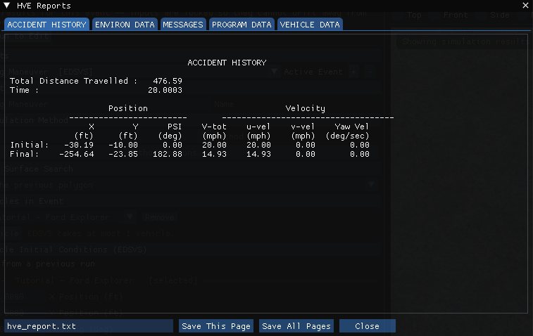
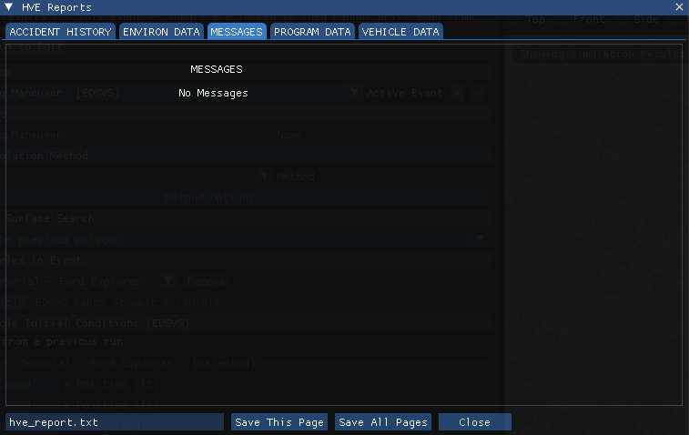
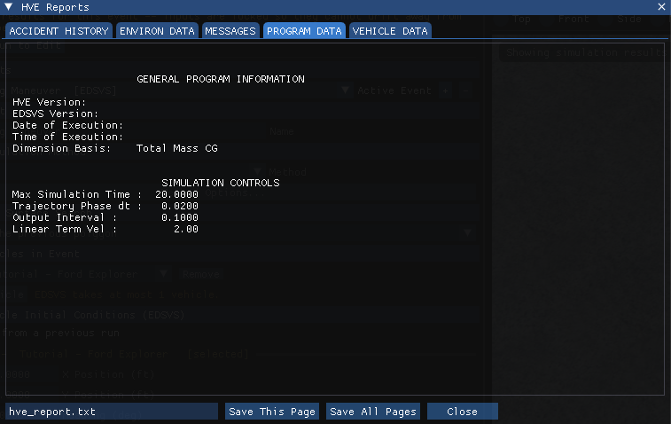
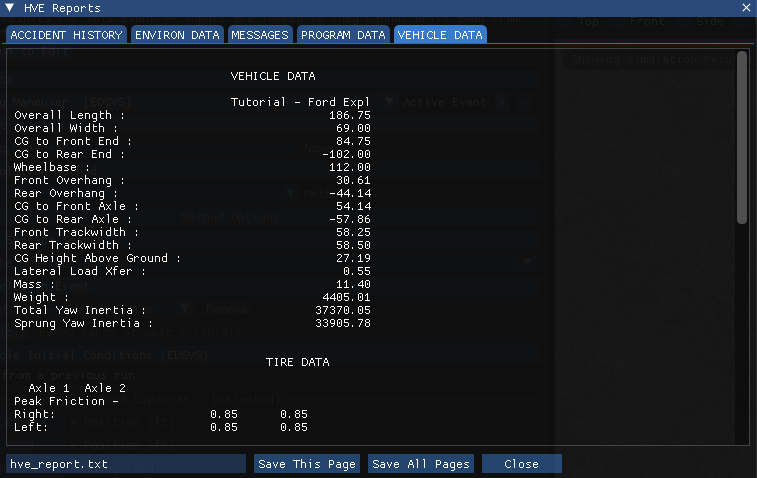
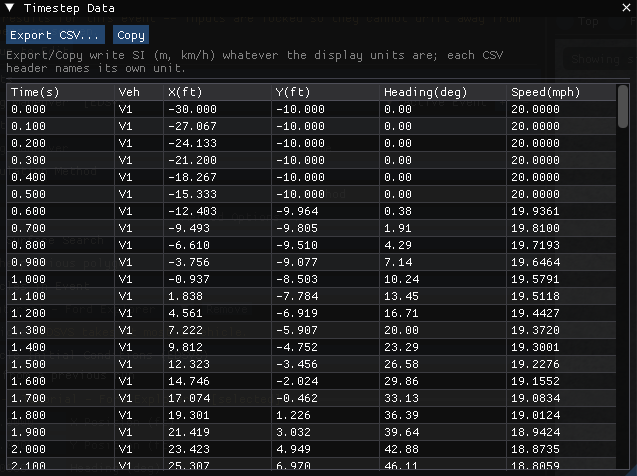
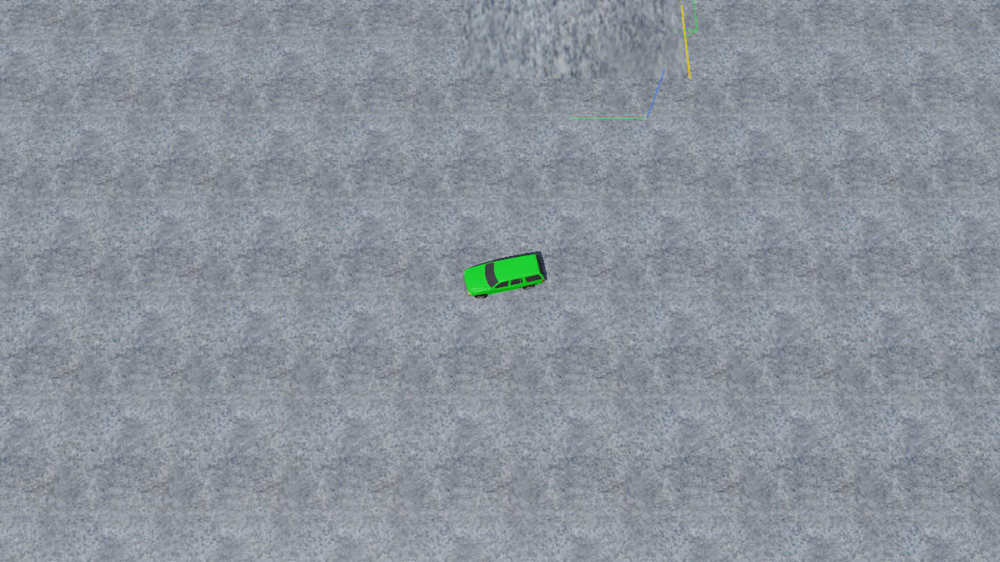

# Chapter 3 — EDSVS Program Output

This chapter defines the outputs available from an EDSVS event. In HVE 2027 a solved event plays back in the Event editor's viewport, and the reports are opened from the **Output** menu.

## Overview

EDSVS produces three types of output reports:

- **Alpha-Numeric Reports** — Reports containing text and numeric information, such as vehicle dimensional parameters
- **Variable Output Tables** — Reports containing tabular simulation results as a function of time
- **Trajectory Simulations** — Viewers containing dynamic, visual simulations

!!! note "HVE 2027"
    HVE 2027 has no Playback Editor and no report windows to create. Run the event, then:

    - **Output › HVE Reports** shows the alpha-numeric pages EDSVS writes itself, one tab per page: *ACCIDENT HISTORY*, *ENVIRON DATA*, *MESSAGES*, *PROGRAM DATA* and *VEHICLE DATA*. **Save This Page** and **Save All Pages** write them to a text file for printing.
    - **Output › Timestep Data Table**, **Output › Output Graph**, **Output › Key Results** and **Output › Variable Report** show the time histories (the Variable Output of this chapter). **Output › Variable Selection** chooses the channels. **Output › Export Variables** writes them to a file.
    - **Output › Accident History Report** opens HVE Reports on its *ACCIDENT HISTORY* tab — EDSVS's own Accident History page. **Save This Page** saves it as text and **Save Page as HTML** as an HTML page.
    - The trajectory plays back in the viewport with the playback bar.

    The reports describe the event that was last run. Running another event replaces them.

    The values on these pages follow the unit system set in **Tools › Preferences**. Two differences from HVE's printed pages: some single-value rows (for example *Total Distance Travelled* or *Max Simulation Time*) omit the unit label HVE prints beside them, and the header fields HVE fills from its installation (HVE and EDSVS version, date and time of execution, the geometry file name) are blank or read *(Unknown)*.

## Alpha-Numeric Reports

EDSVS produces the following alpha-numeric reports:

- **Messages** — A list of messages produced by the current run
- **Accident History** — A table of initial and final positions and velocities
- **Vehicle Data** — A series of tables containing the vehicle data used by EDSVS
- **Program Data** — A table containing program control information for the current run

An example of each of these numeric output reports from EDSVS is shown on the following pages.

### Accident History

The Accident History Report displays a table of initial and final positions and velocities for the vehicle. A typical Accident History Report is shown in Figure 3-1.

*Figure 3-1: The ACCIDENT HISTORY page of Output › HVE Reports for the tutorial's Steering Maneuver event.*

The report shows the Total Distance Travelled and Time, along with Initial and Final rows containing Position (X, Y, PSI) and Velocity (V-tot, u-vel, v-vel, Yaw Vel) values. *(updated: the current report layout also supports a "Rest" row.)*

### Messages

A typical Messages Report is shown in Figure 3-2. For a complete listing of messages issued by EDSVS, see [Chapter 6](06-messages.md).

*Figure 3-2: The MESSAGES page of Output › HVE Reports.*

!!! note "HVE 2027"
    The run status line under the Run button (and in the **Simulation** panel) also says how the run ended and lists anything HVE 2027 supplied or changed on the way to the engine. Read it together with the Messages page.

### Program Data

The Program Data Report includes the following information:

- **Simulation Controls** — Integration parameters used for the current event (Max Simulation Time, Trajectory Phase dt, Output Interval, Linear Term Vel)

*(updated: the current Program Data report also includes a General Program Information section — HVE Version, EDSVS Version, Date and Time of Execution, Dimension Basis — and General Environment Data and 3-D Environment Terrain Data sections, including the 3-D geometry filename, number of polygons, the Get Surface Information method in use, minimum/maximum terrain elevation, and counts of water, curb, friction-zone and road polygons.)*

A typical Program Data Report is shown in Figure 3-3.

*Figure 3-3: The PROGRAM DATA page of Output › HVE Reports.*

### Vehicle Data

The Vehicle Data Report includes the following information:

- **Vehicle Dimensional and Inertial Properties** — The dimensional and inertial parameters used by EDSVS in the current event (Overall Length and Width, CG to Front/Rear End, Wheelbase, Front/Rear Overhang, CG to Front/Rear Axle, Front/Rear Trackwidth, Inter-tandem Distance and Load Transfer, CG Height Above Ground, Lateral Load Transfer, Mass, Weight, Yaw Inertia).

  > NOTE: The Total Yaw Inertia adds the effect of the unsprung masses (i.e., the wheel and axle masses) to the sprung mass; thus, the value printed is greater than the one displayed in the Vehicle Editor's Inertias dialog.

- **Tire Properties** — The tire parameters used by EDSVS in the current event (Peak Friction, Slide Friction, Slip @ Peak Mu, Cornering Stiffness and Antilock Efficiency, right and left, for each axle).
- **Driver Tables** — Individual Driver Control tables for steering, braking, throttle and gear selection used by EDSVS in the current event.

A portion of a typical Vehicle Data Report is shown in Figure 3-4.

*Figure 3-4: The start of the VEHICLE DATA page of Output › HVE Reports (scroll the page to see the rest).*

EDSVS also writes an *ENVIRON DATA* page (the environment's physical data and the 3-D terrain summary), shown as its own tab.

## Graphic Reports

EDSVS produces no Graphic Output Reports.

> NOTE: Graphs of simulation results vs time are produced with **Output › Output Graph** (see next section).

## Variable Output Table

EDSVS produces a Variable Output table containing the time-based simulation results. The Variable Output groups produced by EDSVS are as follows:

### Vehicle Output Groups

- **Kinematics** — Position, velocity and acceleration for the vehicle
- **Tire** — The tire output parameters existing at the tire contact patch (compare with Wheel Output, below)
- **Wheel** — The wheel output parameters existing at the wheel's hub position of each wheel (compare with Tire output, above)
- **Driver** — Current levels of driver inputs (steering, braking and throttle)

An example of a Variable Output table is shown in Figure 3-5. A detailed listing of each Variable Output parameter produced by EDSVS is found in Table 3-1. For more information about Variable Output parameters, refer to the User's Manual, Chapter 16, Event Model.

!!! note "HVE 2027"
    In HVE 2027 the table is **Output › Timestep Data Table**; choose its columns with **Output › Variable Selection** (the *Filter* box accepts HVE's own variable names, such as Delta or V-tot).

**Table 3-1: Vehicle Variable Output Data**

| Parameter | Description |
|---|---|
| Vehicle Kinematic Data | X,Y,Z position of CG; $\Phi,\Theta,\Psi$ orientation; Path Radius of CG; $\nu$ (Course Angle); Total linear velocity, u,v,w components; Sideslip angle; r angular velocity; Total linear acceleration, forward and side components; u-dot, v-dot linear components; r-dot angular components |
| Tire Data | X,Y,Z position of tire contact patch; Slip Angle; $F'_x$, $F'_y$, $F'_z$; Skid Flag |
| Wheel Data | x,y,z location of each wheel; $F_x$, $F_y$, $F_z$; Steer Angle ($\delta$) at each steerable wheel |
| Driver Data (*) | Steering wheel angle |

(*) If Driver Control option was *At Steering Wheel*.

*Figure 3-5: Output › Timestep Data Table for the tutorial's Steering Maneuver event.*

## Trajectory Simulations

EDSVS produces a trajectory simulation of the current event. The trajectory simulation is a visualization of the data displayed in the Variable Output table (see previous section). An example of a trajectory simulation is shown in Figure 3-6.

*Figure 3-6: The tutorial's EDSVS Steering Maneuver played back in the HVE 2027 viewport.*

### Displaying a Trajectory Simulation

The trajectory plays back in the Event editor's viewport, controlled by the playback bar under it (see Figure 3-7).

The playback bar's controls have the following functions:

- **Run** — Execute the event
- **Reset** — Discard the results so that the event can be edited and run again
- **|<** — Jump to the start of the simulation
- **<<** — Step back one output step
- **Play** — Play the simulation forwards (Pause while playing)
- **>>** — Step forward one output step
- **>|** — Jump to the end of the simulation

*Figure 3-7: The playback bar.*

> NOTE: To combine events for playback, use the **Playback (F6)** editor. To make a video, use **File › Record Animation**.

---

[Previous: Chapter 2 — Program Input](02-program-input.md) | [Contents](README.md) | [Next: Chapter 4 — EDSVS Calculation Method](04-calculation-method.md)

<!-- NAV -->

---

← Previous: [Chapter 2 — EDSVS Program Input](02-program-input.md)  |  [Index](README.md)  |  Next: [Chapter 4 — EDSVS Calculation Method](04-calculation-method.md) →

<!-- /NAV -->
