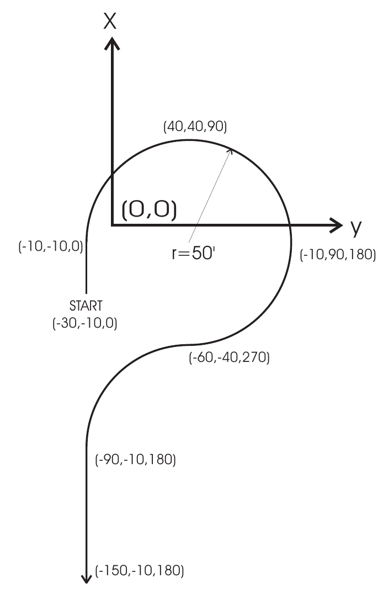
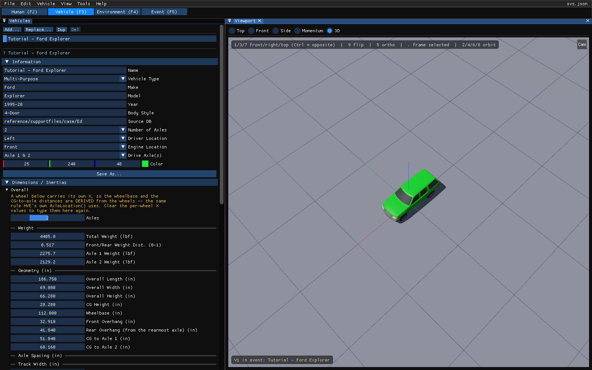
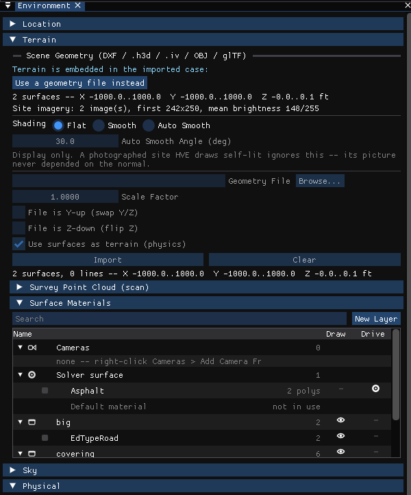
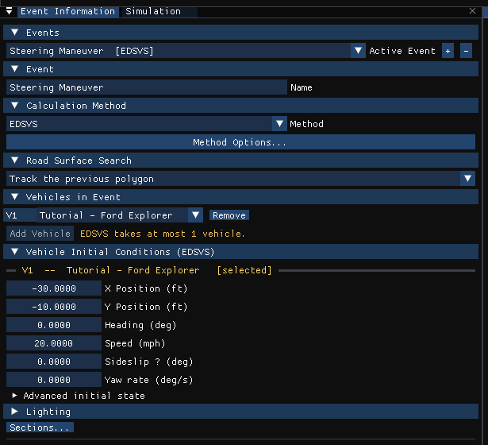
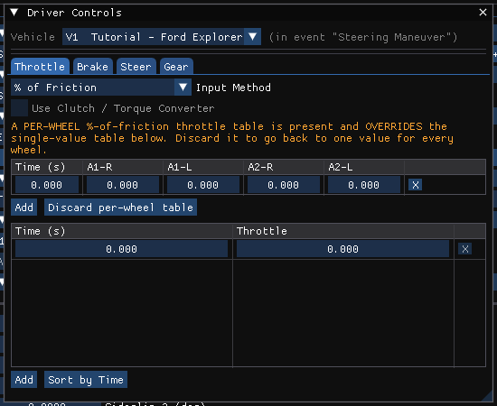
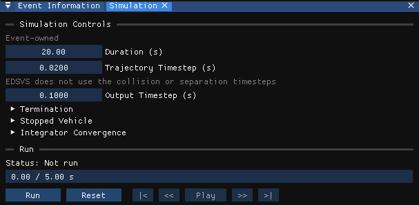

# Chapter 5 — EDSVS Tutorial

This tutorial comes from the EDC Simulations seminar. It provides a good example of the use of the driver input tables. In particular, it illustrates how the driver tables use linear interpolation to compute the current steer angle.

The goal of this tutorial is simply to make the simulated vehicle follow the desired path. Only steering is required, so the scope is limited, but extremely useful.

Like all EDSVS events, the procedures involve the following basic steps:

- Create the vehicles
- Create the environment
- Execute the EDSVS event
- Review the EDSVS output reports

These basic procedures are described in detail in this tutorial.

> NOTE: It is assumed that HVE 2027 is running and that you are familiar with its editors (Human, Vehicle, Environment and Event, the tabs under the menu bar), its dialogs and the viewport. The purpose of this tutorial is to illustrate those features while setting up and executing an EDSVS event.

!!! tip "New in HVE 2027: start from EDC's own tutorial case"
    HVE 2027 opens HVE's case files directly. The finished case for this tutorial, `EdsvsTutorialEDC.hve`, is supplied with HVE in its `supportFiles/case` folder. **File › Open** it and the vehicle, the site and the event arrive as EDC set them up. This chapter follows the original tutorial step by step and shows where each input lives in HVE 2027, so you can either build the case yourself or open EDC's and check each value against the text.

    Run from that case, HVE 2027 reproduces the result HVE saved in it: at t = 20 s the final position agrees within 1 mm, the heading change within 0.01 degree and the speed within 0.01 km/h.

## Getting Started

Before starting, set the display options so that we're all starting on the same page.

- **Tools › Preferences**: set *Units* to **Imperial (ft/in, mph, lb, lbf)**, HVE's US units.
- **View › Key Results**: on.
- **View** menu: turn on *Skidmarks*; leave the vectors off.

> NOTE: These options affect only the appearance of the viewport. EDSVS places the vehicle on the terrain itself, so there is no Auto Position setting for an EDSVS event.

The remaining options will keep their default settings. We're now ready to proceed with the tutorial.

Our goal is to use EDSVS to drive a 1997 Ford Explorer along the path described in Figure 5-1. This tutorial shows us how to perform this simulation.

*Figure 5-1: Path for EDSVS Simulation Tutorial. The path starts at (-30,-10,0), passes (-10,-10,0), follows a circle of radius 50 ft through (40,40,90) and (-10,90,180), reverses curvature through (-60,-40,270), then continues through (-90,-10,180) to (-150,-10,180). Coordinates are (X, Y, heading in degrees).*

## Creating the Vehicle

Now let's add the vehicle to our case. The vehicle is a dark green 1997 Ford Explorer:

1. Choose the **Vehicle** editor (the **Vehicle (F3)** tab).
2. In the **Vehicles** panel click **Add…**. The vehicle database search is displayed. Search for or pick the vehicle from the loaded databases:
   - Type = *Sport Utility* (HVE 2027 shows HVE's type *Multi-Purpose*)
   - Make = *Ford*
   - Model = *Explorer*
   - Year = *1995-1999*
   - Body Style = *4-Door*
   - Source Database = *Tutorial.db*
3. Under *Information* in the Vehicles panel, set *Drive Axle(s)* to **Axle 2**.

   > NOTE: The Ford Explorer is a 4-wheel drive vehicle, but we're going to select 2-wheel drive for the tutorial. (EDC's saved case has *Axle 1 & 2*; EDSVS accepts either. This tutorial uses no throttle, so the choice does not affect the result.)

The Ford Explorer is displayed in the viewport, as shown in Figure 5-2.

*Figure 5-2: The Ford Explorer in the HVE 2027 Vehicle editor.*

### Editing the Vehicle

Next, we will edit the vehicle to change its color and weight. To edit the color:

1. Under *Information* in the Vehicles panel, click the **Color** swatch (or type the red, green and blue values beside it) and choose a dark green.

Next, let's change the weight:

1. Under *Dimensions / Inertias* in the Vehicles panel, find the *Weight* group.

   > NOTE: Only total weight and total yaw inertia is used by the 3-DOF EDSVS calculations.

2. In the *Total Weight (lbf)* field, enter the measured value, `4405` lb.

   > NOTE: HVE 2027 stores the case in SI units, so a value you type may redisplay with a small difference in its last digit after conversion.

3. Check the yaw inertia in **Vehicle › Vehicle Information › Vehicle Properties › Inertia / Mass…**, which shows each inertia on both the *Total* and the *Sprung* basis.

## Creating the Environment

Now, let's set up the environment:

1. Choose the **Environment** editor (the **Environment (F4)** tab) and open **Environment › Environment…**.
2. Under *Location*, enter the latitude and longitude of Beaverton, Oregon, USA (*Search an address* can look a place up), and the date and time of the incident we are studying, `8/8/97` at `1230`.
3. Set the angle from *true north* to the earth-fixed X axis, `165` degrees. In HVE 2027 this is the **North** setting in the *Sun & Sky* section of **View › Shader Editor** (the *Sky* section of the Environment window links to it).

   > NOTE: The latitude, longitude, date, time and angle from true north are used to position the sun in the scene, which is the primary light source for the scene.

4. Under *Terrain*, choose **Browse…** beside *Geometry File*, select the HVE geometry file *EdsvsTutorial.h3d* and click **Import**.

The environment is displayed in the viewport (see Figure 5-3).

*Figure 5-3: The environment used for our EDSVS tutorial, in the HVE 2027 Environment editor.*

## Saving the Case

Now that we've created all the objects (*vehicle* and *environment*) for our case, let's save the case file.

1. Click on the **File** menu and choose **Save As**. Enter the file name `EdsvsTutorial` and save.

   > NOTE: HVE 2027 saves a case as `.hvc` (or as `.json` with **File › Save As JSON**). It reads HVE's `.hve` case files but does not write them. A case saved after a run also keeps its results, in a separate file beside it.

   > NOTE: Saving the file occasionally is a highly recommended practice.

## Creating Events

As mentioned at the outset of the tutorial, we are going to simulate a vehicle traveling along a pre-determined path to learn more about the use of driver tables. To create the event, perform the following steps:

1. Choose the **Event** editor (the **Event (F5)** tab). The **Event Information** panel is docked on the left.
2. Under *Events*, click **+** to add an event.
3. Under *Event*, enter the name `Steering Maneuver`.
4. Under *Calculation Method*, choose **EDSVS** as the *Method*.
5. Under *Vehicles in Event*, click **Add Vehicle** and choose the Ford Explorer.

Now, we're ready to set up the event.

1. Under *Vehicle Initial Conditions (EDSVS)*, enter the initial position, X = `-30` ft, Y = `-10` ft, and the heading, `0` degrees.

   > NOTE: You can also drag the vehicle into position in the viewport: select it, press **G** to move it (X or Y locks an axis) and **R** to rotate it. It is often easier to type the coordinates, especially the heading angle.

2. Enter the initial *Speed*, `20` mph.

*Figure 5-4: The Event Information panel with the Steering Maneuver event set up.*

The vehicle initial conditions are now established. Let's enter the driver controls. But, before we enter the steer angle data, let's be smart: Although we could simply find the steer angles by trial and error, instead we'll use a simple formula to arrive at a very good estimate. From the vehicle wheelbase and desired path radius, it can be shown the required steer angle is approximated by:

$$\delta = \arctan\left(\frac{wheelbase}{radius}\right)$$

> NOTE: The accuracy of this estimate is normally an acceptable initial estimate unless the vehicle is sideslipping.

Noting the wheelbase of the vehicle is 112 inches and the desired path radius is 50 feet (600 in), the required steer angle is about 11 degrees at the wheels.

> NOTE: An initial attempt using 11 degrees caused the vehicle's path to be too large. We'll use 11.25 degrees in our table.

The steer angles are applied at the front wheels (HVE's *At Axle* table):

**Table 5-1: Steering Table for the EDSVS, Steering Maneuver event**

| Time (sec) | Steer Angle at Axle (deg) — Axle 1, Right | Steer Angle at Axle (deg) — Axle 1, Left |
|---|---|---|
| 0.50 | 0.00 | 0.00 |
| 0.60 | 11.25 | 11.25 |
| 9.50 | 11.25 | 11.25 |
| 10.00 | -11.25 | -11.25 |
| 12.65 | -11.25 | -11.25 |
| 13.75 | 0.00 | 0.00 |

!!! note "HVE 2027"
    Open **Event › Driver Controls** and choose the **Steer** tab. In EDC's tutorial case the table above appears as the steer table *at the tires*, which overrides the steering-wheel table below it. HVE 2027 does not currently have a control for creating an at-the-tires table from scratch. To build the event yourself, enter the equivalent **steering-wheel** angles instead: the road-wheel angle multiplied by the *Gear Ratio* shown in **Vehicle › Steering System**. EDSVS then divides by the same ratio, so the road-wheel angles are those of Table 5-1.

*Figure 5-5: The Driver Controls dialog for the Steering Maneuver event. The tutorial case's throttle and brake tables are %-of-friction tables of zeros.*

This event lasts more than 5 seconds. To prevent premature termination, let's increase the maximum simulation time.

1. Choose the **Simulation** tab beside Event Information (or **View › Simulation**).
2. Set *Duration (s)* to `20`.

The tutorial uses a *Trajectory Timestep* of 0.02 s and an *Output Timestep* of 0.1 s (Figure 5-6).

*Figure 5-6: The Simulation panel for the Steering Maneuver event.*

Since our goal for this event is to follow a desired path, let's look at some Key Results during execution:

1. If the Key Results window is not displayed, choose **Output › Key Results** (or **View › Key Results**).
2. Choose **Output › Variable Selection**. The **Select Output Variables** window is displayed.

Let's add *Wheel Fx, Fy, Fz* and *Steer Angle* to the Key Results window:

1. Type `A1-R` in the *Filter* box to list the right front wheel and tire channels, and select the wheel forces *Fx*, *Fy*, *Fz* and the steer angle *Delta*.

   > NOTE: The above procedure adds the forces for the right front wheel only; you might wish to add the variables for the remaining three tires.

Now, we're ready to execute the event.

- Press **Run** on the playback bar under the viewport. When the run is complete (t = 20 seconds), press **Play** to watch it.

The EDSVS event is shown at time t = 3.10 seconds in Figure 5-7. Note the vehicle travels within 2 feet and 2 degrees of each path position defined in Figure 5-1.

> NOTE: While the event plays, watch the current results (especially the X,Y path coordinates and heading angle) in the Key Results window.

We have now completed the event.

*Figure 5-7: The EDSVS Steering Maneuver at t = 3.10 seconds in the HVE 2027 viewport.*

## Viewing Results

Now that we have produced our EDSVS simulation, let's take a detailed look at the results. In HVE 2027 the results of the event you last ran are shown in the viewport and through the **Output** menu; there is no separate Playback Editor.

EDSVS produces the following reports:

- **Accident History** — A table of initial and final positions and velocities
- **Environment Data** — The environment parameters used by EDSVS
- **Messages** — A list of messages produced by the current run
- **Program Data** — A table containing program control information
- **Trajectory Simulation** — The event played back in the viewport
- **Variable Output** — A table containing time-dependent simulation results
- **Vehicle Data** — A series of tables containing the vehicle data used by EDSVS

### Report Windows

The alpha-numeric reports are pages of a single window. To view them:

1. Choose **Output › HVE Reports**. The HVE Reports window is displayed with one tab per page: *ACCIDENT HISTORY*, *ENVIRON DATA*, *MESSAGES*, *PROGRAM DATA* and *VEHICLE DATA*.
2. Click a tab to display that page.

The following pages illustrate the reports produced for the *Steering Maneuver* event.

### Accident History

The Accident History report displays the time and total distance traveled, as well as position and velocity information for the start and end of the run.

*Figure 5-8: The ACCIDENT HISTORY page for the Steering Maneuver event.*

!!! note "HVE 2027"
    The figures in the original manual (final X = -259.93 ft, Y = -9.24 ft, PSI = 179.88 degrees, 15.00 mph) came from an earlier execution of the event. The run saved in EDC's case file, which HVE 2027 reproduces, ends at X = -254.64 ft, Y = -23.85 ft, PSI = 182.88 degrees and 14.93 mph (Figure 5-8).

### Messages

EDSVS produces a number of messages, depending on the outcome of the event. For a complete list and explanation of the messages produced by EDSVS, see [Chapter 6](06-messages.md).

*Figure 5-9: The MESSAGES page for the Steering Maneuver event.*

### Program Data

The Program Data report for EDSVS displays the simulation controls used for the current event.

*Figure 5-10: The PROGRAM DATA page for the Steering Maneuver event.*

### Vehicle Data

The Vehicle Data report displays the vehicle data, tire data and driver control tables for the EDSVS vehicle.

*Figure 5-11: The start of the VEHICLE DATA page for the Steering Maneuver event.*

> NOTE: The Vehicle Data report contains more information than fits in the window. Scroll to view the entire report.

### Variable Output

The Variable Output report is a table of time-dependent results. In HVE 2027 it is **Output › Timestep Data Table**.

#### Variable Selection

The purpose of our EDSVS study is to make our vehicle follow a desired path. To document the resulting path, as well as some other pertinent results, let's select the CG path coordinates and path radius:

1. Choose **Output › Variable Selection**. The **Select Output Variables** window is displayed. The Kinematics group is listed first.
2. Select *X, Y, Yaw* and *Radius* from the list.
3. Type `A1-R` in the *Filter* box and select the right front wheel's *Fx, Fy, Fz* and *Delta*.

   > NOTE: Feel free to add additional variables.

The Timestep Data Table for the *Steering Maneuver* event now includes the selected results (see Figure 5-12). **Output › Output Graph** plots the same channels against time.

*Figure 5-12: The Timestep Data Table for the Steering Maneuver event.*

### Trajectory Simulation

The trajectory plays back in the Event editor's viewport. To visualize the motion, use the playback bar under the viewport:

1. Click **Play**. The simulation plays at the current playback speed.
2. Click **Pause**. The simulation stops.
3. Click **<<** or **>>** to step backward or forward one output step.
4. Click **|<** to return to the start, or **>|** to advance to the end of the run.
5. Drag the time scrubber, or type a time in the field beside it, to jump to any instant.

### Printing

HVE 2027 does not print directly. To print a report, save it to a file and print the file:

1. In the HVE Reports window, type a file name in the box at the bottom and click **Save This Page** (or **Save All Pages** for every page).
2. For the Variable Output, use **Export CSV…** in the Timestep Data window, or **Output › Export Variables**.

> NOTE: A page saved as TEXT is laid out in spaces for a fixed-width font. Open it in a text editor with a monospaced font before printing it, or use **Save Page as HTML**, which lays the page out as tables. For several reports it may be best to print in landscape rather than portrait mode.

---

[Previous: Chapter 4 — Calculation Method](04-calculation-method.md) | [Contents](README.md) | [Next: Chapter 6 — EDSVS Messages](06-messages.md)

<!-- NAV -->

---

← Previous: [Chapter 4 — EDSVS Calculation Method](04-calculation-method.md)  |  [Index](README.md)  |  Next: [Chapter 6 — EDSVS Messages](06-messages.md) →

<!-- /NAV -->
