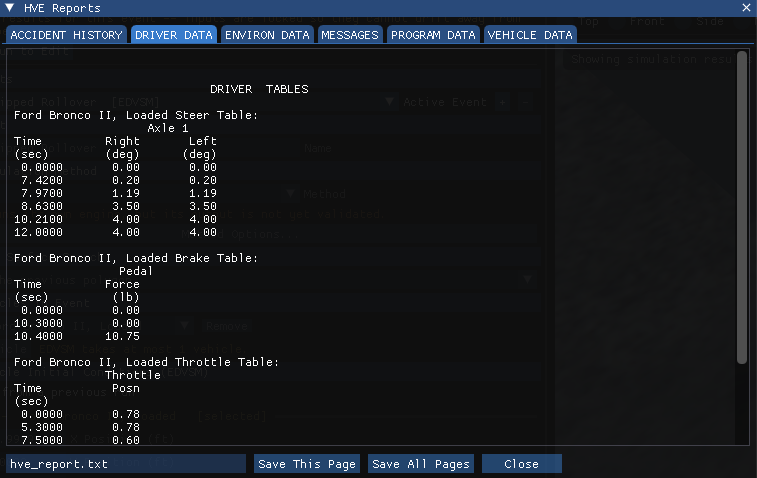
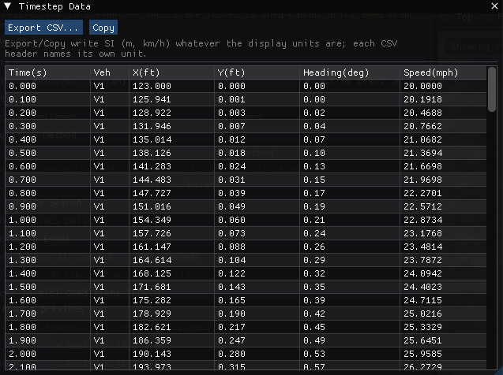

# Chapter 3 — EDVSM Program Output

This chapter defines the outputs available from an EDVSM event. In HVE 2027 a solved event plays back in the Event editor's viewport, and the reports are opened from the **Output** menu.

## Overview

EDVSM produces three types of output reports:

- **Alpha-Numeric Reports** - Reports containing text and numeric information, such as vehicle dimensional parameters
- **Variable Output Tables** - Reports containing tabular simulation results as a function of time
- **Trajectory Simulations** - A 3-D viewer containing dynamic, visual simulations of the vehicle trajectory during the run.
- **Damage Profile Simulations** - A 3-D viewer containing dynamic, visual damage simulation as it occurs during the run.

!!! note "HVE 2027"
    HVE 2027 has no Playback Editor and no report windows to create. Run the event, then:

    - **Output › HVE Reports** shows the alpha-numeric pages EDVSM writes itself, one tab per page: *ACCIDENT HISTORY*, *DRIVER DATA*, *ENVIRON DATA*, *MESSAGES*, *PROGRAM DATA* and *VEHICLE DATA*. **Save This Page** and **Save All Pages** write them to a text file for printing.
    - **Output › Timestep Data Table**, **Output › Output Graph**, **Output › Key Results** and **Output › Variable Report** show the time histories (the Variable Output of this chapter). **Output › Variable Selection** chooses the channels. **Output › Export Variables** writes them to a file.
    - **Output › Accident History Report** opens HVE Reports on its *ACCIDENT HISTORY* tab — EDVSM's own Accident History page. **Save This Page** saves it as text and **Save Page as HTML** as an HTML page.
    - The trajectory and damage play back in the viewport with the playback bar.

    The reports describe the event that was last run. Running another event replaces them.

    The values on these pages follow the unit system set in **Tools › Preferences**. Two differences from HVE's printed pages: some single-value rows (for example *Total Distance Travelled* or *Max Simulation Time*) omit the unit label HVE prints beside them, and the header fields HVE fills from its installation (HVE and EDVSM version, date and time of execution, the geometry file name) are blank or read *(Unknown)*.

## Alpha-Numeric Reports

EDVSM produces the following alpha-numeric reports:

- **Messages** - A list of messages produced by the current run
- **Accident History** - A table of initial and final positions and velocities
- **Driver Controls** - A report of all the driver control inputs (Steering, Braking, Throttle, Gear Selection) for the current run.
- **Environment Data** - A table describing the environment physical and visual parameters used during the run.
- **Vehicle Data** - A series of tables containing the vehicle data used by EDVSM
- **Program Data** - A table containing program control information for the current run

An example of each of these numeric output reports from EDVSM is shown on the following pages.

### Messages

A typical Messages Report is shown in Figure 3-1. For a complete listing of messages issued by EDVSM, see [Chapter 6, Messages](06-messages.md).

*Figure 3-1: The MESSAGES page of Output › HVE Reports for the tutorial's Curb-tripped Rollover event.*

!!! note "HVE 2027"
    In HVE 2027 the run status line under the Run button (and in the **Simulation** panel) also says how the run ended, and lists anything HVE 2027 supplied or changed on the way to the engine, such as a seeded cornering-stiffness table or body vertices that found no terrain. Read it together with the Messages page.

### Accident History

The Accident History Report displays a table of initial and final positions and velocities for the vehicle. A typical Accident History Report is shown in Figure 3-2. The report includes total distance traveled and total time, plus initial and final X, Y, PSI position and V-tot, u-vel, v-vel and yaw velocity.

*Figure 3-2: The ACCIDENT HISTORY page of Output › HVE Reports for the Curb-tripped Rollover event. In HVE 2027 this run continues to the 15 s maximum time; HVE's stops at 10.8 s (see [Chapter 2](02-program-input.md#vehicle-body-vs-environment-contact)).*

### Driver Controls

The Driver Controls Report displays a table of driver steering, braking, throttle and gear selections for the vehicle. A typical Driver Controls Report is shown in Figure 3-3 (Brake Table of Pedal Force vs time, Throttle Table by axle, Gear Table and Steer Table of Steering Wheel angle vs time).

*Figure 3-3: The DRIVER DATA page of Output › HVE Reports.*

### Environment Data

The Environment Data Report displays the physical and visual information describing the environment (ambient temperature and pressure, gravity constant, 3-D geometry filename, number of polygons, GetSurfaceInfo method and minimum terrain elevation). A typical Environment Data Report is shown in Figure 3-4.

*Figure 3-4: The ENVIRON DATA page of Output › HVE Reports.*

> **NOTE:** A detailed description of the vertex information is not practical, owing to its large size (a terrain often is composed of several thousand vertices). However, it is possible to view the terrain information (friction multiplier, slope, elevation and so forth) beneath each tire during the entire sequence by selecting the tire terrain outputs in the Variable Output, Tires output group (see Variable Output, later in this chapter).

### Vehicle Data

The Vehicle Data Report includes the following information:

- **Vehicle Dimensional and Inertial Properties** - The dimensional and inertial parameters as were used by EDVSM in the current event.
- **Suspension Properties** - The suspension parameters as were used by EDVSM in the current event.
- **Brake System Properties** - The brake system parameters as were used by EDVSM in the current event.
- **Tire Properties** - The tire parameters as were used by EDVSM in the current event.

A portion of a typical Vehicle Data Report is shown in Figures 3-5a, b, and c (a vehicle data report consumes several pages). The report begins with General Vehicle Information (overall length and width, CG-to-front/rear end, wheelbase, track widths, overhangs, CG-to-axle distances, CG height, total weight, aerodynamic drag data), followed by Sprung Mass Data (mass, weight, rotational inertias), Suspension Data (per-axle suspension type, wheel locations, unsprung weights, roll steer, auxiliary roll stiffness, ride and damping rates, suspension friction, jounce/rebound stops, energy loss ratio), Camber and Half-track Tables, Anti-pitch Table, Brake System Data (pedal ratio and per-wheel brake type, torque ratio, pushout pressure and proportioning data) and Tire Data (physical data, deflection rates, friction tables at each test load and speed, cornering and camber stiffness data).

*Figure 3-5: The start of the VEHICLE DATA page of Output › HVE Reports. Scroll the page to see the rest.*

### Program Data

The Program Data Report includes the following information:

- **Simulation Controls** - Integration parameters used for the current event
- **General Information** - EDVSM version number and internally assigned constants used for the current event

A typical Program Data Report is shown in Figure 3-6. The Simulation Controls section reports the integration method (Fixed Runge-Kutta), maximum simulation time, normal integration timestep, output interval, and the linear and angular termination velocities. The General Information section reports the EDVSM version number, wheel spin integration constant, terminal wheel spin velocity, pitch index angle and driveline inertia.

*Figure 3-6: The PROGRAM DATA page of Output › HVE Reports.*

## Graphic Reports

EDVSM produces no Graphic Output Reports.

> **NOTE:** Graphs of simulation results vs time are produced with **Output › Output Graph** (see next section).

## Variable Output Table

EDVSM produces a Variable Output table containing the time-based simulation results. The Variable Output groups produced by EDVSM are as follows:

### Vehicle Output Groups

- **Kinematics** - Position, velocity and acceleration for the vehicle sprung mass
- **Kinetics** - Forces and moments acting on the sprung mass
- **Accelerometers** - Linear accelerations at user-specified locations on the vehicle
- **Tire** - The tire output parameters existing at the tire contact patch (compare with Wheel Output, below)
- **Wheel** - The wheel output parameters existing at the wheel's hub (compare with Tire Output, above)
- **Drivetrain** - Current levels of driving torque and other information related to the drivetrain
- **Driver** - Current levels of driver inputs (steering, braking, throttle and gear ratios)

An example of a Variable Output table is shown in Figure 3-7. A detailed listing of each Variable Output parameter produced by EDVSM is found in Table 3-1. For more information about HVE Variable Output parameters, refer to the HVE Operations Manual, Chapter 16, Event Model.

!!! note "HVE 2027"
    In HVE 2027 the table is **Output › Timestep Data Table**; choose its columns with **Output › Variable Selection** (the *Filter* box accepts HVE's own variable names, such as Delta, Spin or V-tot). Channel names follow HVE's. Two things to know when reading them:

    - EDVSM does not compute brake temperatures. A brake-temperature channel holds no number after the first sample, so HVE 2027 shows it as blank (`--`) rather than as a flat line, the channel names carry *(no thermal data)*, and the run status says how many such channels there are.

**Table 3-1 Vehicle Variable Output Data**

| Parameter | Description |
|---|---|
| Vehicle Kinematic Data | X,Y,Z position of CG; $\Phi,\Theta,\Psi$ orientation; Total linear velocity, u,v,w components; Sideslip, course angles; p,q,r angular velocity; Total linear accel, fwd, side, vert components; u-dot, v-dot, w-dot linear components; p-dot, q-dot, r-dot angular components |
| Kinetic Data | $\Sigma F_x$, $\Sigma F_y$, $\Sigma F_z$ (Suspension); $\Sigma M_x$, $\Sigma M_y$, $\Sigma M_z$ (Suspension); $\Sigma F_x$, $\Sigma F_y$, $\Sigma F_z$ (Collision); $\Sigma M_x$, $\Sigma M_y$, $\Sigma M_z$ (Collision); $F_x$ (Aerodynamic) |
| Accelerometer Data | Total linear accel; forward, Lat, Vert components for each accelerometer |
| Tire Data | X,Y,Z position of tire contact patch; $F_{x'}$, $F_{y'}$, $F_{z'}$ of tire contact patch; Loaded Tire Radius; Longitudinal Slip; Slip Angle; Skid Flag |
| Wheel Data | x,y,z location of wheel; Camber, Steer angle of wheel; Wheel Spin Velocity; $F_x$, $F_y$, $F_z$ of wheel; Jounce/Rebound displacement, velocity; Spring, Damping and Anti-pitch Suspension Force; Drive and Brake Torque at wheel; Brake Pressure at wheel |
| Drivetrain Data | Engine Speed, Power and Torque; Transmission and Differential Numeric Ratio |
| Driver Data | Steering wheel angle; Throttle position; Brake Pedal Force and Master Cylinder Pressure; Transmission and Differential Gear Selection |

*Figure 3-7: Output › Timestep Data Table for the tutorial's Curb-tripped Rollover event.*

## Trajectory Simulations

EDVSM produces a trajectory simulation of the current event. The trajectory simulation is a 3-D visualization of the data displayed in the Variable Output Table (see previous section). An example of a trajectory simulation is shown in Figure 3-8.

*Figure 3-8: The tutorial's Curb-tripped Rollover event played back in the HVE 2027 viewport, at t = 10.8 s, after the curb strike.*

### Displaying a Trajectory Simulation

The trajectory plays back in the Event editor's viewport, controlled by the playback bar under it (see Figure 3-9).

*Figure 3-9: The playback bar.*

The playback bar's controls have the following functions:

- **Run** - Execute the event
- **Reset** - Discard the results so that the event can be edited and run again
- **|<** - Jump to the start of the simulation
- **<<** - Step back one output step
- **Play** - Play the simulation forwards (Pause while playing)
- **>>** - Step forward one output step
- **>|** - Jump to the end of the simulation

The time field beside the scrubber accepts a time to jump to. The view list (*Free view* in Figure 3-9) chooses a camera.

> **NOTE:** To make a video, use **File › Record Animation**. **Output › Playback Options** sets the playback speed and frame step.

## Damage Profile Simulations

EDVSM produces a damage profile simulation of the current event. The damage profile simulation is a 3-D visualization of the 3-D vertex data stored in the Damage output group in the Variable Output Table.

> **NOTE:** The Damage output group is not currently displayable in the Variable Output table.

!!! warning "Not in HVE 2027"
    HVE 2027 has no separate Damage Profile viewer; the event plays back in the viewport only. The *VEHICLE DATA* page of Output › HVE Reports reports the number of body nodes the rollover model damaged. In the tutorial's Curb-tripped Rollover it is 0.

<!-- NAV -->

---

← Previous: [Chapter 2 — EDVSM Program Input](02-program-input.md)  |  [Index](README.md)  |  Next: [Chapter 4 — Calculation Method](04-calculation-method.md) →

<!-- /NAV -->
