# Chapter 5 — EDVSM Tutorial

## Description

This tutorial is based on the EDVSM validation study described in SAE Paper No. 970895 [4]. The validation study includes a curb-tripped rollover of a Ford Bronco II. In this tutorial, we extend this validation study by illustrating how a tire blow-out at various wheel positions affects the vehicle response.

Like all EDVSM events, the procedure involves the following basic steps:

- Create the vehicle(s)
- Create the environment
- Execute the EDVSM event(s)
- Review the EDVSM output reports

This basic procedure is described in detail in this tutorial.

> **NOTE:** It is assumed that HVE 2027 is running and that you are familiar with its editors (Human, Vehicle, Environment, Event and Playback, the tabs under the menu bar), its dialogs and the viewport. The purpose of this tutorial is to illustrate those features while setting up and executing an EDVSM event.

!!! note "HVE 2027: start from EDC's own tutorial case"
    HVE 2027 opens HVE's case files directly. The finished case for this tutorial, `EdvsmTutorialEDC.hve`, is supplied with HVE in its `supportFiles/case` folder. Open it with **File › Open Case…** and the vehicle, the curb site and all five events arrive as EDC set them up, including every edit described below. This chapter follows the original tutorial step by step and shows where each input lives in HVE 2027, so you can either build the case yourself or open EDC's and check each value against the text.

    Run from that case, HVE 2027 reproduces the results HVE saved in it: for each of the five events the final position agrees within 1 mm (2 mm on one), the heading change within 0.01 degree and the speed within 0.01 km/h. The one difference in behaviour is described under [Rollover Validation Event](#rollover-validation-event).

## Getting Started

Before starting, set the display options so that we're all starting on the same page.

> **NOTE:** Most options simply affect the appearance of the viewport. One affects the analysis: **Auto Position** (a checkbox under *Vehicle Initial Conditions* in Event Information) settles the vehicle onto the terrain; with it off, the vehicle starts at the Z, roll and pitch you enter. The resulting difference in initial conditions could substantially change the event.

- **Tools › Preferences**: set *Units* to **Imperial (ft/in, mph, lb, lbf)**, HVE's US units.
- **View › Key Results**: on.
- **View › Scene Display**: turn on *Skidmarks*; leave the vectors off.

The remaining options will keep their default settings. We're now ready to proceed with the tutorial.

Our goal is to use EDVSM to simulate a handling experiment conducted by the University of Missouri [6]. This tutorial shows us how to perform this simulation.

## Creating the Vehicle

First let's add the vehicle to our case. The vehicle is a yellow 1984 Ford Bronco II:

- Choose the **Vehicle** editor (the **Vehicle (F3)** tab).
- In the **Vehicles** panel click **Add…**. The vehicle database search is displayed. Search for or pick the vehicle from the loaded databases:
  - Type = *Sport-Utility* (HVE 2027 shows HVE's type *Multi-Purpose*)
  - Make = *Ford*
  - Model = *Bronco II*
  - Year = *1984-1991*
  - Body Style = *2-Door*
  - Source Database = *Tutorial.db*
- In the Vehicles panel's *Configuration* section, set *Drive Axle(s)* to **Axle 2**.

> **NOTE:** The Ford Bronco II is a 4-wheel drive vehicle. Because it was used in 2-wheel drive mode during the handling experiments, we must edit the default Drive Axle option. EDVSM does not run 4-wheel drive vehicles.

- In the *Identity* section, edit the *Name*: `Ford Bronco II, Loaded`.

The Ford Bronco II is displayed in the viewport, as shown in Figure 5-1.

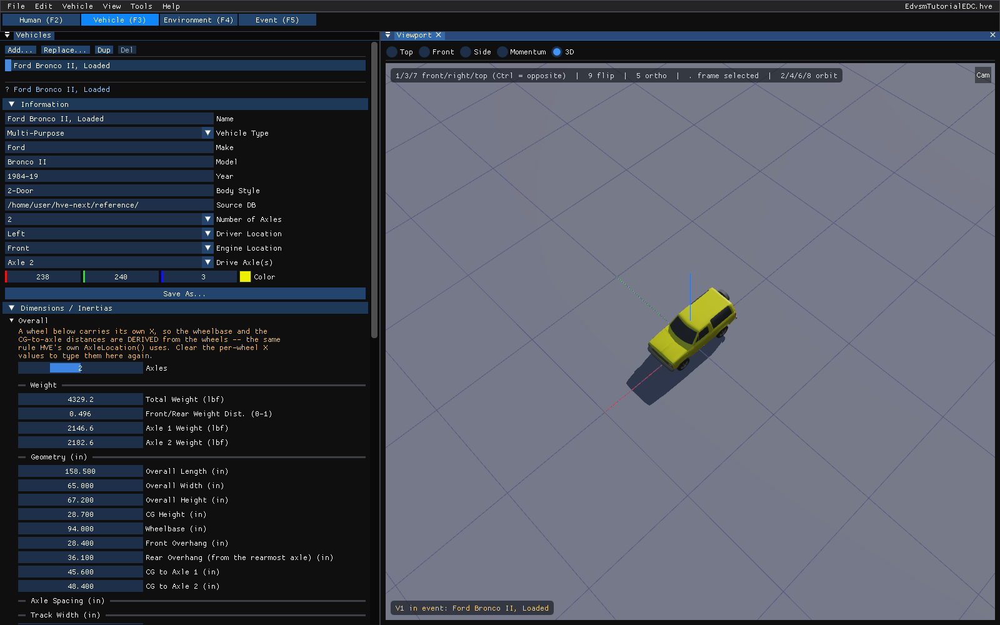

*Figure 5-1: The Ford Bronco II, Loaded in the HVE 2027 Vehicle editor.*

### Editing the Vehicle

Next, we will edit the vehicle to change its color and inertias (the test vehicle was fitted with outriggers to prevent a catastrophic rollover; these outriggers and other test equipment affected the vehicle's inertial properties). In addition, we'll add an anti-sway bar to the rear suspension, and disable the left front brake (this was done as part of the handling experiment to help ensure directional control and test repeatability).

To edit the color:

- In the Vehicles panel's *Identity* section, click the **Color** swatch (or type the red, green and blue values beside it) and choose a light yellow (Figure 5-2).

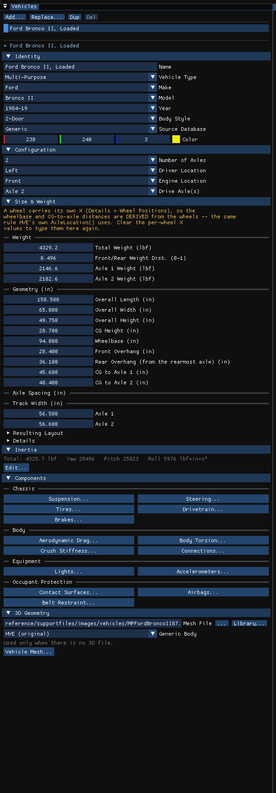

*Figure 5-2: The Vehicles panel, with the vehicle's name, drive axle and color.*

Next, let's change the weight and rotational inertias to account for the outriggers installed on the test vehicle to prevent rollover:

- In the Vehicles panel's *Inertia* section, click **Edit…**. The Inertia / Mass dialog shows each quantity on both the *Total* and the *Sprung* basis.
- In the *Weight* row, *Total* column, enter the measured (test) value, `4329.2` lb.
- In the *Roll*, *Pitch* and *Yaw* rows, *Sprung* column, enter the measured values `5372.4`, `23666.9` and `26100.85` lb-sec²-in.

> **NOTE:** HVE 2027 stores the case in SI units, so a value you type may redisplay with a small difference in its last digit after conversion.

Next, let's add a 1-inch anti-sway bar at the rear suspension:

- Open **Vehicle › Suspension Data**. The dialog has one column per axle.
- In the *Aux Roll Stiffness* row, Axle 2 column, enter the calculated value for a 1-inch anti-sway bar, `1310.0` in-lb/deg.

Finally, let's disable the left front brake by setting its brake torque ratio to zero:

- Open **Vehicle › Brakes › Brake Assembly**. The dialog has one column per wheel (*A1 Right* is the right front, *A1 Left* the left front).
- In the *Torque Ratio* row, *A1 Left* column, replace the existing value with `0.0` (Figure 5-3).

> **NOTE:** The wheel columns are linked in groups (the *- A B C* selector at the top of each column), and an edit in one column is copied to every column in the same group. A vehicle usually arrives with all four columns in group *A*, so click **-** at the top of the *A1 Left* column to unlink it before you enter the zero.

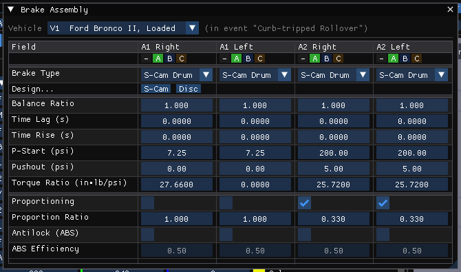

*Figure 5-3: The Brake Assembly dialog, with the left front brake disabled.*

The vehicle is now ready for use in our events. Rotate the view in the viewport to look at the vehicle (the keys 1, 3 and 7, on the number pad or the main keyboard, give front, right and top views).

## Creating the Environment

Now, let's set up the environment:

- Choose the **Environment** editor (the **Environment (F4)** tab) and open **Environment › Environment…**.
- Under *Location*, enter the name `Jefferson City Airport`, the latitude and longitude of Jefferson City, Missouri, USA (38.58 N, 92.20 W; *Search an address* can look a place up), and the date and time of the experimental study, `7/11/93` at `1500`.
- Set the angle from *true north* to the earth-fixed X axis, `165` degrees. In HVE 2027 this is the **North** setting in the *Sun & Sky* section of **View › Shader Editor** (the *Sky* section of the Environment window links to it).

> **NOTE:** The latitude, longitude, date, time and angle from true north are used to position the sun in the scene, which is the primary light source for the scene.

- Under *Terrain*, choose **Browse…** beside *Geometry File*, select the HVE geometry file *EDVSMValidAASHTOCurb.h3d* and click **Import**.

The environment is displayed in the viewport (see Figure 5-4).

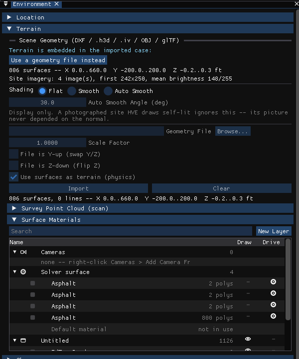

*Figure 5-4: The 3-D environment used for our EDVSM tutorial, in the HVE 2027 Environment editor.*

### Saving the Case

Now that we've created all the objects (*vehicle* and *environment*) for our case, let's save the case file.

- Click on the **File** menu and choose **Save Case As…**. Enter the file name `EdvsmTutorial` and save.

> **NOTE:** HVE 2027 saves a case as `.hvex` (or as `.json` with **File › Save Case As JSON…**). It reads HVE's `.hve` case files but does not write them. A case saved after a run also keeps its results, in a separate file beside it.

> **NOTE:** Saving the file occasionally is a highly recommended practice.

## Creating the Events

As mentioned at the outset of the tutorial, our EDVSM tutorial includes several events. The first event is a curb-tripped rollover prepared as part of the EDVSM validation project. The next four events simply use the first event, and introduce a blow-out at each of the four tires.

### Rollover Validation Event

To create the rollover event, perform the following steps:

- Choose the **Event** editor (the **Event (F5)** tab). The **Event Information** panel is docked on the left.
- Under *Events*, click **+** to add an event.
- Under *Event*, enter the name `Curb-tripped Rollover`.
- Under *Calculation Method*, choose **EDVSM** as the *Method*.
- Under *Vehicles in Event*, click **Add Vehicle** and choose *Ford Bronco II, Loaded*.

Now, we're ready to set up the first event.

- Under *Vehicle Initial Conditions (EDVSM)*, enter the initial position, X = `123` ft, Y = `0` ft. Its initial heading angle is 0 degrees and need not be modified.
- Enter the initial *Speed*, `20` mph.

> **NOTE:** You can also drag the vehicle into position in the viewport: select it, press **G** to move it (X or Y locks an axis) and **R** to rotate it. It is often easier to type the coordinates.

*Figure 5-5: The Event Information panel with the Curb-tripped Rollover event set up.*

The vehicle initial conditions are now established. Let's enter the driver controls. The steering inputs were obtained from the validation study [reference 4]. However, the throttle, brake and gear selection were not documented in the study and were determined by repeated adjustments until the correct vehicle acceleration was achieved.

#### Steering Input

The rollover event steers the front wheels directly (HVE's *At Axle* table):

**Table 5-1: Steer Table entries for the Ford Bronco.**

| Time (sec) | Steer Angle at Axle (deg), Right Front | Steer Angle at Axle (deg), Left Front |
|---|---|---|
| 0.00 | 0.00 | 0.00 |
| 7.42 | 0.20 | 0.20 |
| 7.97 | 1.19 | 1.19 |
| 8.63 | 3.50 | 3.50 |
| 10.21 | 4.00 | 4.00 |
| 12.00 | 4.00 | 4.00 |

!!! note "HVE 2027"
    Open **Event › Driver Controls** and choose the **Steer** tab. In EDC's tutorial case the table above appears as the steer table *at the tires*, which overrides the steering-wheel table below it. HVE 2027 does not currently have a control for creating an at-the-tires table from scratch. To build the event yourself, enter the equivalent **steering-wheel** angles instead (the road-wheel angle multiplied by the steering gear ratio shown in **Vehicle › Steering System**); EDVSM then applies the gear ratio, so the result is the same road-wheel angle.

#### Throttle Input

To enter the throttle table:

- In Driver Controls, choose the **Throttle** tab.
- Set *Input Method* to **Pedal (AT_DRIVER)** (HVE's *Wide-open Throttle* option: 0 is closed, 1 is wide open).
- Enter the throttle position, as shown below, using **Add** for each row (Figure 5-6).

**Table 5-2: Throttle Table entries for the Ford Bronco.**

| Time (sec) | Throttle Position (Percent WOT) |
|---|---|
| 0.00 | 0.78 |
| 5.30 | 0.78 |
| 7.50 | 0.60 |
| 10.30 | 0.57 |
| 10.40 | 0.00 |

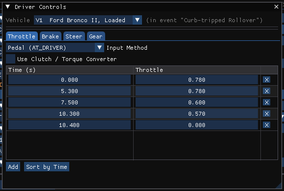

*Figure 5-6: The Driver Controls dialog, Throttle tab, for the Curb-tripped Rollover event.*

#### Gear Selection Input

To enter the gear selection:

- In Driver Controls, choose the **Gear** tab.
- Enter one row: time `0.00`, gear `3`.

**Table 5-3: Gear Selection table entries for the Ford Bronco.**

| Time (sec) | Gear Selection |
|---|---|
| 0.00 | Shift Into 2nd |

> **NOTE:** HVE 2027 numbers the gears 0 = neutral, 1 = reverse, 2 = first, 3 = second, and so on, so *Shift Into 2nd* is entered as `3`.

> **NOTE:** The gear selection and throttle tables were created by trial and error as required to match the experimental and simulated velocity profiles.

#### Brake Input

To enter the brake input:

- In Driver Controls, choose the **Brake** tab and set *Input Method* to **Pedal (AT_DRIVER)** (HVE's *Pedal Force*).
- Enter the brake pedal force, as shown below:

**Table 5-4: Brake Table entries for the Ford Bronco.**

| Time (sec) | Brake Pedal Force (lb) |
|---|---|
| 10.30 | 0.00 |
| 10.40 | 10.75 |

!!! note "HVE 2027"
    In EDC's case this table arrives as a *Pedal force* table, in pounds when Preferences are set to Imperial units. A pedal table typed into a new HVE 2027 event is a 0 to 1 pedal *position* instead, scaled by the vehicle's brake pressure curve (**Vehicle › Brakes › Brake System Pressure**).

The driver control inputs are now complete.

#### Simulation Controls

This event lasts more than 5 seconds. To prevent premature termination, let's increase the maximum simulation time.

- Choose the **Simulation** tab beside Event Information (or **View › Simulation**).
- Set *Duration (s)* to `15`.

The tutorial uses a *Trajectory Timestep* of 0.0025 s and an *Output Timestep* of 0.1 s.

#### Calculation Options

In this event, we intend to simulate the rollover of a vehicle where the body of the vehicle may contact the ground. We need to activate the *Vehicle Body vs. Environment Contact* model (see [Chapter 2, Calculation Options](02-program-input.md#calculation-options)).

- In Event Information, under *Calculation Method*, click **Method Options…**. The **EDVSM Options** window is displayed.
- Check **Vehicle body vs. environment contact**.

#### Key Results

Let's look at some Key Results during execution:

- If the Key Results window is not displayed, choose **Output › Key Results** (or **View › Key Results**).
- Choose **Output › Variable Selection**. The **Select Output Variables** window is displayed (Figure 5-7).

The vehicle kinematics are already selected. Let's add the tire forces *Fx', Fy', Fz'* and the steer angle:

- Type `A1-R` in the *Filter* box to list the right front tire and wheel channels, and click *Fx'*, *Fy'* and *Fz'* to select them.
- Repeat for the left front (`A1-L`), right rear (`A2-R`) and left rear (`A2-L`) tires.

> **NOTE:** For calculation methods that support dual-tired vehicles, you can select the inner or outer tire; however, EDVSM does not support dual tires.

- Type `Delta` in the filter and select the steer angle of the two front wheels.

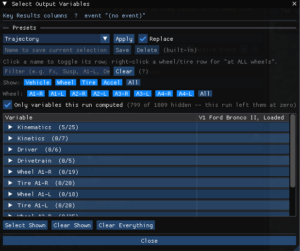

*Figure 5-7: The Select Output Variables window, used for choosing the variables shown in Key Results.*

Now, we're ready to execute the event.

- Press **Run** on the playback bar under the viewport. When the run is complete, press **Play** to watch the vehicle strike the curb.

The EDVSM event is shown in Figure 5-8.

*Figure 5-8: The EDVSM Curb-tripped Rollover event in the HVE 2027 viewport, at t = 10.3 s as the vehicle reaches the curb.*

!!! note "HVE 2027"
    In HVE the simulation terminates with an error at 10.8 s, because the vehicle travels beyond the terrain boundary: the body contact model finds a vertex with no terrain beneath it and ends the run. HVE 2027 treats such a vertex as not touching the ground, so the run continues to the 15 s maximum time, and the run status reports *vehicle partly over unmapped terrain: 64.9% of body-vertex ground queries found no surface, at worst 2606 vertices at once*. Up to 10.8 s the two runs agree (final position within 1 mm). Treat the part of the run after the vehicle leaves the mapped site as unsupported by terrain.

> **NOTE:** While the event plays, watch the current results in the Key Results window.

We have now completed the first event.

### Creating Tire Blow-out Simulations

The next four events in our Tutorial use EDVSM to study the vehicle's response to a loss of pressure at various tire locations during a cornering maneuver. In this parameter study, we will change only the wheel location at which the blow-out occurs, so any difference in vehicle response is attributable solely to the location of the blown tire. To simplify our study, we'll use the current environment.

To study the effect of a blow-out at the right front tire, perform the following steps:

- In Event Information, click **+** under *Events* to add an event, name it `R/F Tire Blow-out`, choose **EDVSM** as the *Method* and add *Ford Bronco II, Loaded* to it.

Now, we're ready to set up (i.e., supply *position, velocity, driver controls and tire blow-out parameters*) for the right front tire blow-out event.

- Under *Vehicle Initial Conditions (EDVSM)*, enter the initial position, X = `123` ft, Y = `0` ft. Its initial heading angle is 0 degrees and need not be modified.
- Enter the initial *Speed*, `50` mph.

The vehicle initial conditions are now established. Let's enter the driver controls. Only steering inputs need to be supplied:

- Open **Event › Driver Controls**, **Steer** tab. The table is steering-wheel angle against time, the option we'll use in our study.
- Enter the steering wheel angles, as shown below:

**Table 5-5: Steer Table entries for the EDVSM Blow-out Studies events. (The same table will be used for all blow-out simulation events.)**

| Time (sec) | Steer Angle at Steering Wheel (deg) |
|---|---|
| 1.00 | 0.0 |
| 1.50 | 45.0 |

Now, let's set up the HVE Tire Blow-out Model.

- Open **Event › Wheels** and choose the **Tire Blowout** tab (Figure 5-9). There is one column per wheel; *A1-R* is the right front.
- In the *A1-R* column, check **Blown**.
- Enter the *Blowout time (s)*, `3.0`.
- Enter the *Deflation time (s)*, `0.2`.
- Enter the *Stiffness factor*, `0.10`.

> **NOTE:** The Stiffness Factor reduces the tire's radial tire stiffness, cornering stiffness and camber stiffness.

- Enter the *Rolling resist. factor*, `10`.

> **NOTE:** The Rolling Resistance Factor increases the tire rolling resistance.

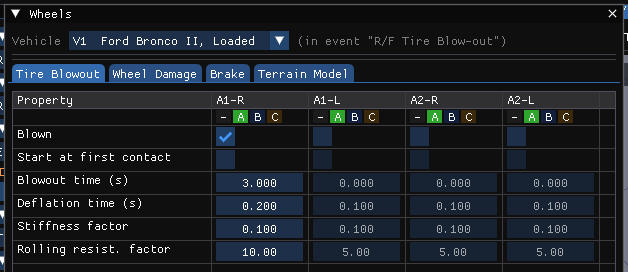

*Figure 5-9: The Wheels dialog, Tire Blowout tab, set up for the R/F Tire Blow-out event.*

!!! note "HVE 2027"
    The blow-out reaches EDVSM, and the four events below reproduce HVE's saved results. (The Wheels window notes that EDVSM does not read wheel damage, which is a different page.)

Now, we're ready to execute the event.

- Press **Run** on the playback bar. The simulation runs to t = 5.00 seconds. Press **Play** to watch it; the view cube's **Top** face (top-right corner of the viewport) and the CG path (**Output › Playback Options**, *CG Path*) show the path best.

To study the effect of a blow-out at each of the other three tires, add three more events in the same way: `L/F Tire Blow-out`, `R/R Tire Blow-out` and `L/R Tire Blow-out`. Each uses the same initial position (X = `123` ft, Y = `0` ft), the same initial speed (`50` mph), the same steer table (Table 5-5) and the same blow-out parameters (3.0 s, 0.2 s, 0.10, 10). The only difference is the column in which **Blown** is checked:

| Event | Wheels column |
|---|---|
| L/F Tire Blow-out | A1-L |
| R/R Tire Blow-out | A2-R |
| L/R Tire Blow-out | A2-L |

Run each event in turn. The results of all four are summarized in Table 5-6.

We have now created four events simulating a tire blow-out. The only difference in these events is the location of the blown tire. Thus, any differences in vehicle behavior are attributable solely to the location of the blown tire.

**Table 5-6: Results of the four blow-out events at t = 5.0 s, as run by HVE 2027 from EDC's tutorial case. HVE's own saved results agree to the figures shown. Final X and Y are earth-fixed; the start position is X = 37.49 m (123 ft), Y = 0.**

| Event | Final X (m) | Final Y (m) | Heading change (deg) | Speed (km/h) |
|---|---|---|---|---|
| R/F Tire Blow-out | 135.38 | 27.67 | 45.54 | 70.27 |
| L/F Tire Blow-out | 137.36 | 25.05 | 35.95 | 70.65 |
| R/R Tire Blow-out | 130.92 | 29.86 | 79.82 | 62.28 |
| L/R Tire Blow-out | 131.24 | 25.16 | 232.62 | 46.56 |

### Observations

Note the vehicle is in a right turn, thus the vertical tire force is shifted from the right-side to the left-side tires. As a result, the left-side (outside) tires are more heavily loaded and produce a greater portion of the cornering force.

It follows, then, that a blow-out in the left-side tires should have a greater effect on vehicle handling and controllability. This fact is confirmed by the simulation results.

Note also the difference in vehicle cornering response for blow-outs at the front tires compared to the rear tires. Front tire blow-outs cause the vehicle to *tend* to maintain a straight-ahead path, or *plow*. This is generally referred to as an *understeer* characteristic. For rear tire blow-outs, the vehicle tends to become unstable and spin out. This is generally referred to as an *oversteer* characteristic. Oversteer is generally considered an undesirable characteristic, although a small tendency for oversteer is often designed into high-performance vehicles.

Spend a few minutes reviewing each event, noting how the location of the blown tire affects response. You'll find this procedure useful the next time you need to reconstruct an accident involving a tire blow-out.

It is quite instructive to look carefully at all tire forces ($F_{x'}$, $F_{y'}$, $F_{z'}$) before, during and after the blow-out to learn exactly how a blown tire affects vehicle behavior.

> **NOTE:** Look carefully; you'll see a lot of interesting phenomena taking place.

You might also find it interesting to change the amount and timing of the steering and introduce braking to observe the effect on vehicle behavior for the various blown-tire locations. The blow-out model is extremely powerful! For additional information about vehicle response to tire blow-out, see reference [8].

One final, but very important point: This tutorial involves a Ford Bronco II. This particular vehicle was selected because it was included in a rigorous validation study involving vehicle rollover [6]. In this study, the vehicle was subjected to extremely violent experimental conditions (i.e., curb-tripped impact) in an effort to induce a rollover response. The Ford Bronco II's response to these conditions, as well as to the tire blow-out simulations included in this tutorial, is substantially the same as the response of other multi-purpose vehicles.

*(updated: The original manual cited reference [7] for tire blow-out response; the correct citation in the Chapter 7 reference list is [8], Blythe, Day, Grimes, "3-Dimensional Simulation of Vehicle Response to Tire Blow-outs," SAE 980221.)*

## Viewing Results

Now that we have produced our EDVSM simulations, let's take a detailed look at the results. In HVE 2027 the results of the event you last ran are shown in the Event editor's viewport and through its **Output** menu; the **Playback** editor (F6) is only for playing several events in sequence.

EDVSM produces the following reports:

- **Messages** — A list of messages produced by the current run
- **Accident History** — A table of initial and final positions and velocities
- **Driver Data** — The driver control tables used in the run
- **Environment Data** — A list of the visual and physical environment parameters used by EDVSM
- **Vehicle Data** — A series of tables containing the vehicle data used by EDVSM, including tire blow-out information
- **Program Data** — A table containing program control information
- **Variable Output** — A table containing user-selectable, time-dependent simulation results
- **Trajectory Simulation** — The event played back in the viewport
- **Damage Profiles** — Not available as a separate view in HVE 2027 (see below)

> **NOTE:** Our tutorial uses the Curb-tripped Rollover event to illustrate the procedures for viewing output reports. Select the event as the *Active Event* in Event Information and run it; the reports then describe that run. The same procedures apply to any of the events in the case.

### Report Windows

The six alpha-numeric reports are pages of a single window. To view them:

- Choose **Output › HVE Reports**. The HVE Reports window is displayed with one tab per page: *ACCIDENT HISTORY*, *DRIVER DATA*, *ENVIRON DATA*, *MESSAGES*, *PROGRAM DATA* and *VEHICLE DATA*.
- Click a tab to display that page.

The following pages illustrate the reports produced for the *Curb-tripped Rollover* event.

### Messages

EDVSM produces a number of messages, depending on the outcome of the event. For a complete listing and explanation of the messages, refer to [Chapter 6](06-messages.md).

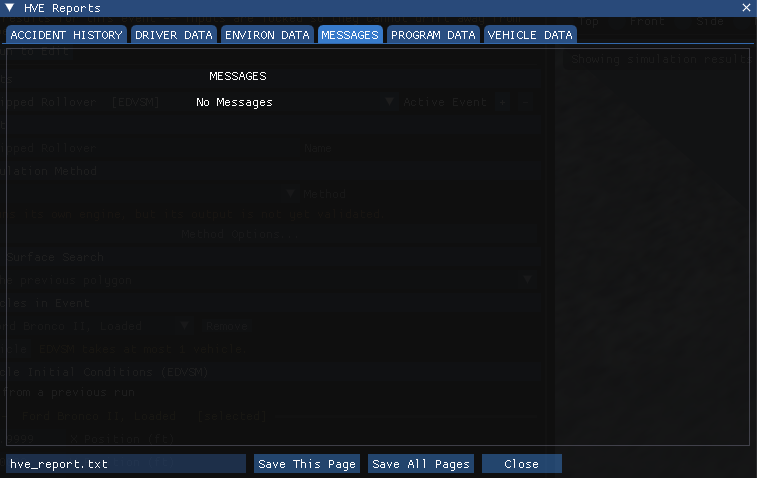

*Figure 5-10: The MESSAGES page for the Curb-tripped Rollover event.*

### Accident History

The Accident History report displays the time and total distance traveled, as well as the position and velocity at the start and end of the run.

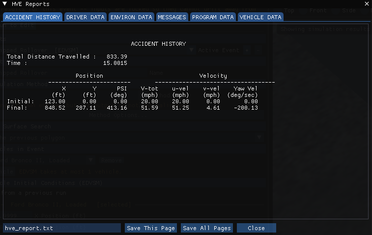

*Figure 5-11: The ACCIDENT HISTORY page for the Curb-tripped Rollover event.*

### Environment Data

The Environment Data report displays the physical and visual parameters describing the environment.

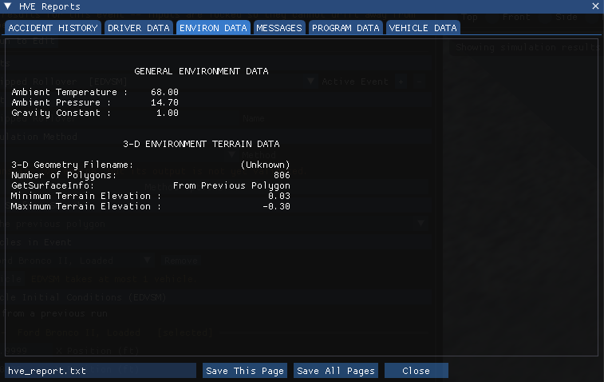

*Figure 5-12: The ENVIRON DATA page for the Curb-tripped Rollover event.*

### Vehicle Data

The Vehicle Data report for EDVSM contains all the vehicle data groups (Sprung Mass, Suspension, Tire, Brake and Driver Controls).

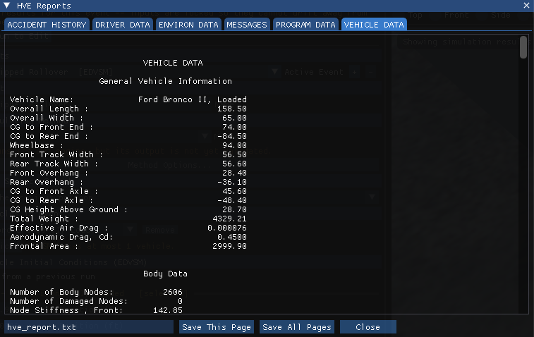

*Figure 5-13: The start of the VEHICLE DATA page for the Curb-tripped Rollover event.*

> **NOTE:** The EDVSM Vehicle Data report is too large to fit in the window. Scroll to view the entire report.

### Program Data

The Program Data report includes the simulation control parameters and other run-time information.

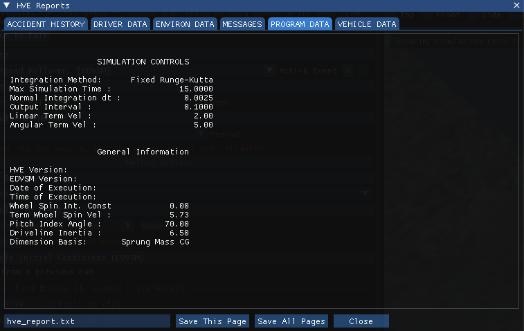

*Figure 5-14: The PROGRAM DATA page for the Curb-tripped Rollover event.*

### Variable Output

The Variable Output report is a table of user-selectable, time-dependent simulation results for the current event. In HVE 2027 it is **Output › Key Results**.

#### Variable Selection

The purpose of our EDVSM study is to illustrate a rollover sequence. To document the resulting path, as well as some other pertinent results, let's select the CG path coordinates, velocity and acceleration.

- Choose **Output › Variable Selection**. The **Select Output Variables** window is displayed (see Figure 5-7). The Kinematics group is listed first.
- Select *X, Y, Z, Roll, Pitch, Yaw, V-tot, Sideslip, u-vel, v-vel, w-vel, Roll Vel, Pitch Vel, Yaw Vel, Acc-tot, Fwd Acc, Lat Acc, Vert Acc, p-dot, q-dot* and *r-dot* from the list.

> **NOTE:** Feel free to add additional variables. You might be especially interested in the tire forces.

Key Results for the *Curb-tripped Rollover* event now includes the selected results, and **Output › Export Variables** writes them to a file. **Output › Output Graph** plots channels against time; choose them with its own **Select Variables…** button.

### Trajectory Simulation

The trajectory plays back in the Event editor's viewport (see Figure 5-16). To visualize the motion, use the playback bar under the viewport:

- Click **Play**. The simulation plays at the current playback speed.
- Click **Pause**. The simulation stops.
- Click **<<** or **>>** to step backward or forward one output step.
- Click **|<** to return to the start, or **>|** to advance to the end of the run.
- Drag the time scrubber, or type a time in the field beside it, to jump to any instant.

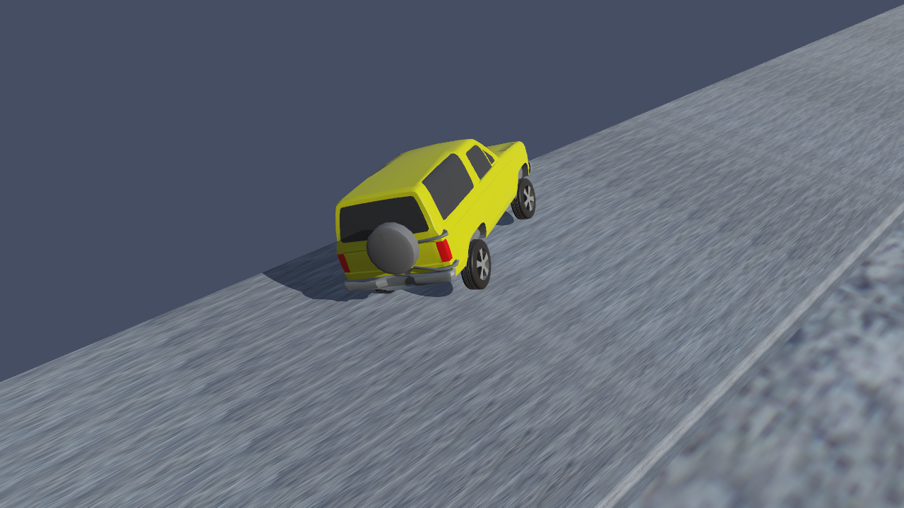

*Figure 5-16: The Curb-tripped Rollover event played back in the viewport, at t = 10.8 s.*

### Damage Profiles

!!! warning "Not in HVE 2027"
    HVE 2027 has no separate Damage Profile viewer. The number of body nodes the rollover model damaged is on the *VEHICLE DATA* page; for this event it is 0.

### Printing

HVE 2027 does not print directly. To print a report, save it to a file and print the file:

- In the HVE Reports window, type a file name in the box at the bottom and click **Save This Page** (or **Save All Pages** for every page).
- For the Variable Output, use **Export CSV…** in Key Results, or **Output › Export Variables**.

> **NOTE:** A page saved as TEXT is laid out in spaces for a fixed-width font. Open it in a text editor with a monospaced font before printing it, or use **Save Page as HTML**, which lays the page out as tables.

<!-- NAV -->

---

← Previous: [Chapter 4 — Calculation Method](04-calculation-method.md)  |  [Index](README.md)  |  Next: [Chapter 6 — Messages](06-messages.md) →

<!-- /NAV -->
