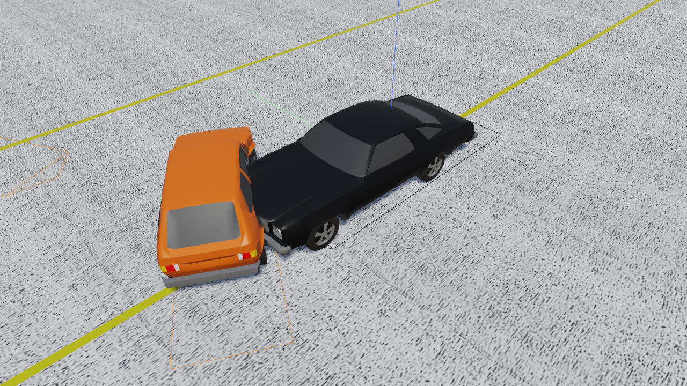

# Chapter 1 — SIMON Program Description

## Overview

SIMON (**SI**mulation **MO**del **N**on-linear) is a dynamic simulation of the response of one or more vehicles to driver inputs, inter-vehicle collision(s) and factors related to the environment (e.g., terrain, atmosphere). SIMON is a simulation model built on a general-purpose 3-D vehicle dynamics engine developed by Engineering Dynamics Corporation. The dynamics engine allows a sprung mass with six degrees of freedom and multiple axles with up to five degrees of freedom per axle. SIMON was specifically designed to take advantage of the rich feature set available in the HVE simulation environment, including the HVE Brake Designer, Driver Model and Tire Blow-out Model.

## General Features and Capabilities

Each SIMON vehicle may have up to three axles (six axles for full trailers) and single or dual tires.

!!! tip "New in HVE 2027"
    HVE 2027's SIMON accepts up to **four** axles per vehicle, so a truck with a tag (self-steering or lift) axle can be modelled as one unit. HVE's SIMON stops at three. See [Chapter 2, Vehicles](02-program-input.md#vehicles).

Independent and solid axle suspensions are allowed. SIMON may be used for numerous types of simulation studies. Applications for SIMON include:

- **Single Vehicle Simulation** — SIMON's 3-D simulation model incorporates robust tire and suspension models required for vehicle handling simulation studies, including rollover.
- **Articulated Vehicle Simulation** — SIMON also simulates the dynamics of articulated multi-vehicle trains. The model is general and allows the user to model virtually any vehicle/trailer configuration.
- **Collision Simulation** — SIMON incorporates DyMESH, a general-purpose, 3-D collision model for simulating vehicle-to-vehicle and vehicle-to-barrier collisions.
- **Vehicle Design** — SIMON may be used for vehicle design projects involving suspension, brake (including ABS), tire and steering systems. Using SIMON, these systems may be optimized on the computer before expensive prototyping and testing begins. Parametric studies involving in-use factors, such as weight distribution changes due to occupant loading and payload location, may also be performed.
- **Safety Research** — Safety researchers may use SIMON for reconstructing most crashes involving single or multiple vehicles. Human, vehicle and environment factors may be simulated and evaluated to assist in performing detailed crash studies.

*Figure 1-1: A SIMON event in HVE 2027 — EDC's RICSAC 6 DyMESH validation case (Chevelle into Rabbit) during the impact.*

## Model Inputs

SIMON inputs include one or more vehicles. Articulated vehicles are created from individual unit vehicles using compatible front and rear connections. Full trailers are created using a semi-trailer and a front dolly.

Human occupants may also be included in SIMON. Placing a human in a vehicle affects the vehicle's inertial properties and weight distribution; however, human motion relative to the vehicle is not modeled.

An environment is optional. If supplied, the environment may be a simple flat surface or complex 3-D digital terrain map (DTM) from a total station survey. An unlimited number of friction zones may be supplied.

## Model Outputs

SIMON output reports include the following HVE Output Reports:

- Accident History
- Damage Data
- Damage Profiles
- Driver Controls
- Environment Data
- Event Data
- Human Data
- Messages
- Program Data
- Trajectory Simulation
- Variable Output
- Vehicle Data

!!! note "HVE 2027"
    In HVE 2027 the outputs are not added as Playback Editor windows. The engine's own report pages (Accident History, Damage Data, Driver Data, Environment Data, Event Data, Human Data, Messages, Program Data, Vehicle Data) are shown in **Output › HVE Reports...**; the time-based results are in **Output › Key Results** and **Output Graph**; and the trajectory and damage are played back in the 3-D viewport of the Event editor, or with other solved events on one timeline in the **Playback (F6)** editor. See [Chapter 3](03-program-output.md).

## Validation

The validation of SIMON for unit vehicle (UV), articulated vehicle (AV) and vehicle collision (VC) simulation has been completed and is available in Reference 17. A summary of the validation test matrix is shown in Table 1-1.

This test matrix represents a cross-section of the types of events for which SIMON was intended. It is anticipated that additional validations will be published as they are performed.

**Table 1-1 SIMON Validation Study. Matrix of test configurations.**

| Test | Description | Validation By |
|------|-------------|---------------|
| UV-1 | Passenger Car Combined Steering and Braking [12] | Experiment, EDVSM |
| UV-2 | Passenger Car Alternate Ramp Traversal [12] | Experiment, EDVSM |
| UV-3 | Light Truck Rollover [13] | Experiment, EDVSM |
| UV-4 | Straight 3-Axle Truck (30 mph), Combined Braking and Steering [14] | Experiment, EDVDS |
| AV-1 | Chevrolet Pickup (55 mph) towing Open-wheel Utility Trailer, ISO Lane-change with braking | EDSMAC4 |
| AV-2 | Tractor-trailer (27 mph), Combined Braking and Steering (U of M) [14] | Experiment, EDVDS |
| VC-1 | 1992 Ford Explorer (45.9 mph) vs. 1984 Ford F-150 Pickup (46.1 mph), 55 Degree Angled Impact [15] | Experiment, EDSMAC4 |
| VC-3 | 1974 Ford Torino (21.23 mph) vs. 1974 Ford Pinto (0 mph), 10 Degree Offset Rear-end Impact (Calspan, RICSAC 3) [16] | Experiment, EDSMAC4 |
| VC-7 | 1974 Chev Chevelle Malibu (31.53 mph) vs. 1974 Ford Pinto (31.53 mph), 60 degree Angled Impact (Calspan, RICSAC 2) [16] | Experiment, EDSMAC4 |
| VC-8 | 1974 Chev Chevelle Malibu (21.47 mph) vs. 1975 Volkswagen Rabbit (21.47 mph), 60 degree Angled Impact (Calspan, RICSAC 6) [16] | Experiment, EDSMAC4 |
| VC-11 | 1974 Honda Civic CVCC (31.35 mph) vs. 1974 Ford Torino (31.35 mph), 90 Degree Angled Impact (Calspan, RICSAC 10) [16] | Experiment, EDSMAC4 |

## Basic Procedure

The procedure for using SIMON is the same as for any simulation model in HVE 2027:

- Optionally, in the **Human (F2)** editor, add one or more occupants to the case.
- In the **Vehicle (F3)** editor, add one or more vehicles (**Add...** in the *Vehicles* panel searches the vehicle databases). Optionally, edit any of the vehicle parameters from the **Vehicle** menu.
- Optionally, in the **Environment (F4)** editor, set up the environment (**Environment › Environment...**) and load a 2- or 3-dimensional terrain.
- In the **Event (F5)** editor, open **Event › Event Information...** and:
  - Create an event with the **+** button beside **Active Event**.
  - Choose **SIMON** as the **Method** under **Calculation Method**.
  - Add the vehicles under **Vehicles in Event** in the desired order.

    > **NOTE:** The order determines how articulated vehicles are connected: a vehicle without a front connection is assumed to be a unit vehicle or the first vehicle in a vehicle train.

  - Optionally, add occupants under **Humans in Event**.
- Set up the event. For each vehicle in the event:
  - Position the vehicle and supply a velocity (the *Vehicle Initial Conditions (SIMON)* section of Event Information, or **Event › Position / Velocity...**).
  - Optionally, assign Driver Controls (**Event › Driver Controls...**: Throttle, Brake, Steer, Gear) or the HVE Driver Model (**Event › Path Follower...**).
  - Optionally, assign a collision pulse (**Event › Collision Pulse...**).
  - Optionally, assign a payload (**Event › Payload...**).
  - Optionally, assign tire blow-out, wheel damage, brake failure and temperature, and tire-terrain data (**Event › Wheels...**).
  - Optionally, assign locations for one or more accelerometers (**Event › Accelerometers...**).
- Execute the simulation: **Run** on the playback bar under the viewport, or **Output › Run Simulation...**.
- Modify the initial conditions, driver controls and other parameters as required to achieve the desired match between simulation and test conditions. Press **Reset** before editing an event that has results on screen: a solved event's inputs are read-only until it is reset.
- Review the results from the **Output** menu and by playing the event back in the viewport.
- If desired, record a movie of the simulation (**File › Record Animation...**).

<!-- NAV -->

---

← Previous: [SIMON — Simulation Model Non-Linear](README.md)  |  [Index](README.md)  |  Next: [Chapter 2 — SIMON Program Input](02-program-input.md) →

<!-- /NAV -->
