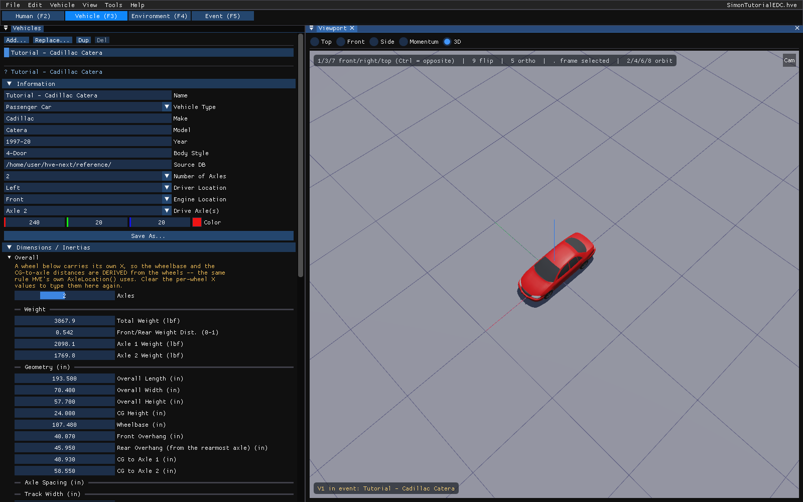
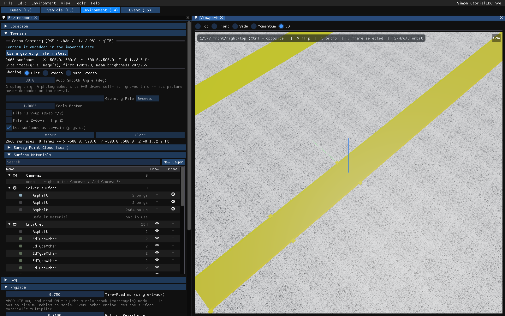
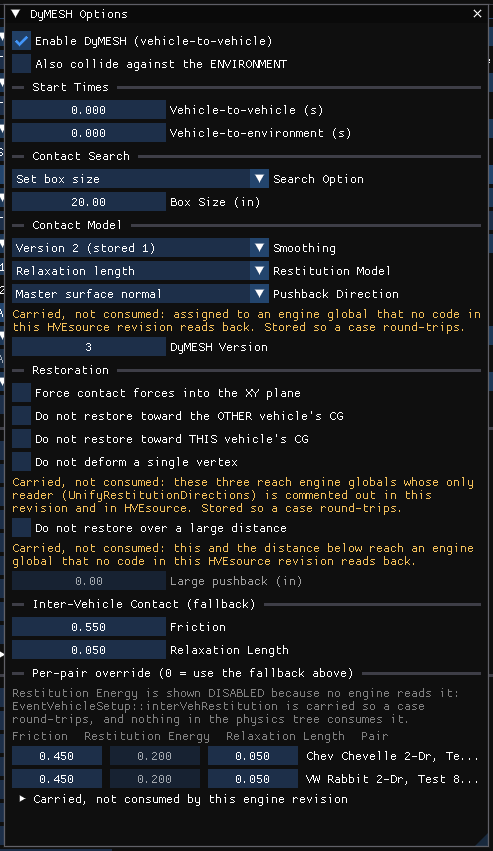
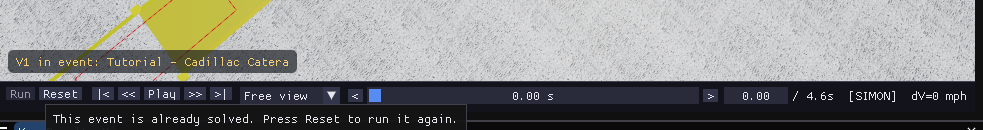

# Chapter 2 — SIMON Program Input

This chapter defines the objects (humans, vehicles and environment) and the event set-up parameters (positions, velocities, driver controls, and so forth) used by the SIMON analysis. In general, the chapter is divided into the following sections:

- **Objects** — The number of humans and vehicles, and the specific human, vehicle, and environment parameters actually used by SIMON.
- **Events** — The various HVE options available for setting up and executing a SIMON event.

## Objects Overview

The objects used by the SIMON model are:

- **Humans** — Human occupants may be placed in vehicles in SIMON, and human pedestrians may be placed in environments in SIMON.
- **Vehicles** — An infinite number of vehicles may be studied by SIMON.
- **Environment** — Like the *real* world, SIMON has exactly one environment.

> **NOTE:** The environment is used in any HVE-compatible reconstruction or simulation model.

The following sections describe how the humans, vehicles and environment provide the required inputs to the SIMON calculation model.

## Humans

SIMON uses humans created in HVE 2027's Human editor. A human is added to the case in the **Human (F2)** editor, where the *Occupants* panel (**Occupant › Human Information...**) holds its identity and anthropometry (location, sex, age, weight and height percentiles).

To place an occupant in a SIMON event, open **Event › Event Information...** in the **Event (F5)** editor and add the human under **Humans in Event**. SIMON carries each occupant rigidly with the vehicle it rides in.

> **NOTE:** SIMON is not a human simulator. During simulation, the human occupants do not move relative to the vehicle.

The following human parameters are used by SIMON:

- Inertia
  - Weight

### Inertia

#### Weight

SIMON uses the total weight of the human in order to adjust the inertial properties of the vehicle sprung mass. The weights of all ellipsoids are added together to compute the total human weight. The total weight is applied to the vehicle at the vehicle-fixed coordinates of the pelvis CG. Neither the rotational segment inertias nor the body configuration is used by SIMON.

## Vehicles

SIMON uses vehicles created in HVE 2027's Vehicle editor (**Vehicle (F3)**). Vehicles come from the vehicle databases (HVE's own `.vdb` databases and generics, as well as vehicles carried in an opened `.hve` case). SIMON supports all vehicle types: *Passenger Car, Pickup, Van, Sport-Utility, Truck, Trailer, Dolly, Fixed Barrier* and *Movable Barrier*.

Each vehicle also has the following user-editable parameters, in the *Information* section of the *Vehicles* panel and in **Vehicle › Vehicle Information...**:

- **Number of Axles** — SIMON supports 0-, 1-, 2-, 3- and 4-axled vehicles.
- **Driver Location** and **Engine Location** — not used by SIMON.
- **Drive Axle(s)** — SIMON supports all drive axles.

!!! tip "New in HVE 2027"
    HVE's SIMON accepts at most three axles per vehicle. HVE 2027's SIMON accepts **four**, so a truck with a tag axle can be modelled as a single unit; combine a fourth axle with the per-axle steer degree of freedom (see [Steering System Data](#steering-system-data)) for a self-steering tag axle.

To add a vehicle to the case:

1. Choose the **Vehicle (F3)** editor.
2. Click **Add...** in the *Vehicles* panel. A searchable list of the loaded vehicle databases (and HVE's generic vehicles by type and class) is displayed.
3. Pick a vehicle. It is added to the case and, in the Event editor, to the active event.
4. Edit its name in the *Information* section if desired. The name does not affect calculations.

The vehicle's parameter groups are edited from the **Vehicle** menu (**Inertia / Mass...** and **Connections...** are in the *Vehicle Properties* section of the *Vehicles* panel; Steering System, Suspension Data, Tire Data, Tire Tables, Brake Assembly, Brake Designer, ABS / Brake Design, Drivetrain, Aero Dynamic Drag, Body Torsion, Vehicle Mesh, and so on).

*Figure 2-2: The HVE 2027 Vehicle editor, showing the Cadillac Catera from the SIMON tutorial case.*

The following Vehicle Parameter groups are used by SIMON:

- Sprung Mass
  - Inertias
  - Move CG
  - Connections
  - Aerodynamic Drag
  - Body Torsion
  - Geometry File
- Unsprung Mass
  - Suspension Data
  - Brake Data
  - Tire Data
  - Wheel Location
- Steering System
- Braking System
- Drivetrain
  - Engine
  - Transmission
  - Differential
  - Inertia
- Exterior Stiffness

The specific data used in each of the above parameter groups are defined in Tables 2-1 through 2-5.

### Sprung Mass

The Sprung Mass parameters are shown in Table 2-1. Information on each group is provided below.

**Table 2-1 Vehicle Sprung Mass Parameters Used By SIMON.**

| Parameter | Description |
|-----------|-------------|
| Sprung Weight | Weight of vehicle sprung mass |
| Sprung Mass Roll, Pitch and Yaw Inertia, and x-z Product of Inertia | Rotational inertia of sprung mass about the vehicle-fixed x, y and z axes, respectively, and x-z product of inertia |
| Move CG x, y, z | Relocates the CG in the vehicle-fixed x, y and z directions. This entry causes an automatic adjustment of all vehicle coordinate-related parameters (e.g., contact surface, belt anchor points). |
| Geometry File | Vehicle exterior 3-D mesh and dimensions used by DyMESH |
| Inter-vehicle Connections | Type, location, and properties of front and rear connections |
| Aerodynamic Drag | Drag coefficient, projected surface area, and center of pressure x, y, z coordinates for each surface or device that is defined as installed |

#### Inertias

SIMON uses the sprung vehicle weight (converted to mass according to the current gravitational constant; see Environment), as well as the roll, pitch, and yaw rotational inertia and x-z product of inertia of the sprung mass.

The total weight is often entered because it is the value traditionally obtained from data sources. However, the equations of motion require that the sprung mass be known. To obtain this value, SIMON simply deducts the weight of the suspensions and wheels from the total weight.

#### Move CG

Move CG is not directly used by SIMON, i.e., the current values do not show up in the SIMON results. However, in HVE the Move CG fields may be used in the Vehicle Editor to quickly move the vehicle's center of gravity; the x, y, z coordinates for the wheels and other vehicle-fixed components are updated to reflect the new CG location. (HVE 2027 offers its Move CG dialog on the Event menu of EDSMAC and EDSMAC4 events, and from the **Move CG...** button of the Crush Profile window of EDCRASH, EDSMAC and EDSMAC4 events.)

#### Geometry File

The Geometry File supplies the vehicle exterior vertex data used by DyMESH.

#### Contact Surfaces

Contact Surface parameters are not used by SIMON.

#### Belt Restraints

Belt Restraint parameters are not used by SIMON.

#### Airbag Restraints

Airbag Restraint parameters are not used by SIMON.

#### Inter-vehicle Connections

Inter-vehicle Connection parameters define the type, location and mechanical properties of the front and rear vehicle connections. The x, y, and z location is specified relative to the vehicle CG. The z coordinates for each vehicle determine the elevation at the connection point, and thus establish the pitch angle of the trailer.

Dollys may be either *fixed* or *converter* dollys. A fixed dolly is permanently attached to the front of the trailer and normally has a hinged drawbar. A converter dolly is removable. It normally has a hinged fifth wheel and a fixed drawbar. See Chapter 4 for more information about drawbar types and their characteristics.

The *Connection Friction, Radius* and *Maximum Articulation Angle* are only supplied for the rear connections.

> **NOTE:** Every trailer will have a pre-defined front connection. However, not every tow vehicle has a pre-defined rear connection. In HVE 2027, check the vehicle's connections with **Connections...** in the *Vehicle Properties* section of the *Vehicles* panel.

#### Drag Forces

Aerodynamic drag forces are allowed to act on up to six surfaces (front, rear, right, left, top, bottom) and two user-defined devices (e.g. front or rear wing). These forces are functions of projected area, *Aerodynamic Drag Coefficient*, wind speed and air density. By default, the front surface is assigned aerodynamic properties. Assignment of aerodynamic properties for other surfaces is left up to the user. See Chapter 4 for more information about aerodynamic drag forces.

### Unsprung Mass

The Unsprung Mass parameters used by SIMON are shown in Tables 2-2 and 2-3. Information on each group is provided below.

#### Wheel Location

SIMON allows for the definition of x, y, z coordinates for each wheel center without any assumption of vehicle symmetry. The specific parameters used by SIMON are shown in Table 2-2.

> **NOTE:** SIMON uses $z_{wheel}$ and the tire radius (see Tire Parameters) to calculate static CG elevation above ground.

> **NOTE:** It is possible, therefore, that one tire, on a four wheeled vehicle, could be out of contact with the ground in both static and dynamic conditions.

#### Brake

SIMON uses Time Lag and Time Rise in controlling brake torque application. Each wheel's brake assembly optionally can be described using the HVE Brake Designer (see HVE User's Manual, Section Eleven, Chapters 29 and 30, and reference 1). SIMON does not use the wheel brake system Antilock Effectiveness. Instead, SIMON uses the HVE ABS Model to simulate ABS. This is a robust, algorithm-driven ABS simulation model. See also Brake System (later in this chapter), HVE User's Manual, Chapter 31, *Anti-lock Braking Systems*, and references 10 and 11.

**Table 2-2 Vehicle Unsprung Mass, Wheel and Brake Parameters Used By SIMON.**

| Parameter | Description |
|-----------|-------------|
| Wheel Location | Vehicle-fixed x, y, z coordinates for each wheel |
| Brake Time Lag, Brake Time Rise | Time delay from initiation of pedal force to initiation of brake pressure at the wheel, and amount of time necessary to build up brake torque after pressure reaches the wheel |
| Brake Assembly Type, Brake Push-out Pressure, Brake Torque Ratio | Type of generic, disc, or drum brake (Brake Designer), and physical parameters of the brake system |
| Brake Proportioning Ratio, Brake Pstart | Ratio for splitting brake pressure between front and rear brakes, and pressure at which proportioning begins |
| ABS Wheel Data Parameters | Algorithm-dependent parameters used by the selected ABS model (see Brake System) |

#### Tire

SIMON uses a modified version of the EDC Semi-empirical Tire Model developed for EDVDS [2, 3]. The HVE tire parameters provide the following data groups:

- Physical Data
- Friction Table
- Cornering Stiffness Table
- Camber Stiffness Table
- Slip vs. Rolloff Table

SIMON's use of these parameters is described below and in Table 2-3.

##### Physical Data

The Tire Physical Data used by SIMON are shown in Table 2-3. The tire's unloaded radius is used to establish the vehicle's static CG elevation. Aligning torque is not used.

##### Friction Table

The Friction Data used by SIMON are shown in Table 2-3. At each time-step SIMON interpolates between the data in the Friction vs. Longitudinal Slip table to obtain the peak friction, slide friction, slip at peak friction and *Longitudinal Stiffness* for the tire's current load and speed. The interpolated peak and slide friction values are then multiplied by the friction multiplier of the terrain beneath the tire; the longitudinal stiffness is not. *(updated: earlier editions stated that the Longitudinal Stiffness value was used only when there was no slippage in the contact patch. It is interpolated and used at every time-step — see Chapter 4, Tire Model.)*

The *In-use Factor* is a convenient way to reduce or increase the dependent friction values (peak and slide friction) for all loads and speeds by making just one adjustment.

##### Cornering Stiffness Table

The Cornering Stiffness data used by SIMON are shown in Table 2-3. SIMON interpolates between the data in the $F_y$ vs. Slip Angle table to calculate cornering stiffness for the correct load and speed at each time-step.

The *In-use Factor* is a convenient way to reduce or increase the dependent cornering stiffness values for all loads and speeds by making just one adjustment.

> **NOTE:** If you are simulating a vehicle with a flat tire, you'll probably want to use the HVE Tire Blow-out Model (see Event).

**Table 2-3 Vehicle Unsprung Mass, Tire Parameters Used By SIMON.**

| Parameter | Description |
|-----------|-------------|
| Tire Unloaded Radius | Tire radius before any load is applied |
| Tire Initial and Secondary Deflection Rates, Deflection at Secondary Rate and Maximum Deflection | The initial spring rate of the tire, and the spring rate after a specified amount of tire deflection. The maximum deflection is used to determine when tire deflection exceeds an allowable value. |
| Pneumatic Trail | In the tire-fixed coordinate system, the x' coordinate of the center of pressure |
| Weight, Spin Inertia, Steer Inertia | The weight and rotational inertia (about the spin and steer axes) of the tire/wheel/brake assembly |
| Linear and Velocity Dependent Rolling Resistance Constant | Constants accounting for rolling resistance due to tire and terrain properties |
| Tire Friction Table, Test Load/Speed | The load and speed for a given set of friction results |
| Peak Longitudinal Friction, Peak Lateral Friction, Slide Friction, Slip at Peak Friction and Longitudinal Stiffness | Tire frictional and longitudinal stiffness properties at the specified load and speed |
| Friction In-use Factor | Multiplier for Longitudinal and Slide Friction |
| Tire Cornering Stiffness Table, Test Load and Speed | The load and speed for a given cornering stiffness value |
| Cornering Stiffness | Tire lateral force per unit of tire lateral slip for small amounts of lateral slip |
| Cornering Stiffness In-use Factor | Multiplier for Cornering Stiffness values |
| Tire Camber Stiffness Table, Test Load and Speed | The load and speed for a given camber stiffness value |
| Camber Stiffness | Tire lateral force per unit of inclination angle for small amounts of inclination angle |
| Camber Stiffness In-use Factor | Multiplier for Camber Stiffness values |

##### Camber Stiffness Table

The Camber Stiffness data used by SIMON are shown in Table 2-3. SIMON interpolates between the data in the $F_y$ vs. Inclination Angle table to calculate camber stiffness for the correct load and speed at each time-step.

The *In-use Factor* is a convenient way to reduce or increase the dependent camber stiffness values for all loads and speeds by making just one adjustment.

##### Slip vs. Rolloff Table

SIMON does not use either the longitudinal or lateral Slip vs. Rolloff Tables.

#### Suspension

The HVE Suspension Model provides the following data groups:

- Springs and Shocks
- Inertia
- Jounce/Rebound Stops
- Spindle Axis
- Camber Table
- Anti-pitch Table
- Roll Steer Table

SIMON supports all suspension types, including those with tandem axles. Independent suspension types do not use inertial properties (the weight of the suspension arms is ignored; the weight of the brake and wheel are included with the tire). Independent and solid axle suspension types use different camber and roll-steer parameters. Spindle axis is only available for steerable wheels (see Steering System). SIMON's use of these parameters is described below.

#### Inter-tandem Axle Load Transfer

Inter-tandem Axle Load Transfer is not used by SIMON.

#### Springs and Shocks

SIMON uses the individual spring rates for the right and left springs on an axle. They need not be equal.

Roll Center Height and Lateral Spring Spacing apply for each axle.

> **NOTE:** Remember that roll center height is measured from the sprung mass CG, and is positive downwards.

Damping properties, like spring rates, are applied to the right and left sides of each axle. They need not be equal.

The Spring and Shock data used by SIMON are shown in Table 2-4.

**Table 2-4 Suspension Mechanical and Geometry Parameters Used By SIMON.**

| Parameter | Description |
|-----------|-------------|
| Wheel Ride Rate | Linear force vs. Deflection characteristic measured at the wheel |
| Auxiliary Roll Stiffness | Moment per unit of body roll produced by the addition of an anti-sway bar |
| Roll Center Height | Vertical distance from the vehicle CG to the roll axis measured at the suspension |
| Lateral Spring Spacing | Lateral distance between right and left side suspensions |
| Shock Damping | Damping at wheel |
| Coulomb Friction and Friction Null Band | Coulomb friction and friction null band at wheel |
| Suspension Inertias | Weight and roll/yaw rotational inertia of the suspension, excluding wheels and brakes |
| Maximum Deflection at Jounce/Rebound Stop | Maximum suspension travel in jounce/rebound |
| Linear and Cubic Deflection Rates at Jounce/Rebound Stop | Linear and cubic stiffness rates of jounce/rebound stop |
| Energy Ratio of Jounce/Rebound Stop | Ratio of stop relaxation force to stop compression force |
| Caster | Rearward tilt of steering axis |
| Kingpin Inclination Angle | Inward tilt of steering axis |
| Stub Axle Length | Distance from steering axis to wheel center |
| Steering Offset (Scrub Radius) | Distance from wheel plane to steering axis at ground plane |
| Steering Stop Angles | Steer angle for right and left steering stops |
| Steering Stop Stiffness | Mechanical stiffness of steering stops |
| Camber | Camber and Half-track change as a function of jounce/rebound (constant camber value used for solid axle suspension) |
| Roll Steer | Constant, linear, quadratic, and cubic coefficient of roll steer (constant roll steer value used for solid axle suspension) |

#### Inertias

Inertial mass parameters do not include the weight of the brake assemblies or wheels (brake and wheel inertias are included with the tire). The Suspension Inertia data used by SIMON are shown in Table 2-4.

#### Jounce and Rebound Stops

The linear and cubic deflection rate of the suspension stops is the effective value at the wheel. Left and right side suspension stops are not assumed to be the same. The Jounce and Rebound Stop data used by SIMON are shown in Table 2-4.

#### Spindle Axis

Caster, kingpin inclination angle, stub axle length and steering offset are used to orient the wheel (wheel camber and inclination angles change as the wheel jounces and steers).

> **NOTE:** Wheel Camber (below) also affects wheel orientation.

Steer stop data (stop angles and stop stiffness) are used when the Steer Degree of Freedom option is selected.

#### Camber and Half-track Change Tables

A constant Camber value may be assigned at each wheel for a solid axle suspension.

Camber and half-track tables apply only to independent suspension types. The default properties for the right side and left side tires are the same, but they may be edited individually.

#### Anti-pitch

Anti-pitch force vs. Suspension jounce and rebound are not used by SIMON.

#### Roll Steer

A Roll Steer vs. Jounce/Rebound Table is used for independent suspension types; a single value is used for solid axles. The roll steer properties for the right and left side tires are not assumed to be the same.

### Exterior

The Vehicle Exterior Stiffness Data are used by the DyMESH collision routine within the SIMON physics model; see DyMESH manual.

### Steering System Data

SIMON uses the steering gear ratio if the *At Driver* Steering Table option is used during Event set-up (see Table 2-5). SIMON also uses steering column friction and friction null band, and steering column inertia if the Steer Degree of Freedom option is selected.

If the Steer Degree of Freedom Normal option is selected, SIMON ignores user-entered steering system data and computes steer angles based on driving surface inputs. If the Append option is selected, SIMON uses the user-entered steering system data until the last timestep for which data are entered; after that, the Steer Degree of Freedom model is used.

The steering system data used by SIMON are shown in Table 2-5. In HVE 2027 they are edited in **Vehicle › Steering System...** (one column per axle).

!!! tip "New in HVE 2027"
    **Steer degree of freedom per axle.** The *Steering System* dialog has a **Steer DOF (SIMON)** row with one setting per steerable axle — *Event default*, *Normal (free)*, *Append (free after table)* or *Auto start (free at contact)* — and a **Has steering column** checkbox per axle. *Event default* follows the Steer DOF chosen for the event in the SIMON Options dialog, which is HVE's behavior. Any other setting overrides it for that axle only, so the driver can keep steering the front axle from the steer table while a castoring tag axle finds its own angle from the tire forces. Clear **Has steering column** for an axle with no steering linkage: the column's inertia and friction are then left out of that axle's steer degree of freedom. HVE applies one Steer DOF setting to every steerable axle of every vehicle.

**Table 2-5 Steering System, Brake System, and Drivetrain Parameters Used By SIMON.**

| Parameter | Description |
|-----------|-------------|
| Steering Gear Ratio | Ratio of steering wheel angle to wheel angle |
| Steering Column Friction and Friction Null Band | Friction and friction null band of steering column |
| Steering Column Inertia | Rotational inertia of the steering column |
| Brake Pedal Ratio | Ratio of brake system pressure to pedal force |
| Engine Power vs. Speed Table | Tables of engine power vs. engine speed for open and closed throttle positions |
| Transmission Ratio | Ratio of engine to drive shaft rotation |
| Differential Ratio | Ratio of drive shaft to axle rotation |
| Drivetrain Inertia | Rotational inertia of the drivetrain |

### Brake System Data

The Brake System pedal ratio (system pressure per unit of pedal force) is used if the *Pedal Force* Brake Table option is used during Event set-up (see Table 2-5).

The Brake System Data also include the HVE ABS System Model option. If this model is invoked, SIMON uses the ABS System Data parameters and ABS Wheel Data parameters. See also HVE User's Manual, Chapter 31, *Anti-lock Braking Systems*, and reference 10.

> **NOTE:** See also Wheel Brake Data (Unsprung Mass Parameters) for related information.

!!! note "HVE 2027"
    Where the brake data live in HVE 2027: the brake pedal ratio and system pressure in **Vehicle › Brake System Pressure...**; time lag, rise time, proportioning and the per-wheel **Antilock (ABS)** checkbox in **Vehicle › Brake Assembly...**; the Brake Designer in **Vehicle › Brake Designer...**; and the ABS controller in **Vehicle › ABS / Brake Design... › ABS System...**.

!!! warning "Not in HVE 2027"
    **ABS Algorithms 3, 5 and 6 stop the run.** HVE's ABS System dialog offers six algorithms, and SIMON implements three of them: *Tire Slip*, *Bosch Version 1* and *Algorithm 4*. HVE 2027 offers all six under HVE's names and marks the other three "(not implemented)": with one of them selected, the run stops with error −5230 the first time ABS regulates a braking wheel, and the results cover only the part of the run before that. HVE's SIMON behaves the same way. Note also that *Bosch Version 1* enters regulation only when a wheel's spin acceleration falls below **Spin Accel Min**, and *Algorithm 4* only when it exceeds **Spin Accel Max**; if the wheels never reach that threshold the run is identical to one without ABS.

### Drivetrain Data

Engine power as a function of engine speed is defined for both wide-open throttle and closed throttle positions. The Drivetrain data (engine power vs. speed, transmission ratio, differential ratio, drivetrain inertia) are used if the *Percent Wide-open Throttle* option is used during Event set-up (see Table 2-7). Rotational inertia includes the engine, transmission, driveline, and differential.

The drivetrain data used by SIMON are shown in Table 2-5. In HVE 2027 they are edited in **Vehicle › Drivetrain...** (engine, transmission, differential and the Electronic Stability (ESS) section — see [Electronic Stability Systems](09-electronic-stability-systems.md)).

!!! note "HVE 2027"
    **Differential type changes the answer in HVE 2027.** HVE stores the differential's *Diff Type* (Open, Limited Slip, Locked) but its SIMON solves every differential as open — equal torque to both wheels. HVE 2027 adds a torque-biasing model: in the *Differential* section of the Drivetrain dialog, **Limited Slip** sends a torque difference of **Preload Torque** plus **Locking Coeff** times the axle torque toward the slower wheel, and **Locked** uses a locking coefficient of 1.0. **Open** is exactly HVE's behavior, so a case with open differentials (every case in EDC's own case library) gives HVE's answer. The difference shows only when the two wheels of a driven axle have different grip, and only under the *Pedal* throttle method.

The user-entered Power vs. Engine Speed Table defines the valid range of engine speeds for a given event. If the maximum engine speed in the table is exceeded, the simulation terminates with an error message (see Messages).

> **NOTE:** The typical solution to this problem is to shift sooner.

The transmission may have up to 12 forward ratios, plus reverse and neutral. The differential may have up to three ratios.

The transmission may be either manual or automatic. A manual transmission takes its gear from the driver's Gear table. An automatic transmission selects its own gear from the current engine speed and throttle position, using the vehicle's shift data — a minimum and maximum engine speed for shifting, and the upshift and downshift throttle positions at each. See Chapter 4, *Drive Torque — Gear selection*.

*(updated: automatic transmission support was not described in the Fifth Edition manual.)*

> **NOTE:** The *Use Clutch/Torque Converter* option is part of the event's Driver Controls rather than the vehicle's Drivetrain data. When it is selected, the engine is allowed to turn faster than the road speed implies while the transmission is in reverse or first gear. See Chapter 4, *Drive Torque — Clutch*.

## Environment

SIMON uses the environment set up in HVE 2027's Environment editor (**Environment (F4)**). The case has exactly one environment, edited in **Environment › Environment...**, whose sections are:

- **Location** — the site's place, date and time (they position the sun).
- **Terrain** — the scene geometry: a DXF, `.h3d`, `.iv`, OBJ or glTF file, or the site carried inside an opened `.hve` case. Without one, SIMON drives on a flat default ground plane.
- **Sky** — display only.
- **Physical** — ambient temperature and pressure, wind speed and direction, and gravity. Standing water, used by the hydroplaning models, is set per surface (see [Event Calculation Options](#event-calculation-options)).
- **Friction Zones** — patches of different grip drawn over the site.

### Creating an Environment

1. Choose the **Environment (F4)** editor.
2. Open **Environment › Environment...**.
3. In **Location**, enter or search for the site and set the date and time.
4. In **Terrain**, load the scene geometry file (or keep the geometry an opened `.hve` case brings with it).
5. In **Physical**, enter the ambient temperature and pressure, the wind speed and direction, and the gravity constant.

*Figure 2-3: The HVE 2027 Environment editor with the SIMON tutorial's ISO 3888 lane-change site.*

### Visual Data

The following visual parameters may be edited:

- **Environment Location** — The site's name, latitude, longitude and time zone (Environment dialog, **Location**).
- **Time and Date** — The local standard time and date for the event.

The visual data are not used by the event; they are provided for studies related to visibility at the time of an event (e.g., avoidability of an accident).

> **NOTE:** The visual data (Location, Time, Date and the direction of north) affect the lighting of the scene in the viewport only.

### Physical Data

The Physical Data groups are:

- Angle of X Axis
- Wind Speed and Direction
- Atmospheric Temperature and Pressure
- Gravity Constant
- 3-D Surface Geometry

The specific physical environment data used by SIMON are described below and in Table 2-6.

**Table 2-6 Environment Model Parameters Used By SIMON.**

| Parameter | Description |
|-----------|-------------|
| Angle of X Axis | The angle between the earth-fixed X axis and true North |
| Wind Speed and Direction | Local wind speed and direction relative to earth-fixed X axis |
| Atmospheric Temperature and Pressure | Local atmospheric temperature and pressure |
| Gravitational Constant | Local gravitational constant |
| 3-D Surface Geometry (Elevation, Friction Factor) | The polygon database used to create the 3-D environment describing the physical characteristics of the driving surface |

#### Angle Of X Axis

The angle of the X axis is used to position the earth-fixed coordinate system on the surface of the earth.

> **NOTE:** The angle is specified relative to true North. If you are using a compass to determine direction at the scene of an accident, you should provide a correction factor before entering this angle.

> **NOTE:** The angle of the X axis affects how you visualize a SIMON event because it affects the location of the sun.

!!! note "HVE 2027"
    HVE 2027 uses this angle only to place the sun. It is set as **North** in the sun settings of the Shader Editor (**View › Shader Editor**), and an opened `.hve` case brings its own value.

#### Wind Speed and Direction

SIMON uses Wind Speed and Direction together with vehicle velocity and exterior to calculate aerodynamic forces acting on the vehicle (see Chapter 4, Calculation Method).

> **NOTE:** Enter the wind direction relative to the earth-fixed coordinate system.

#### Atmospheric Temperature and Pressures

Atmospheric temperature and pressure are used to calculate the density of the air. The density, in turn, is used in the aerodynamic calculations.

#### Gravity Constant

The gravity constant converts mass to force. An object's mass and rotational inertias are properties that are the same throughout the universe; however, the weight of an object is dependent on the local gravitational constant.

#### 3-D Surface Geometry

The 3-D Surface Geometry is used by the tire model in SIMON to calculate the elevation, slope and friction multiplier for the current X, Y position of the tire.

Rapid changes in surface elevation, such as curbs, during one integration timestep may cause severe tire force causing the run to terminate. If this occurs, you should try reducing the integration timestep or smoothing, to the degree possible, the surface.

!!! note "HVE 2027"
    Each surface's friction multiplier comes from the friction assigned to the scene geometry's surface materials (**Environment › Environment... › Terrain**, *Surface Materials*). Whether the geometry is driven on is controlled by its **Use surfaces as terrain (physics)** setting in the same section.

## Event

SIMON events are created, set up and executed in HVE 2027's Event editor (**Event (F5)**, Figure 2-4). Each of these topics is described below.

### Creating An Event

A SIMON event is created in the *Event Information* panel (**Event › Event Information...**).

To create a SIMON event:

1. Choose the **Event (F5)** editor. The *Event Information* panel is displayed.
2. Click **+** beside **Active Event**. A new event is created (it takes the method of the event that was active) and becomes the active event.
3. Under **Calculation Method**, choose **SIMON** in the **Method** list. A method that cannot run the event's vehicles is marked "N/A for these vehicles", with the reason when you hover over it.
4. Under **Vehicles in Event**, click **Add Vehicle** for each vehicle, in the desired order. Each row is a vehicle *slot* (V1, V2, ...): choosing a different vehicle in a slot's list swaps the vehicle while keeping that slot's initial conditions and other event data.

   > **NOTE:** The order of the vehicles is important in SIMON, as in all HVE physics models. Trailers and dollys are attached to the vehicle immediately before them.

5. Optionally, add occupants under **Humans in Event**.
6. Under **Event**, edit the event **Name**. The name does not affect calculations.

If the event cannot be run as set up (for example, a vehicle with more axles than SIMON allows), the *Calculation Method* section says "Cannot run:" and gives the reason.

*Figure 2-4: The HVE 2027 Event editor with a SIMON event: the Event Information panel (left) and the viewport (right), with Run, Reset and the playback controls under the viewport.*

### Setting Up an Event

SIMON uses the following event set-up options. In HVE 2027 each is on the **Event** menu of the Event editor and edits the vehicle selected in its *Vehicle* list (or the vehicle selected in the viewport):

- Position/Velocity — Vehicles (*Vehicle Initial Conditions (SIMON)* in Event Information, or **Event › Position / Velocity...**)
- Position/Velocity — Humans (the occupant's vehicle, position and **Pose**, under **Humans in Event** in Event Information)
- Driver Controls (**Event › Driver Controls...** and **Event › Path Follower...**)
- Collision Pulse (**Event › Collision Pulse...**)
- Vehicle Mesh (**Event › Vehicle Mesh...** and **Event › DyMESH Options...**)
- Vehicle Payload (**Event › Payload...**)
- Vehicle Wheels (**Event › Wheels...**)
- Accelerometers (**Event › Accelerometers...**)

The specific Event Set-up data used by SIMON are defined in Table 2-7.

**Table 2-7 Event Set-up Parameters Used By SIMON.**

| Parameter | Description |
|-----------|-------------|
| Vehicle Initial Position | Earth-fixed X, Y, Z coordinates and roll, pitch, yaw angles of the vehicle sprung mass at the start of the simulation |
| Vehicle Initial Velocity | Total velocity and sideslip angle, and roll, pitch and yaw angular velocities at the start of the simulation |
| Human Initial Position | For occupants, the vehicle-fixed x, y, z coordinates and roll, pitch and yaw angles of the human pelvis segment; for pedestrians, the positions are defined in the earth-fixed coordinate system |
| Human Initial Velocity | Any initial velocity is ignored by SIMON |
| Driver Controls, Steer Table | Steer Table Option: Steering Wheel Angle vs. time, or Tire Steer Angle vs. time |
| Driver Controls, Brake Table | Brake Table Option: Brake Pedal Force vs. time, or Wheel Brake Force vs. time, or Percent Available Friction vs. time |
| Driver Controls, Throttle Table | Throttle Table Option: Percent Wide-open Throttle vs. time, or Tractive Force vs. time, or Percent Available Friction vs. time |
| Driver Controls, Gear Table | Gear Table Option: Transmission Gear vs. time, or Differential vs. time |
| Driver Controls, HVE Driver Model | Variable Steering control parameters, Neuro-muscular Filter |
| Collision Pulse | Pulse Table Type: vehicle-fixed force and moment vs. time (HVE 2027 passes only this type to SIMON; see Collision Pulse below) |
| Vehicle Mesh (DyMESH Only) | Weld Distance, Tessellation Length, Water-tight Status, Inter-vehicle Friction, Restitution |
| Payload | Location, Weight and roll, pitch and yaw moments of inertia of payload |
| Accelerometers | Vehicle-fixed x, y, z coordinates for up to five accelerometers |
| Wheels, Blow-out | Start time and Duration, stiffness factor, and rolling resistance factor for tire blow-out model |
| Wheels, Damage | Start time and Duration, Vehicle-fixed change in Wheel Coordinates and Camber, Percent of Lock-up Torque |
| Wheels, Brake | Initial Lining/Drum Temperatures, Stroke, and Start Time, Duration and Percent of Brake Failure |
| Wheels, Tire-Terrain | Tire-Terrain Model, Radial Spring Parameters, Sidewall Impact Parameters |

#### Position/Velocity

Like all simulations, SIMON requires initial positions and velocities to be supplied by the user.

Unit vehicles and tow vehicles are positioned relative to the earth-fixed coordinate system by supplying the X, Y, Z coordinates of the CG, and roll ($\Phi$), pitch ($\Theta$) and yaw ($\Psi$) angles about vehicle x, y and z axes, respectively.

In HVE 2027 these are entered in the *Vehicle Initial Conditions (SIMON)* section of the Event Information panel, one block per vehicle slot: **X Position**, **Y Position**, **Heading**, **Auto Position (settle onto terrain)**, **Z Height**, **This height is the SETTLED ride height**, **Speed**, **Sideslip** and **Yaw rate**, with roll and pitch angles and rates under **Advanced initial state**. **Event › Position / Velocity...** is a compact dialog with the same X, Y, Heading and Speed. A vehicle can also be moved in the viewport with the gizmo (G to move, R to rotate).

> **NOTE:** With **Auto Position** checked, Z, roll and pitch are taken from the terrain under the wheels. An imported HVE case keeps the height HVE entered and leaves Auto Position off.

Trailers and dollys are positioned relative to their respective tow vehicle by supplying the initial roll, pitch and yaw articulation angles. Roll and pitch are determined by the environment if Auto Position is selected. The default yaw articulation angle is 0.0 degrees.

The velocities of unit and tow vehicles are supplied in the form of a total velocity and sideslip angle.

> **NOTE:** The vehicle-fixed u (forward) and v (side) velocity components are calculated using the total velocity and sideslip angle. Vertical velocity is initially set to zero.

Trailer and dolly articulation angular velocities are assigned relative to the tow vehicle. The default angular velocities are 0.0 degrees/second.

For human occupants, positions are specified relative to the vehicle. Any initial velocity entered for an occupant is ignored by SIMON. The positions are used with the occupant body weights to adjust the weight and CG location of the sprung mass.

> **NOTE:** Pedestrians are not used by SIMON.

#### Driver Controls

SIMON uses the following Driver Controls. In HVE 2027 the four tables are the tabs of **Event › Driver Controls...** (**Throttle**, **Brake**, **Steer**, **Gear**), and the HVE Driver Model is **Event › Path Follower...**.

- **Steering** — A table of steering inputs as a function of time. Both input options (*At Driver* and *At Axle*) are supported by SIMON.

  > **NOTE:** If selected, the Steer Degree of Freedom Model will override any user-entered steering inputs, unless the Append Option is selected.

!!! note "HVE 2027"
    The **Steer** tab edits a steering-wheel angle table (*At Driver*). A road-wheel angle table (*At Axle*, HVE's "at the tires") is shown and editable on the same tab when the case carries one, as EDC's validation cases do, and then overrides the steering-wheel table; HVE 2027 has no control for starting a new one.

- **Brakes** — A table of braking inputs as a function of time. All input options are supported; in HVE 2027 the **Input Method** list on the **Brake** tab offers **Pedal (AT_DRIVER)**, **Wheel Force** and **% of Friction**.

  > **NOTE:** The Pedal Force option is recommended (see Chapter 4, Calculation Method).

  Antilock is not set on the Brake tab. SIMON regulates every wheel when the vehicle's **ABS Installed** (**Vehicle › ABS / Brake Design... › ABS System...**) or any wheel's **Antilock (ABS)** box (**Vehicle › Brake Assembly...**) is ticked, and an event can override it in **Event › Wheels... › Brake** (see [Vehicle Wheels](#vehicle-wheels)).

- **Throttle** — A table of throttle inputs as a function of time. HVE 2027's **Input Method** list on the **Throttle** tab offers **Pedal (AT_DRIVER)** (percent wide-open throttle through the engine model) and **% of Friction**; the **Use Clutch / Torque Converter** checkbox is on the same tab.

  > **NOTE:** The %WOT (Pedal) option is recommended (see Chapter 4, Calculation Method).

- **Gears** — A table of instructions for shifting gears as a function of time (0 = neutral, 1 = reverse, 2 = first gear, and so on).
- **HVE Driver Model** — Options for using the Path Follower, Speed Follower, and Neuro-muscular Filter. The HVE Driver Model is a closed-loop driver simulator which calculates driver input as a function of time (see Chapter 4 and [4]). In HVE 2027 it is **Event › Path Follower...**: **Use Path Follower**, then the **Method**, **Steering**, **Path**, **Speed Follower** and **Filter** tabs. The target path is entered on the **Path** tab as a table of points (X, Y, heading and speed), or by clicking points in the 3-D viewport; the vehicle's initial position is the first point. HVE's *Driver Comfort Level* is **Driver Comfort Level (g)** on the Method tab.

!!! note "HVE 2027"
    **The driver model stops per vehicle at an impact.** HVE's SIMON switches every vehicle's driver model off at the first collision anywhere in the event. HVE 2027 switches off only the driver model of a vehicle that is itself in the collision, so a following vehicle that is not involved keeps following its path. For a vehicle that is in the collision the result is the same as HVE's. (EDC's case library has no event where the two differ.)

!!! tip "New in HVE 2027"
    **Keep following through an impact.** The Path Follower dialog has a **Keep following through an impact** checkbox, per vehicle, off by default. Off is HVE's behavior: the path and speed followers stop at the vehicle's first collision and steering reverts to the steer table (an axle set to *Auto start* becomes a free steer degree of freedom). On, the follower keeps steering and pedalling toward its path through and after the impact. The driver model is not validated during a collision, so use it only when the vehicle's post-impact path is something you are asserting rather than solving.

!!! tip "New in HVE 2027"
    **Prescribed lean.** For a motorcycle (or any vehicle that already carries one), **Event › Driver Controls...** shows a **Lean** tab with **Prescribe the lean angle** and a lean-angle table. When it is checked, SIMON's body roll is driven from the table instead of being solved. Leaning does not steer the vehicle — supply the path as well — and nothing computes whether the machine would have stayed up. See also the [motorcycle chapter](../../new-features/09-motorcycles.md).

The Driver Controls Data used by SIMON are shown in Table 2-7.

#### Damage Profiles

The Damage Profiles data are not used by SIMON.

!!! note "HVE 2027"
    **Event › Damage Profiles...** is EDCRASH's measured damage and is disabled for a SIMON event. The vehicle's **3-D Node Stiffness**, the force law DyMESH collides with, is in **Vehicle › Crush Stiffness...**; the CRASH3 A/B/Kv sides in the same window are not read by SIMON.

#### Collision Pulse

SIMON supports a user-entered collision pulse table, available from **Event › Collision Pulse...** for the selected vehicle. HVE's SIMON reads three table types:

- **Force and moment vs. time** — vehicle-fixed force and moment components are applied at a user-specified vehicle-fixed location and added to the forces and moments acting on the sprung mass. The effect of non-modeled external forces (e.g., wind) may be studied using this option.
- **Velocity vs. time** — the vehicle's six velocity components are prescribed directly from the table.
- **Position vs. time** — the vehicle's earth-fixed position and orientation are prescribed directly from the table.

*(updated: the Fifth Edition manual described only the force and moment table type.)*

!!! warning "Not in HVE 2027"
    HVE 2027 passes only the **force and moment** table to SIMON. In the Collision Pulse dialog this is the **Impulse** entry of the **Pulse type** list, with the **Impulse centre X/Y/Z** (the vehicle-fixed point the force acts at; all zero applies it at the CG, producing no moment from the force). A **Position** or **Velocity** table is kept in the case but is not handed to SIMON, and the dialog says so; such a pulse does not move the vehicle. A pulse can also be generated from another event that contains the same vehicle.

#### Vehicle Mesh

The Vehicle Mesh options used by SIMON include the ability to tessellate the vehicle mesh, assign inter-vehicle friction and relaxation length values between the selected object and target objects. These options are used in vehicle collision simulations by the DyMESH 3-D collision algorithm. In HVE 2027 the *Vehicle Mesh* dialog (**Event › Vehicle Mesh...**, also on the Vehicle menu) assigns the vehicle's mesh file and, under **DyMESH Contact Mesh Preparation**, sets tessellation, maximum leg length and weld distance — for the vehicle, or for this event only with **This event states its own preparation**. The per-pair inter-vehicle friction and relaxation length are in the grid at the bottom of **Event › DyMESH Options...**.

#### Vehicle Payload

The Payload Data used by SIMON include the payload x, y, z coordinates relative to the vehicle's CG, and the payload rotational inertias. One payload may be entered per vehicle per event, in **Event › Payload...** (**Payload Exists**, the X, Y, Z location, mass or weight, and the roll, pitch and yaw inertias). SIMON computes a new sprung mass CG location and new sprung mass rotational inertias based on these data.

#### Vehicle Wheels

SIMON supports the Tire Blow-out Model [10], Wheel Damage option, HVE Brake Designer (HVE User's Manual, See Section Eleven and References 1 and 11) and the Tire-Terrain Model options. These options allow the user to study event-related phenomena at each wheel. The individual parameters are shown in Table 2-7.

In HVE 2027 these are the tabs of **Event › Wheels...**, one column per wheel with link groups so a value can be entered once for several wheels: **Tire Blowout**, **Wheel Damage**, **Brake** (initial lining and drum temperatures, S-cam stroke, and brake failure start time, duration and extent) and **Terrain Model** (*Point contact*, *Soft soil* or *Radial spring*, with the Sidewall Impact options under Radial spring).

!!! tip "New in HVE 2027"
    **Antilock per event.** HVE keeps antilock on the vehicle, so running the same vehicle with and without ABS means editing the vehicle between runs, and a saved case remembers only the last setting. The **Brake** tab of HVE 2027's Wheels dialog has an **Antilock brakes** list for this event only: *Use the vehicle's setting*, *Force OFF for this event* or *Force ON for this event*. When HVE's saved run of an imported case shows ABS active although the saved vehicle has it off (EDC's own SIMON tutorial case is one), HVE 2027 restores it for that event and says so.

!!! note "HVE 2027"
    **Brake failure needs an extent.** A failed brake's line pressure is reduced by the failure *extent* (a fraction from 0 to 1) ramped over the failure duration; an extent of 0 — the default — reduces nothing, so ticking the failure alone changes nothing. This is HVE's model.

!!! note "HVE 2027"
    **Brake temperatures.** The initial lining and drum temperatures are passed to SIMON, but the brake temperature model also needs rotor and drum thickness, density and specific heat, which HVE 2027 does not collect. The brake temperature output channels are therefore not computed: they show as absent ("--") rather than as numbers, and the run status names them.

#### Accelerometers

SIMON allows the user to place virtual accelerometers in the vehicle at up to five vehicle-fixed locations. These accelerometers can be used to track the total acceleration and acceleration components at various locations within the vehicle (e.g., specific seat locations). The accelerometer outputs are included in the Variable Output, Accelerometer group (see Chapter 3, Variable Output).

!!! note "HVE 2027"
    HVE 2027 stores accelerometers with the **vehicle**, not with the event: **Event › Accelerometers...** and **Vehicle › Accelerometers...** open the same list (**Add**, **Delete**, a name, a reference frame and the X, Y, Z mount position), and it applies to every event the vehicle is in.

#### Contacts

The Contacts data are not used by SIMON. (**Event › Contacts...** is disabled for a SIMON event.)

#### Restraints

The Restraints data are not used by SIMON.

### Event Calculation Options

*(updated: the SIMON Calculation Options dialog has grown considerably since the Fifth Edition manual, which described only three options — Tire Model Method, Steer DOF and Collision Acceleration Threshold.)*

!!! note "HVE 2027"
    SIMON's calculation options are in the *SIMON Options* dialog, opened with **Method Options...** under **Calculation Method** in the Event Information panel (Figure 2-4). Its sections are **Time Settings**, **Integration**, **Steering Degree of Freedom**, **Tire model**, **Hydroplaning**, **Solid Axle Inertia**, **Collision history and connections**, **DyMESH (mesh-to-mesh collision)** and **Termination Velocity**. Like every input of a solved event, they are read-only while that event's results are on screen; press **Reset** to edit them.

SIMON's Calculation Options include:

- **Tire Model Method** — A radio button defining the version of the EDC semi-empirical tire model used for the event. The current dialog offers *Semi-Empirical, Vers. 1*, *Semi-Empirical, Vers. 2* and *Semi-Empirical, Vers. 3*. **Vers. 3 is the default for a new event** and is the recommended choice; Vers. 1 and Vers. 2 are retained so that results from earlier releases can be reproduced. The three versions share the same structure and differ only in the treatment of the slip-angle function, the direction of the lateral force when a tire travels rearward, the limit placed on effective friction, and the handling of cornering and camber stiffness at very low wheel speeds — see Chapter 4, *Tire Model*, for the details. The selected version affects only the tire shear-force calculation; it does not change the radial force, rolling resistance or hydroplaning models. *(updated: the Fifth Edition manual showed only "Semi-Empirical" and a disabled "Magic Formula" option; the current dialog instead offers three versions of the semi-empirical tire model.)* In HVE 2027: the **Tire model** list (*Semi-empirical V1*, *V2*, *V3*); a case imported from HVE keeps the version it states.
- **Steer DOF** (Off/Normal/Append/AutoStart) — Selecting this option allows tire forces to affect wheel heading. This is equivalent to the driver taking their hands off the steering wheel. With *AutoStart*, the wheels follow the steer table until the vehicle is involved in a collision and respond to tire forces thereafter; both vehicles in the collision start together. See Chapter 4, *Steering System*, for what each setting does and for the moments acting on the steering system. *(updated: the AutoStart option has been added since the Fifth Edition manual.)*

  > **NOTE:** If Normal Steer DOF is selected, any user-entered driver control inputs will be ignored. If Append Steer DOF is selected, SIMON switches from user-entered driver control input to the Steer DOF at the time of the last entry in the Driver Steering Table.

  > **NOTE:** Using the Append option provides a powerful tool for simulating post-collision vehicle behavior during which the driver's hands come off the steering wheel.

  In HVE 2027: the **Steering Degree of Freedom** list (*Off*, *Normal*, *Append*, *Auto start*). It applies to every steerable axle whose own **Steer DOF (SIMON)** setting in the Steering System dialog is *Event default* (see [Steering System Data](#steering-system-data)).

- **Hydroplaning Model** (Off / NASA / NASA-TTI / Gallaway) — Selects the model used to compute tire hydroplaning on flooded road surfaces. The default is Off. Hydroplaning is evaluated only for tires in contact with an environment polygon whose object type is **Water**, and it requires the tire's *Nominal Pressure*, *Tread Width* and *Tread Depth* (Tire Physical Data); the Gallaway model additionally uses the water depth and the pavement macrotexture. Above the model's threshold speed the tire's friction switches to the water polygon's friction value. Hydroplaning cannot be combined with the Soft Soil tire-terrain model. See [Chapter 4 — Hydroplaning Model](04-calculation-method.md#hydroplaning-model) for the threshold equations and reporting. *(updated: option added since the Fifth Edition manual. A Blythe-Day label also exists in the resource file, but that model is not implemented — it is not offered in the dialog and is rejected by the engine.)*

!!! warning "Not in HVE 2027"
    **Blythe-Day refuses the run.** HVE names five hydroplaning models and SIMON implements four. HVE 2027's **Hydroplaning** list offers *Off*, *NASA*, *NASA-TTI*, *Gallaway* and *Blythe-Day (refuses the run)*: with Blythe-Day selected — which an imported case may state — SIMON stops at setup with stop code −5520 rather than running without hydroplaning. HVE's own SIMON refuses it the same way.

!!! note "HVE 2027"
    In HVE 2027 the standing water is a property of each surface: **Water Depth**, **Wet Friction** and **Texture Depth** on the surface's HVE Surface node in the Shader Editor, or on the **Default surface material** (**Environment › Environment... › Terrain**, *Surface Materials*) for ground with no surface of its own. With a water depth of 0 there is no water surface and the run reports hydroplaning off. The four models differ only in each tire's threshold speed, so above every threshold they give the same answer.

- **Connection Model** (Use Both Vehicles / Use Heavier Vehicle / Use Tow Veh Properties; HVE 2027: **Connection constraint**) — Selects which vehicle's properties govern the stiffness of an inter-vehicle connection (e.g., tractor-trailer articulation). The default is Use Heavier Vehicle. *(updated: option added since the Fifth Edition manual.)*
- **Connection Failure Start Time** (HVE 2027: **Connection failure start (s)**) — The earliest simulation time (sec) at which an inter-vehicle connection is permitted to fail. *(updated: option added since the Fifth Edition manual.)*
- **Solid Axle Inertia** (Use Axle Only / Use Axle + Wheels) — Selects whether solid-axle roll inertia is computed from the axle alone or from the combined axle and wheel inertias. The default is Use Axle + Wheels. *(updated: option added since the Fifth Edition manual.)* It has no effect on a vehicle with only independent suspensions; HVE 2027's dialog says how many solid axles the event's vehicles have.
- **Accident History Basis** (*Use Impact Force* / *Use Impact Acceleration*; HVE 2027: **Accident history basis**, *Impact force* / *Total acceleration*) — Selects the basis used by SIMON to detect the separation time reported in the Accident History report. With *Use Impact Force* (the default), the collision phase ends when collision contact between the two vehicles is lost. With *Use Impact Acceleration*, it ends either when contact is lost or when both vehicles' total acceleration falls below the Collision Acceleration Threshold, whichever comes first. The impact time is detected from collision contact in both cases. See Chapter 4, *Sprung Mass Impact Model — Impact and separation*. *(updated: option added since the Fifth Edition manual. Earlier descriptions stated that this option governs the detection of impact as well as separation; it affects separation only.)*
- **Collision Acceleration Threshold** (HVE 2027: **Threshold (g)**) — The total acceleration below which both vehicles must fall for the collision phase to be considered over. *(updated: in the current dialog this field is active only when the Accident History Basis is set to Use Impact Acceleration; its default value is initialized to the environment's gravity constant, i.e., 1 g. It is used to end the collision phase, not to begin it, and it does not gate the delta-V calculation.)*
- **Include Free Space** — A checkbox controlling how crush depth is reported in the Damage Data report. When unchecked (the default), the crush tables report crush depth excluding free space (*Crush Depth, Excl. Free Space*); when checked, the reported crush depth includes the free space between the exterior surface and the underlying crushable structure (*Crush Depth, Incl. Free Space*). *(updated: option added since the Fifth Edition manual.)*

!!! warning "Not in HVE 2027"
    HVE 2027 has no *Include Free Space* control; the Damage Data report is produced with the option's default (crush depth excluding free space).

!!! note "HVE 2027"
    The *SIMON Options* dialog also shows an **Integration** method list, disabled and marked "(inert)". SIMON's input processing always selects fixed-step Runge-Kutta whatever the case states — in HVE as in HVE 2027 — so the list only shows what runs. The step size is set in the *Simulation* panel (see [Simulation Controls](#simulation-controls)). The dialog's **Time Settings** and **Termination Velocity** are the same values as the *Simulation* panel's.

### DyMESH Options

*(updated: this section is new. In the current version of HVE, SIMON events include a separate DyMESH Options dialog, which controls the DyMESH 3-D collision algorithm. SIMON is the HVE simulation model that uses DyMESH.)*

In HVE 2027 the dialog is **Event › DyMESH Options...** (Figure 2-5); the most-used settings are repeated in the **DyMESH (mesh-to-mesh collision)** section of the SIMON Options dialog. No license is needed. The DyMESH model itself is described in the [DyMESH manual](../DyMESH/README.md).

*Figure 2-5: HVE 2027's DyMESH Options dialog for a SIMON event (EDC's RICSAC 6 validation case).*

The DyMESH Options dialog contains the following options:

**General:**

- **Use DyMESH** (HVE 2027: **Enable DyMESH (vehicle-to-vehicle)**) — Master checkbox enabling the DyMESH 3-D collision algorithm for the event. Every vehicle in the event should have a mesh file; a vehicle without one collides as HVE's generic body (a shape profiled from its type and dimensions), and HVE 2027 warns when that happens.
- **Include Environment** (HVE 2027: **Also collide against the ENVIRONMENT**) — Extends DyMESH collision detection to include vehicle-environment mesh contact (e.g., striking a rigid barrier or terrain feature), in addition to vehicle-vehicle contact.
- **Force To x-y Plane** (HVE 2027: **Force contact forces into the XY plane**) — Constrains the DyMESH collision force to act in the horizontal (x-y) plane.
- **Tow Vehicle / Trailer Contact** (HVE 2027: **Contact a vehicle's own trailer**, in the SIMON Options dialog) — Enables DyMESH mesh contact between vehicles joined by an inter-vehicle connection (e.g., jackknife contact between a tractor and its trailer).
- **DyMESH Version No** (Version 3 / Version 4) — Selects the version of the DyMESH collision algorithm. Version 4 turns on pushback reduction, which divides a contact's overlap between the two vehicles by their relative stiffness.
- **DyMESH Start Time** (sec) (HVE 2027: **Start Times › Vehicle-to-vehicle**) — Simulation time at which DyMESH vehicle-vehicle collision detection begins.
- **DyMESH Environment Start Time** (sec) (HVE 2027: **Start Times › Vehicle-to-environment**) — Simulation time at which DyMESH vehicle-environment collision detection begins.

**Advanced:**

- **Search Option** (Automatic / Set Box Size) — Selects the contact search method. Automatic sizes the collision search region from the mesh's own longest element side; Set Box Size uses the user-entered **Box Size** to define the search region surrounding each vehicle.
- **Smoothing Model** (Version 1 / Version 2) — Selects the mesh smoothing algorithm applied to the damaged vehicle mesh.

!!! warning "Not in HVE 2027"
    **Search all vertices refuses the run.** HVE lists a third search option. DyMESH does not implement it: HVE 2027 offers it as *Search all vertices (refuses the run)*, and with it the run stops at setup (stop code −5400), as HVE's does.

!!! note "HVE 2027"
    **Smoothing.** HVE 2027's **Smoothing** list shows HVE's labels with the value each stores (*Version 1 (stored 0)*, *Version 2 (stored 1)*, *Version 3 (stored 2)*). DyMESH detects contact at Version 1 (stored 0) and Version 2 (stored 1, the default for a new SIMON event); they schedule the contact test differently and give slightly different answers. A case that stores 2 or more would find no collision, so the solver runs it as Version 2 and the run status says so. Version 1 cannot be combined with DyMESH wheel contact (such a run is refused). The same choice is offered in the SIMON Options dialog.

!!! note "HVE 2027"
    **Options that reach no engine.** Several DyMESH options are stored and travel with the case but are not read by this revision of the DyMESH source — in HVE or in HVE 2027. HVE 2027 labels each in the dialog "Carried, not consumed": **Pushback Direction**; **Do not restore toward the OTHER vehicle's CG**, **Do not restore toward THIS vehicle's CG** and **Do not deform a single vertex**; **Do not restore over a large distance** and its **Large pushback** distance; and the search-related settings grouped under **Carried, not consumed by this engine revision** at the bottom of the dialog. In the per-pair grid, **Restitution Energy** is shown disabled for the same reason. **Restitution Model** only labels the run in the Program Data report. The event-level **Friction** and **Relaxation Length** under *Inter-Vehicle Contact (fallback)* are used only by a vehicle pair that states no values of its own in the per-pair grid below them; HVE's cases fill that grid, so on an imported case the per-pair values are the ones that count.

### Simulation Controls

SIMON uses the current simulation control parameters. In HVE 2027 they are in the *Simulation* panel (**View › Simulation**, docked beside Event Information), under **Simulation Controls**: **Duration (s)**, **Trajectory Timestep (s)**, **Collision Timestep (s)**, **Output Timestep (s)** and the linear and angular termination velocities. The panel shows only the fields the selected method reads; SIMON does not read the separation timestep or the integrator convergence controls. The Simulation Parameters used by SIMON are shown in Table 2-8.

> **NOTE:** The output time interval should be an even multiple of the vehicle trajectory integration timestep. For example, if the integration timestep is 0.02, the output interval might be 5 × 0.02, or 0.10.

**Table 2-8 Simulation Control Parameters Used By SIMON.**

| Parameter | Description |
|-----------|-------------|
| Vehicle Trajectory Integration Timestep | The integration timestep used by the numerical integration routine while no collision is in progress |
| Collision Integration Timestep | The integration timestep used while any pair of objects in the event is in contact. Collision forces change far more rapidly than trajectory forces, so a shorter timestep is used during the collision phase. See Chapter 4, *Sprung Mass Impact Model — Collision integration timestep* |
| Output Interval | The timestep at which results are recorded |
| Maximum Simulation Time | Maximum length of the run |
| Min Linear Velocity, Min Angular Velocity | The linear and angular velocities used to terminate the run (if the linear and angular velocities for all vehicles are simultaneously less than these termination velocities, the run terminates) |

### Get Surface Information Options

SIMON uses a surface-information search to determine on which environment polygon each tire is riding. This search looks below the X, Y coordinates of each tire contact patch (in the case of the Point Contact Tire-Terrain Model) or in the direction of the radial and sidewall springs (in the case of the Radial Spring and Sidewall Impact Tire-Terrain Models) to determine the friction and other characteristics of the terrain in the vicinity of the tire.

The default search method is *From Previous Polygon*. This results in fastest execution, but does not work for all environments. In HVE 2027 the search mode is chosen under **Road Surface Search** in the Event Information panel: *Default for this method* (tracks the previous polygon for SIMON), *All triangles - first hit in file order*, *Track the previous polygon*, or *Track the previous polygon, friction zones first*.

When the Sidewall Impact Tire-Terrain Model is used, the Search Direction Z component may need to be set to a small, positive value, say 0.001, to account for small rounding errors in the curb geometry.

### Executing An Event

To execute a SIMON event in HVE 2027, click **Run** on the playback bar under the viewport (Figure 2-6), or choose **Output › Run Simulation...**, which also opens the *Simulation* panel with the run's progress. The playback bar's controls are:

- **Run** — Execute the event (while it runs, press **Esc** to cancel it)
- **Reset** — Discard the results so the event can be edited and run again
- **|<** — Return to the start of the simulation
- **<<** and **>>** — Step backward and forward
- **Play** / **Pause** — Play the simulation forwards, or pause it
- **>|** — Advance to the end of the simulation
- The camera list (*Free view*, or a view that follows a vehicle)
- The time slider, with **<** and **>** to step, and a field to type the time to go to

There is no reverse-play button; step backward with **<<** or drag the time slider.

*Figure 2-6: The playback bar under HVE 2027's viewport, after a run (the tooltip is the Run button's: a solved event must be reset before it is run again).*

> **NOTE:** A solved event's inputs (vehicles, event set-up, options) are read-only while its results are on screen, and the dialogs say so. Press **Reset** to edit them, then **Run** again.

> **NOTE:** Use the **View** menu for display options such as Key Results, paths, velocity vectors and skidmarks.

<!-- NAV -->

---

← Previous: [Chapter 1 — SIMON Program Description](01-program-description.md)  |  [Index](README.md)  |  Next: [Chapter 3 — SIMON Program Output](03-program-output.md) →

<!-- /NAV -->
