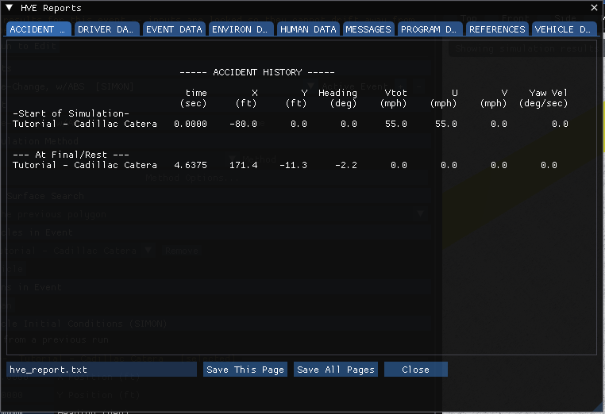
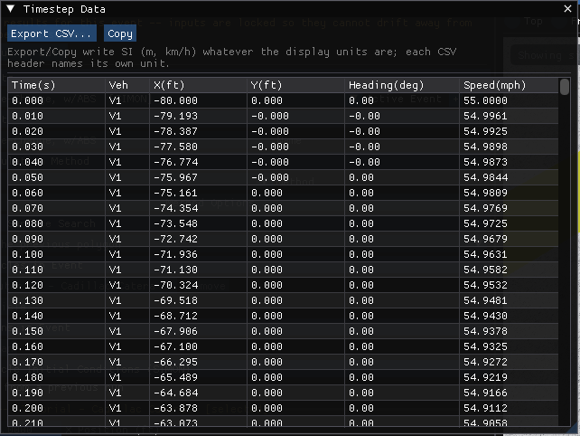
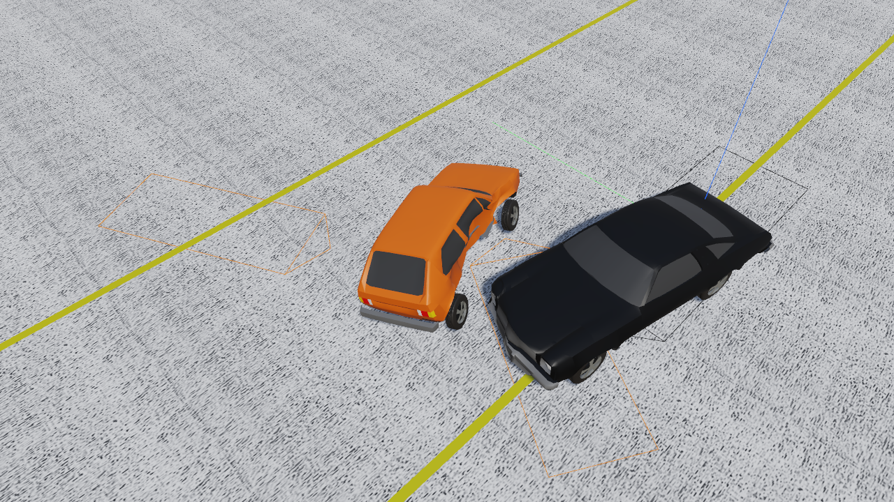

# Chapter 3 — SIMON Program Output

This chapter defines the outputs available from a SIMON event. In HVE they are viewed in the Playback Editor's report windows; HVE 2027 has no Playback Editor, and the same outputs are reached from the **Output** menu of the Event editor and from the viewport.

## Overview

SIMON produces three types of output reports:

- **Alpha-Numeric Reports** — Reports containing text and numeric information, such as vehicle dimensional parameters
- **Variable Output Tables** — Reports containing tabular simulation results as a function of time
- **Trajectory Simulations** — Viewers containing dynamic, 3-D visual simulations

In HVE 2027, after the event has been run (Chapter 2, *Executing An Event*):

| HVE output | Where it is in HVE 2027 |
|---|---|
| Accident History, Damage Data, Driver Data, Environment Data, Event Data, Human Data, Messages, Program Data, Vehicle Data | **Output › HVE Reports...** — the pages SIMON itself builds, one tab per page, with **Save This Page** and **Save All Pages** (plain text), **Save Page as HTML** and **Save All Pages as HTML**, and **Export Run Report (HTML)** (HVE 2027's own printable run summary). **Output › Accident History Report...** opens this window on the ACCIDENT HISTORY tab. |
| Variable Output table | **Output › Key Results...** (the selected variables at the current playback time, plus a summary), **Output › Variable Report...** (minimum, maximum and final value of each selected variable), **Output › Timestep Data Table...** (time, X, Y, heading and speed at every output step); variables are chosen with **Select Variables...** in Key Results and Output Graph, or **Output › Variable Selection...** |
| Variable Output graph | **Output › Output Graph...** |
| Trajectory Simulation | The 3-D **Viewport** of the Event editor, with the playback bar under it |
| Damage Profiles | The deformed vehicle meshes in the viewport during playback; **Output › Damage Studio Options...** and **Damage Studio Report...** (see the [Damage Studio manual](../DamageStudio/README.md)) |

Results are exported with **Export CSV...** (or **Copy**) in the result panels and with **Output › Export Variables...**; the Timestep Data export is written in SI units whatever the display units, with each column header naming its unit. HVE 2027 does not print; save a report page or export a table and print it from another program.

> **NOTE:** The engine's own report pages are built only when the run completes. A refused or aborted run shows no pages in HVE Reports and says so; read the run status in the *Simulation* panel and the Messages page, if any, for the reason.

!!! note "HVE 2027"
    A solved case keeps its results: **File › Save Case** writes the last run's results beside the case, and opening the case restores them as long as its inputs are unchanged. Opening a case never re-runs it.

## Alpha-Numeric Reports

SIMON produces the following alpha-numeric reports:

- **Accident History** — A table of initial, impact, separation and final positions and velocities
- **Damage Data** — A table of vehicle collision data, such as delta-V
- **Driver Data** — A series of tables containing driver input data (steering, brakes, throttle) used by SIMON
- **Environment Data** — A series of tables containing the environment data used by SIMON
- **Event Data** — A series of tables containing the event data used by SIMON
- **Human Data** — A series of tables containing the human locations and weights
- **Messages** — A list of messages produced by the current run
- **Program Data** — A table containing program control information for the current run
- **Vehicle Data** — A series of tables containing the vehicle data used by SIMON

An example of each of these numeric output reports from SIMON is shown on the following pages. The figures are HVE's report windows; HVE 2027 shows the same pages, built by the same engine code, in **Output › HVE Reports...** (Figure 3-1), laid out as tables from the engine's own report records.

### Accident History

The Accident History Report displays a table of initial, impact, separation and final positions and velocities for the vehicle. A typical Accident History Report is shown in Figure 3-1.

*Figure 3-1: The Accident History page issued by SIMON, in HVE 2027's HVE Reports window (the SIMON tutorial's ISO Lane-Change, w/ABS event). The tabs along the top are the other pages of the same run.*

*(updated: the current SIMON Calculation Options dialog includes an **Accident History Basis** option. Impact and separation rows in the Accident History report may be detected either from **Impact Force** or from vehicle **Acceleration** exceeding a user-set threshold; see Chapter 2, Event Calculation Options.)*

### Damage Data

The Damage Data Report displays a table containing vehicle collision information, such as delta-V. A typical Damage Data Report is shown in Figure 3-2.

In HVE 2027 this is the **DAMAGE DATA** tab of **Output › HVE Reports...** (a long tab label is shortened). *(HVE's Figure 3-2, typical Damage Data Report issued by SIMON, is a picture of HVE's report window and is not reproduced.)*

*(updated: the current Damage Data report also includes CDC(s), collision impulse data — up to 10 impulses per vehicle — and crush depth tables. When the **Include Free Space** calculation option is changed, the crush tables switch between "Excl. Free Space" and "Incl. Free Space" measurements; see Chapter 2, Event Calculation Options.)*

### Driver Data

Individual Driver Control tables for steering, braking, throttle and gear selection used by SIMON in the current event. A typical Driver Controls Output Report is shown in Figure 3-3.

In HVE 2027 this is the **DRIVER DATA** tab of **Output › HVE Reports...** (a long tab label is shortened). *(HVE's Figure 3-3, typical Driver Controls Output Report issued by SIMON, is a picture of HVE's report window and is not reproduced.)*

### Environment Data

The Environment Data Output Report consists of two sections of data:

- **General Environment Data** — Environmental parameters used by SIMON including air temperature, pressure and density; wind speed and direction; and gravity constant
- **3-D Environment Terrain Data** — Name of and information about the environment geometry file

A typical Environment Data Output Report is shown in Figure 3-4.

In HVE 2027 this is the **ENVIRON DATA** tab of **Output › HVE Reports...** (a long tab label is shortened). *(HVE's Figure 3-4, typical Environment Data Output Report issued by SIMON, is a picture of HVE's report window and is not reproduced.)*

### Event Data

The Event Data Output Report lists event-specific data for each vehicle. These data include:

- **Payload Information** — Mass and location of optional payload
- **Accelerometer Information** — Location of optional accelerometers
- **Wheel Data** — Information regarding optional wheel displacements, brake assembly, and tire blow-outs for each wheel location

A typical Event Data Output Report is shown in Figure 3-5.

In HVE 2027 this is the **EVENT DATA** tab of **Output › HVE Reports...** (a long tab label is shortened). *(HVE's Figure 3-5, a portion of a typical Event Data Output Report issued by SIMON, is a picture of HVE's report window and is not reproduced.)*

### Human Data

A typical Human Data Output Report is shown in Figure 3-6. Human data includes total weight, vehicle-fixed x, y, z location, and seat position for occupants, and earth-fixed X, Y, Z location for pedestrians.

> **NOTE:** Coordinates are for the pelvis CG.

In HVE 2027 this is the **HUMAN DATA** tab of **Output › HVE Reports...** (a long tab label is shortened). *(HVE's Figure 3-6, typical Human Data Output Report issued by SIMON, is a picture of HVE's report window and is not reproduced.)*

### Messages

A typical Messages Report is shown in Figure 3-7. For a complete listing of messages issued by SIMON, see Chapter 6.

In HVE 2027 this is the **MESSAGES** tab of **Output › HVE Reports...** (a long tab label is shortened). *(HVE's Figure 3-7, typical Messages Output Report issued by SIMON, is a picture of HVE's report window and is not reproduced.)*

### Program Data

The Program Data Report includes the following information:

- **Simulation Controls** — Integration parameters used for the current event (integration method, maximum simulation time, integration timestep, output interval, linear and angular termination velocities)
- **Calculation Options** — Get Surface Information option, Tire Model Method, Steer Degree of Freedom, Articulation Option, DyMESH Option
- **DyMESH Options** — When DyMESH is used, the report lists the DyMESH options in effect (e.g., Restitution Model, Search Option, Pushback Option, Inter-vehicle Friction, Crush Height For Stiffness)

A typical Program Data Report is shown in Figure 3-8.

In HVE 2027 this is the **PROGRAM DATA** tab of **Output › HVE Reports...** (a long tab label is shortened). *(HVE's Figure 3-8, typical Program Data Output Report issued by SIMON, is a picture of HVE's report window and is not reproduced.)*

### Vehicle Data

The Vehicle Data Report includes the following information:

- **Vehicle General Information** — Includes make, model, year, body style, basic vehicle configuration, and specific EDC vehicle version number
- **Sprung Mass Dimensional and Inertial Properties** — The dimensional and inertial parameters used by SIMON in the current event.
- **Connection Properties** — The connection parameters used by SIMON in the current event.
- **Aerodynamic Properties** — Sprung mass aerodynamic parameters used by SIMON in the current event.
- **Brake, Steering, and Drivetrain Properties** — Brake, steering, and drivetrain parameters (including engine, transmission and differential) used by SIMON in the current event.
- **Tire and Wheel Properties** — The tire and wheel parameters used by SIMON in the current event
- **Suspension Properties** — The suspension parameters used by SIMON in the current event.

A portion of a typical Vehicle Data Output Report is shown in Figure 3-9.

In HVE 2027 this is the **VEHICLE DATA** tab of **Output › HVE Reports...** (a long tab label is shortened). *(HVE's Figure 3-9, a portion of a typical Vehicle Data Output Report issued by SIMON, is a picture of HVE's report window and is not reproduced.)*

## Graphic Reports

SIMON produces no Graphic Output Reports.

> **NOTE:** Graphs of simulation results vs time are produced in HVE 2027 with **Output › Output Graph...** (see next section).

## Variable Output Table

SIMON produces a Variable Output table containing the time-based simulation results. The Variable Output groups produced by SIMON are as follows:

### Vehicle Output Groups

- **Kinematics** — Position, velocity and acceleration for the vehicle
- **Kinetics** — Summation of tire, drag and collision forces and moments acting at the CG of each vehicle
- **Accelerometers** — Linear accelerations at user-specified locations
- **Tires** — The tire output parameters existing at the tire contact patch (compare with Wheel Output, below)
- **Wheels** — The wheel output parameters existing at the wheel's hub (compare with Tire output, above)
- **Connections** — Articulation angles and inter-vehicle connection forces
- **Drivetrain** — Engine and transmission parameters used by SIMON
- **Driver** — Current levels of driver inputs (steering, braking and throttle)

In HVE 2027 the groups are listed in the variable picker opened by **Select Variables...** (in Key Results and Output Graph) and by **Output › Variable Selection...**. An example of HVE 2027's time-step table is shown in Figure 3-10. Detailed listings of each Variable Output parameter produced by SIMON are found in Tables 3-1, 3-2, and 3-3. For more information about HVE Variable Output parameters, refer to the HVE User's Manual, Chapter 16, Event Model.

*Figure 3-10: HVE 2027's Timestep Data table for the SIMON tutorial event (time, position, heading and speed at each output step). Selected variables are tabulated in Key Results and plotted in Output Graph.*

**Table 3-1 General Vehicle Variable Output Table**

| Parameter | Description |
|-----------|-------------|
| Vehicle Kinematic Data | X, Y, Z position of CG; $\Phi$, $\Theta$, $\Psi$ orientation; $\nu$ (Course Angle); Total linear velocity; u, v, w components; Sideslip angle; p, q, r angular velocities; Total linear accel; forward, lat, vert components; u-dot, v-dot, w-dot linear components; p-dot, q-dot, r-dot angular accelerations |
| Vehicle Kinetic Data | $F_x$, $F_y$, $F_z$ Suspension; $M_x$, $M_y$, $M_z$ Suspension; $F_x$, $F_y$, $F_z$ Impact; $M_x$, $M_y$, $M_z$ Impact; $F_x$, $F_y$, $F_z$ Aerodynamic; $M_x$, $M_y$, $M_z$ Aerodynamic; $F_x$, $F_y$, $F_z$ Connection; $M_x$, $M_y$, $M_z$ Connection |
| Accelerometer Data | Total linear accel; forward, lat, vert components for each accelerometer |
| Damage Data * | Vertex is changed (Flag); Vertex ID; x, y, z vertex coordinates; $F_x$, $F_y$, $F_z$ vertex force components |

\* Not selectable by user.

**Table 3-2 Vehicle Component Variable Output Table**

| Parameter | Description |
|-----------|-------------|
| Tire Data | X, Y, Z position of tire contact patch; $F'_x$, $F'_y$, $F'_z$; Tire radius, Tire Deflection; Longitudinal slip; Slip angle; Inclination angle; Skid flag; Friction multiplier; $u_x$, $u_y$, $u_z$ (unit vector for surface normal); Soil Constants N, Kphi, Kc (Soft Soil Tire-Terrain Model); $F_x'$, $F_y'$ Flow Force (Soft Soil Model); Fx Sidewall, Fy Sidewall, Fz Sidewall; Water Depth, Macrotexture, Mu Mult (water) (hydroplaning models) |
| Wheel Data | x, y, z location of each wheel center; Axle z deflection from equilibrium (solid axle); Axle roll (solid axle); Vehicle-fixed wheel camber; Wheel spin displacement; Steer angle ($\delta$) at each steerable wheel; Axle z-dot deflection rate (solid axle); Axle roll rate (solid axle); Vehicle-fixed wheel camber rate; Wheel spin velocity; Steer velocity at each steerable wheel; Axle z-dot-dot deflection acceleration (solid axle); Axle roll acceleration (solid axle); Wheel spin acceleration; Steer acceleration at each steerable wheel (steer DOF only); $F_x$, $F_y$, $F_z$ (wheel); Steer axis moment at each steerable wheel (steer DOF only); Spring deflection; Spring deflection rate; Total suspension force; Individual spring and damper suspension forces; Drive, brake torque; Auxiliary stiffness from sway bar; Brake stroke, pressure; Brake interface, drum, lining temperature |
| Connection Data | $\Phi$, $\Theta$, $\Psi$ articulation; $F_x$, $F_y$, $F_z$; $M_x$, $M_y$, $M_z$ |
| Drivetrain Data | Engine speed; Engine power; Engine torque; Transmission ratio; Differential ratio |

*(updated: when a hydroplaning model is active, the Water Depth, Macrotexture and water friction-multiplier tire tracks are populated. The Rolling Resist Mult, Fx' (water) and Fy' (water) tracks are not used. See [Chapter 4 — Hydroplaning Model](04-calculation-method.md#hydroplaning-model).)*

!!! note "HVE 2027"
    HVE 2027's variable picker carries the channel names SIMON's output tables define. A channel that no engine ever computes (it reads 0 on every run, in HVE as well) has **(not computed)** in its name, and a channel the run left without a value — the brake temperatures, when the brake thermal properties are missing — shows "--" rather than a number, and the run status names it.

**Table 3-3 Vehicle Driver Variable Output Table**

| Parameter | Description |
|-----------|-------------|
| Driver Data (for "At Driver" Driver Table options only) | Throttle position; Brake pedal; Brake system; Transmission, differential gear; Steer angle (all options) |
| Driver Data (for HVE Driver Model) | Steering Wheel Angular Velocity; CG Path Error; Preview Distance; Path error at preview distance; X, Y at preview distance |

## Trajectory Simulations

SIMON produces a trajectory simulation and a damage profile (if a vehicle collision has been simulated using DyMESH) of the current event. The trajectory simulation is a 3-D visualization of the data displayed in the Variable Output table (see previous section). The damage profile is a time-domain 3-D visualization of the deformation of the vehicle mesh calculated by DyMESH during the vehicle collision.

In HVE 2027 both are shown in the Event editor's **Viewport** once the event has been run: the vehicles move along their computed trajectories, and with DyMESH their meshes deform as the crush develops. An example is shown in Figure 3-11.

*Figure 3-11: A SIMON trajectory with DyMESH damage in HVE 2027's viewport — EDC's RICSAC 6 validation case 0.35 s into the run, as the Chevelle and the Rabbit separate; the Rabbit's crushed side is visible.*

### Displaying a Trajectory Simulation

The Trajectory Simulation is controlled with the playback bar under the viewport (Figure 3-12).

*Figure 3-12: The playback bar.*

The playback bar's controls have the following functions:

- **|<** — Return to the start of the simulation
- **<<** — Step backward
- **Play** / **Pause** — Play the simulation forwards, or pause it
- **>>** — Step forward
- **>|** — Advance to the end of the simulation
- The camera list — a free view, or a view that follows a vehicle
- The time slider, with **<** and **>** to step, and a field to type the time to go to

There is no reverse-play button; step backward with **<<** or drag the time slider.

The viewport's **Top**, **Front**, **Side**, **Momentum** and **3D** buttons choose the view. Playback speed, frame step and looping are set in **Output › Playback Options...**; display options such as paths, velocity vectors and skidmarks are on the **View** menu. Several events can be played back together in the **Playback (F6)** editor. A movie is recorded with **File › Record Animation...**.

### Displaying a Damage Profile

In HVE 2027 the damage profile plays with the trajectory: there is no separate Damage Profile viewer. The vehicle meshes deform in the viewport as playback passes through the collision. **Output › Damage Studio Options...** controls how the damage is displayed and **Output › Damage Studio Report...** reports it.

<!-- NAV -->

---

← Previous: [Chapter 2 — SIMON Program Input](02-program-input.md)  |  [Index](README.md)  |  Next: [Chapter 4 — Calculation Method](04-calculation-method.md) →

<!-- /NAV -->
